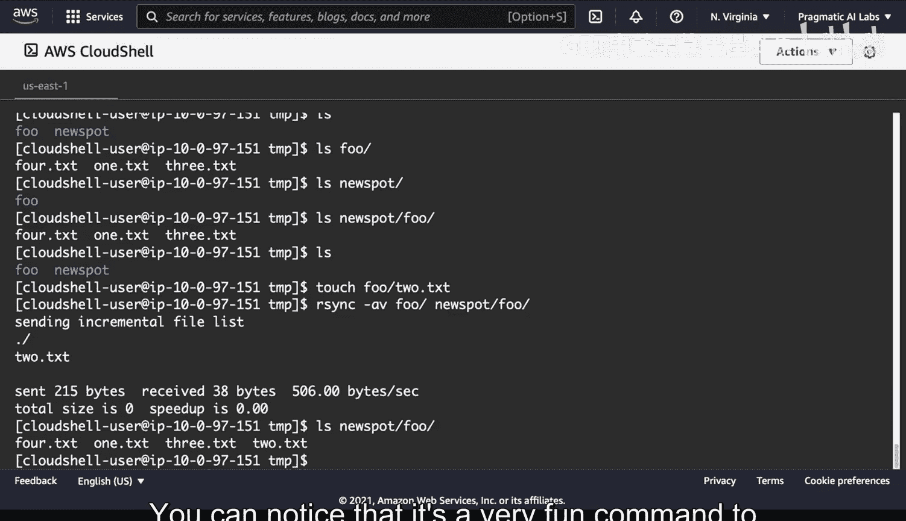
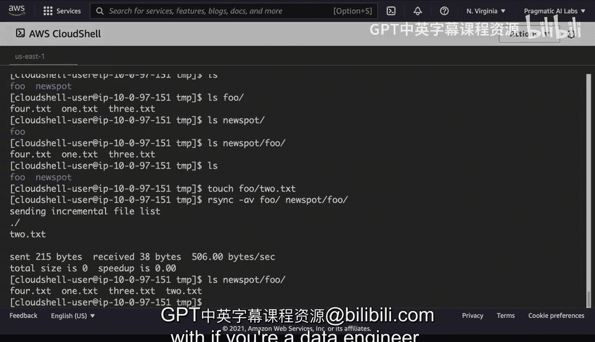

#  060：Linux文件与目录移动


在本节课中，我们将学习如何在Linux环境中操作文件系统。具体内容包括创建目录和文件、移动与复制文件及目录，以及使用强大的`rsync`命令同步两个目录。这些是数据工程师日常工作中管理文件和数据的核心技能。

## 创建目录与文件

首先，我们来学习如何创建目录。在Linux中，使用`mkdir`命令可以创建新目录。

例如，创建一个名为`food`的目录：
```bash
mkdir food
```
执行`ls`命令，可以看到`food`目录已被创建。

`mkdir`命令还有一个非常实用的`-p`选项。它可以自动创建路径中所有不存在的中间目录。

例如，创建嵌套目录结构`bar/bam/bz`：
```bash
mkdir -p bar/bam/bz
```
使用`ls -R`命令递归查看，可以看到`bar`、`bam`、`bz`这一整个目录树都被成功创建了。这个功能在需要搭建复杂目录结构时非常方便。

接下来，我们学习如何创建文件。一个常用的方法是使用`touch`命令。

例如，在`bar`目录下创建一个文件：
```bash
touch bar/1.txt
```
进入该目录查看，文件`1.txt`已经存在。`touch`命令是幂等的，这意味着你可以多次运行同一命令，而不会产生额外影响，它只会确保文件存在。这对于搭建文件系统框架非常有用。

我们还可以在更深的子目录中创建文件：
```bash
touch bar/bam/2.txt
touch bar/bam/bz/3.txt
```
现在，使用`ls -lR`命令递归查看当前目录结构，可以看到完整的文件和目录布局。

## 移动与复制操作

上一节我们创建了目录和文件，本节中我们来看看如何移动和复制它们。

移动操作使用`mv`命令。它可以将文件或目录从一个位置物理移动到另一个位置。

例如，将整个`bar`目录移动到`temp`目录中：
```bash
mv bar temp/
```
执行后，原来的`bar`目录消失了。进入`temp`目录查看，会发现`bar`目录及其内部的全部文件都已被移动过来。

与移动不同，复制操作使用`cp`命令。它会在新位置创建副本，而原始文件保持不变。结合`-r`选项，可以递归复制整个目录。

例如，将`bam`目录复制到当前目录：
```bash
cp -r bar/bam .
```
现在，当前目录下会有一个`bam`目录的副本。进入其中查看，其子目录和文件都被完整复制了。`cp -r`命令在需要备份或复制数据时非常常用。

## 使用rsync同步目录

对于数据工程师而言，管理集中式文件系统时，`rsync`是一个极其重要和有用的命令。它擅长高效地同步两个目录，尤其适用于文件数量庞大的场景。

假设我们有两个目录：`food`和`newspot/food`。使用`ls`命令查看它们的内容：
```bash
ls food
ls newspot/food
```
我们发现`food`目录下有`1.txt`、`3.txt`，但缺少`2.txt`；而`newspot/food`目录下可能文件不全或版本不同。我们希望只同步有变动的文件。

以下是使用`rsync`同步`food`目录到`newspot/food`目录的命令：
```bash
rsync -av food/ newspot/food/
```
*   `-a`：归档模式，保持文件属性并递归同步。
*   `-v`：详细模式，显示同步过程。
*   命令末尾的`/`很关键，它确保同步的是`food`目录内的*内容*，而不是`food`目录本身。

运行命令后，`rsync`会智能地只传输发生变化的文件（例如缺失的`2.txt`）。再次检查目标目录，确认文件已同步完成。

`rsync`是处理大量文件同步的理想工具。最好的学习方式就是多动手实践，体验它高效同步目录的强大功能。

## 总结





本节课中我们一起学习了Linux文件系统的基本操作。我们掌握了使用`mkdir`创建目录（包括`-p`选项创建目录树），使用`touch`创建文件。接着，我们学习了使用`mv`命令移动文件/目录，以及使用`cp -r`命令复制目录。最后，我们重点介绍了数据工程师的核心工具`rsync`命令，它能够高效、增量地同步两个目录，是管理大型数据集的必备技能。