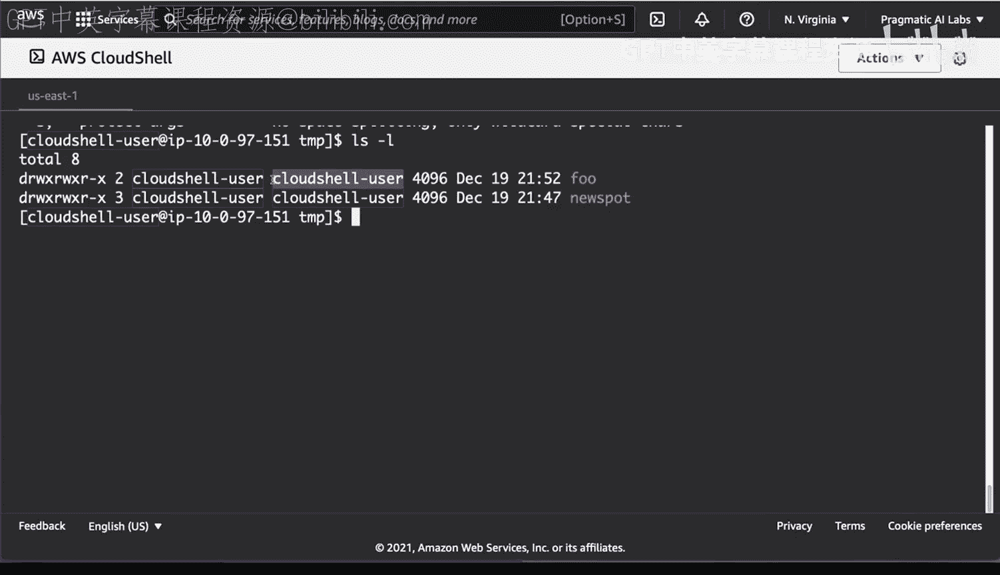
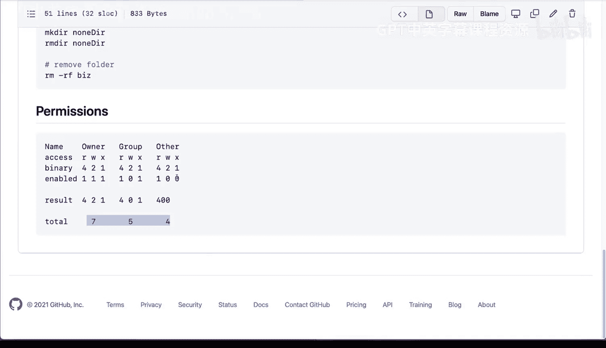
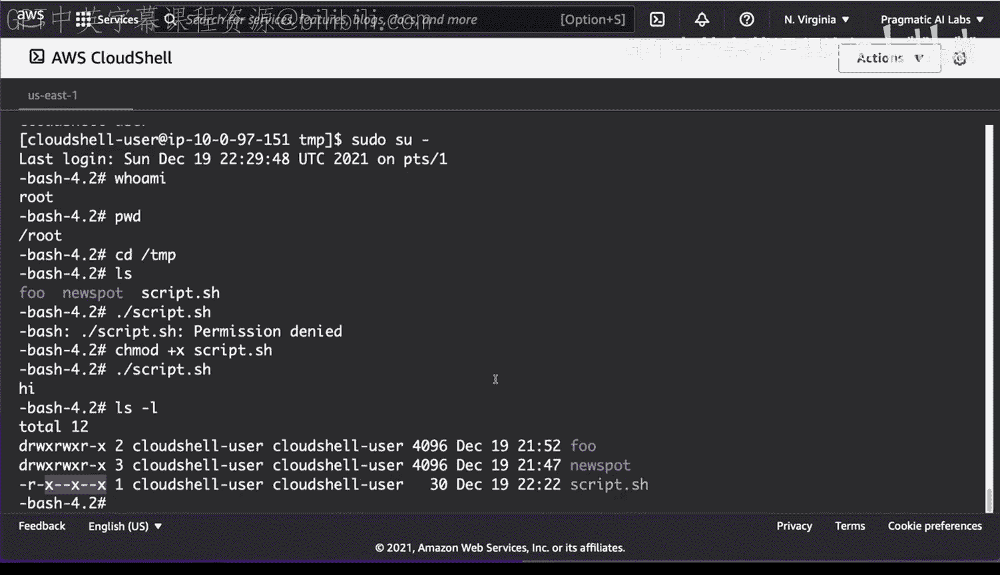
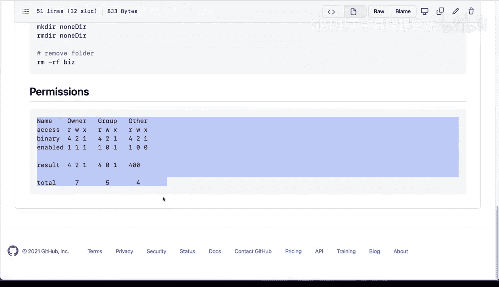

#  061：Linux文件与目录权限设置 🔐


在本节课中，我们将要学习Linux系统中一个核心但常令人困惑的概念：文件与目录的权限设置。我们将详细解释权限的表示方法、如何解读以及如何修改它们，确保您能安全有效地管理您的文件系统。

---

## 权限模式解读



上一节我们介绍了Linux的基本命令，本节中我们来看看如何解读`ls -l`命令输出的权限信息。

执行`ls -l`命令后，您会看到类似`-rwxr-xr--`的字符串，这被称为文件的“模式”。它代表了三组不同的权限：

*   **用户权限**：文件所有者的权限。
*   **组权限**：文件所属用户组成员的权限。
*   **其他权限**：系统中所有其他用户的权限。

紧随权限之后的两个名称，分别是该文件的**所有者**和**所属组**。

---

## 权限的数字表示法

为了更精确地设置权限，Linux使用数字来表示权限。每个权限对应一个二进制值：

*   **读**权限用数字 **4** 表示。
*   **写**权限用数字 **2** 表示。
*   **执行**权限用数字 **1** 表示。



通过将这些数字相加，我们可以为每一组用户（用户、组、其他）定义一个权限值。例如，权限`rwx`（读、写、执行）的计算方式是 **4 + 2 + 1 = 7**。

因此，一个常见的权限数字`754`可以解读为：
*   用户（所有者）：`7` -> 可读、可写、可执行。
*   组：`5` -> 可读(**4**)、可执行(**1**)，但**不可写**（因为`5`不包含`2`）。
*   其他：`4` -> 仅可读。

---

## 修改文件权限 (`chmod`)

理解了权限的数字表示法后，我们就可以使用`chmod`命令来修改文件权限了。

以下是修改权限的几种常用方法：

*   **使用数字模式**：直接指定代表三组权限的三个数字。
    ```bash
    chmod 754 script.sh
    ```

*   **使用符号模式**：通过`+`（添加）、`-`（移除）、`=`（设定）来操作特定权限。
    ```bash
    chmod +x script.sh  # 为所有用户添加执行权限
    chmod u=rw,go=r script.sh  # 设置用户可读写，组和其他仅可读
    ```

---

## 权限实践与`root`用户

让我们通过一个例子来实践。假设我们有一个文件`script.sh`，其初始权限为`400`（仅所有者可读）。

1.  此时，即使是文件所有者也无法执行它。
    ```bash
    ./script.sh  # 会提示“权限被拒绝”
    ```

2.  我们可以为所有者添加执行权限。
    ```bash
    chmod u+x script.sh
    ./script.sh  # 现在可以成功执行
    ```

3.  **`root`用户的特殊权限**：`root`用户（超级管理员）几乎不受普通权限规则限制。即使一个文件权限设置为`400`且所有者是其他用户，`root`用户依然可以强制修改其权限。
    ```bash
    sudo chmod +x script.sh  # 以root权限为文件添加执行权限
    ```
    这展示了系统管理中权限层级的概念，`root`用户拥有最高控制权。

---

## 总结





本节课中我们一起学习了Linux文件权限的核心知识。我们了解了如何解读`ls -l`命令输出的权限字符串，掌握了用数字（如`754`）表示`读`、`写`、`执行`权限的方法，并学会了使用`chmod`命令来修改文件权限。最后，我们还看到了`root`用户超越普通权限规则的特殊能力。建议您在自己的环境中创建文件，反复练习这些`chmod`命令，这是掌握Linux系统安全管理的基石。