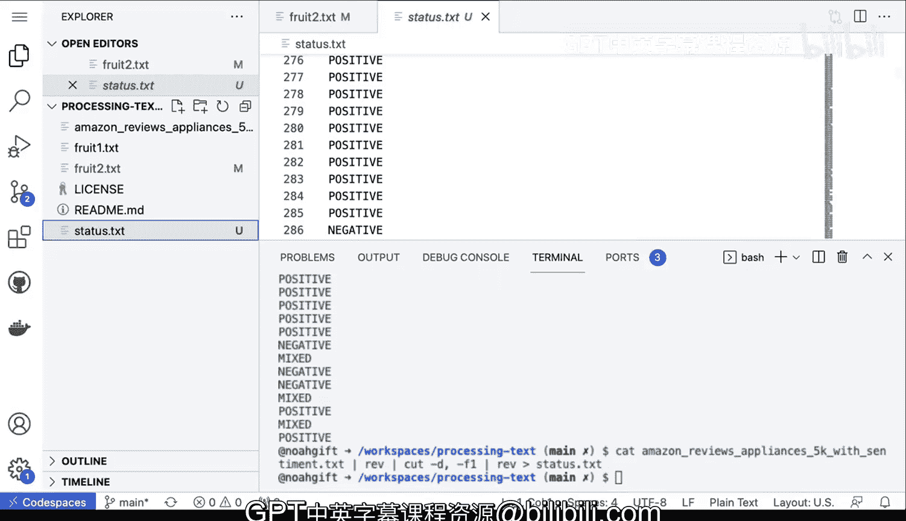

#  065：Linux中grep、cut、sort与unique使用 🛠️


在本节课中，我们将学习如何使用Linux命令行中自带的几个强大文本处理工具：`grep`、`cut`、`sort`和`uniq`。这些工具能帮助我们快速探索、分析和处理数据文件，而无需依赖复杂的图形界面或编程环境。

## 探索文件内容

在开始处理数据之前，我们首先需要了解文件的基本结构和内容。Linux提供了简单的命令来查看文件的头部和尾部。

使用 `head` 命令可以查看文件的开头几行。例如，要查看名为 `Amazon_review` 的文件的前几行，可以输入：
```bash
head Amazon_review
```
同样，使用 `tail` 命令可以查看文件的末尾几行：
```bash
tail Amazon_review
```
这两个命令能让我们对文件内容有一个快速的概览。

## 使用grep进行文本搜索与统计

`grep` 是一个强大的文本搜索工具。我们可以用它来查找文件中包含特定单词或模式的行。

如果我们想统计单词“bad”在文件中出现的次数，可以使用 `-c` 选项进行计数：
```bash
grep -c bad Amazon_review
```
命令会返回一个数字，表示“bad”出现的次数。例如，它可能返回 `154`。

如果我们不仅想计数，还想查看所有匹配的行（其中“bad”会被高亮显示），可以省略 `-c` 选项：
```bash
grep bad Amazon_review
```
我们可以用同样的方法探索其他词汇，例如“plastic”：
```bash
grep -c plastic Amazon_review
```

## 分析数据分布

首先，我们可以使用 `wc -l` 命令来确认文件的总行数：
```bash
wc -l Amazon_review
```
假设文件有5000行。接下来，我们可以利用 `grep` 来分析评论的情感分布。文件中可能包含“negative”、“mixed”、“positive”等状态。

要统计负面评论的数量，可以执行：
```bash
grep -c negative Amazon_review
```
结果显示有1175条负面评论。

统计混合情感评论的数量：
```bash
grep -c mixed Amazon_review
```
结果显示有241条混合评论。

最后，统计正面评论的数量：
```bash
grep -c positive Amazon_review
```
通过简单的减法或直接计数，我们可以验证数据的一致性。这展示了命令行的强大之处——无需额外软件即可完成基础数据分析。

## 使用diff比较文件差异

当我们需要比较两个文件的内容差异时，可以使用 `diff` 命令。

假设我们有两个文件：`fruit1.txt` 和 `fruit2.txt`。
`fruit1.txt` 的内容是：
```
cherry
pear
strawberry
apple
apple
```
`fruit2.txt` 的内容是：
```
cherry
pear
strawberry
apple
```
要比较这两个文件，可以运行：
```bash
diff fruit1.txt fruit2.txt
```
或者使用通配符一次性比较所有匹配的文件：
```bash
diff fruit*.txt
```
输出会清晰地指出两个文件之间的差异，例如，一个文件比另一个多了一行“apple”。

## 使用uniq识别与统计唯一值

`uniq` 命令用于报告或忽略文件中的重复行。在处理可能包含重复项的数据（如客户ID列表）时非常有用。

以 `fruit1.txt` 为例，它包含两个“apple”。如果我们只想查看唯一的行，可以运行：
```bash
uniq fruit1.txt
```
输出将只显示 `cherry`、`pear`、`strawberry`、`apple` 各一次。

如果我们想统计每个唯一项出现的次数，可以加上 `-c` 选项：
```bash
uniq -c fruit1.txt
```
输出会显示每个水果及其出现的次数。简而言之，`diff` 用于找不同，而 `uniq` 用于找唯一和计数。

## 使用sort对数据进行排序

`sort` 命令可以对文本文件的行进行排序，类似于SQL中的 `ORDER BY`。

对 `fruit1.txt` 进行默认的字母顺序排序：
```bash
sort fruit1.txt
```
要进行反向排序（降序），可以添加 `-r` 选项：
```bash
sort -r fruit1.txt
```
这在需要快速查看按特定字段（如客户名、日期）排列的数据时非常方便。

## 使用cut截取文件字段

`cut` 命令允许我们从文件的每一行中提取特定部分（字段），类似于在电子表格中操作列。

假设我们的数据文件 `data.csv` 是以逗号分隔的，并且我们想提取最后一列（情感状态）。由于 `cut` 通常从行首开始计数，一种技巧是先反转每一行的字段顺序。

以下是一个组合命令的示例，它提取逗号分隔文件的最后一列：
```bash
cat data.csv | rev | cut -d',' -f1 | rev
```
让我们分解这个命令：
1.  `cat data.csv`：输出文件内容。
2.  `rev`：反转每一行字符串的顺序（这样最后一列就变成了第一列）。
3.  `cut -d‘,’ -f1`：以逗号（`,`）为分隔符，提取第一个字段（即原最后一列）。
4.  `rev`：再次反转结果，使其恢复原始顺序。

我们可以将结果保存到新文件：
```bash
cat data.csv | rev | cut -d',' -f1 | rev > status.txt
```
现在，`status.txt` 文件就只包含了原始数据的情感状态列。这个结果可以进一步清理或导入到像Python Pandas这样的工具中进行高级处理。

## 总结



本节课我们一起学习了Linux命令行中几个核心的文本处理工具。我们使用 `head` 和 `tail` 探索文件，用 `grep` 搜索和统计文本，用 `diff` 比较文件差异，用 `uniq` 找出唯一值并计数，用 `sort` 对数据进行排序，并用 `cut` 提取特定的数据列。掌握这些工具能让你在初次接触Linux环境下的数据时，高效地进行初步的探查和清洗，为后续更复杂的数据工程任务打下坚实基础。最好的学习方式就是多动手尝试。