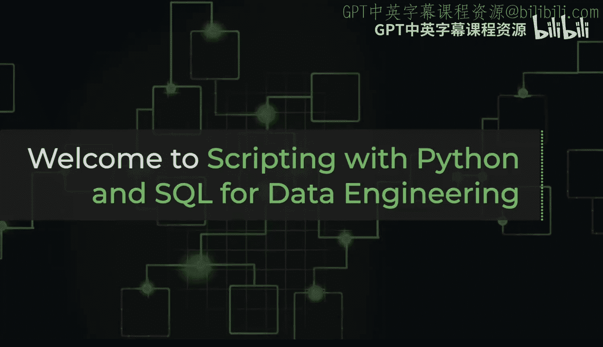

#  068：欢迎来到Python与SQL数据工程脚本编程 🐍

在本课程中，我们将学习如何高效地运用Python和SQL进行数据工程工作。

我们将探讨Python脚本编程中有用的数据结构，并学习如何连接到MySQL等数据库。你将学会使用现代文本编辑器来连接真实的数据库并运行SQL查询，执行数据加载和提取操作。最后，你将运用网络抓取技术从网站中提取数据。掌握这些知识将使你能够在数据不易获取时，或需要执行特殊查询从数据库中提取有用信息时，都能有效地开展工作。

---

上一节我们概述了本课程的整体目标，本节中我们将具体了解课程的核心内容模块。

以下是本课程将涵盖的主要技术要点：

*   **Python脚本与数据结构**：学习在数据工程任务中常用的Python数据结构和脚本编写技巧。
*   **数据库连接与操作**：掌握使用Python连接MySQL数据库，并执行SQL查询的方法。
*   **数据加载与提取**：实践从数据库加载数据以及将处理后的数据提取出来的完整操作流程。
*   **网络数据抓取**：运用Python库从网站上抓取所需数据，扩展数据来源。

---

本节课中我们一起学习了Python与SQL在数据工程中的核心应用场景，包括脚本编写、数据库交互以及数据获取技术。这些技能是构建有效数据管道和处理多样化数据源的基础。