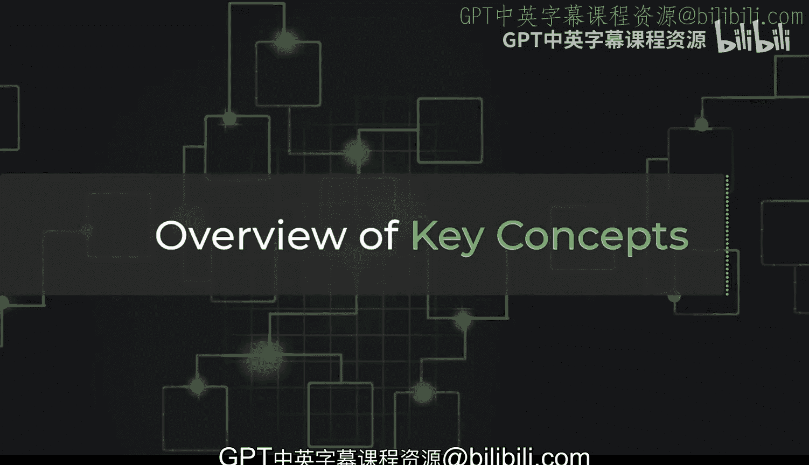
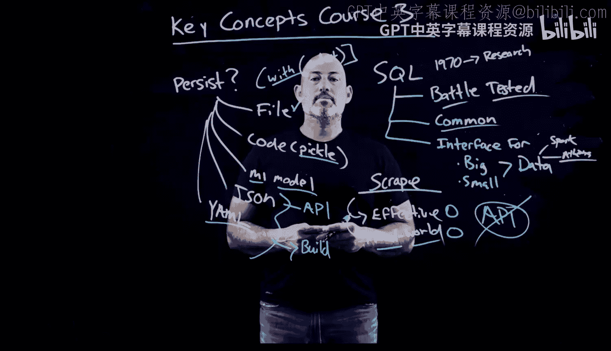

#  070：Python、Bash和SQL核心概念概览 🎯




在本节课中，我们将要学习数据工程中的几个核心概念，包括在Python中持久化数据的不同方法、SQL的重要性以及网络数据抓取（Scraping）的应用场景。理解这些概念将帮助你为不同的任务选择正确的工具。

---

## Python中的数据持久化 💾

上一节我们介绍了课程的整体框架，本节中我们来看看如何在Python中保存数据。将数据保存到磁盘是数据工程中的常见操作，Python提供了多种格式来实现这一目标。

### 使用 `with` 语句写入文件

一种非常基础且常见的方法是直接将数据写入文本文件。在这个过程中，`with` 语句是一个关键工具。它的作用是为代码块创建一个上下文环境，确保文件在使用后被正确关闭，而无需手动调用关闭方法。这可以防止数据丢失或文件损坏。

以下是使用 `with` 语句写入文件的示例代码：
```python
with open('data.txt', 'w') as file:
    file.write('Hello, World!')
```

### 使用 `pickle` 序列化对象

当你需要保存复杂的Python数据结构（如字典、列表或自定义对象）时，`pickle` 模块非常有用。它可以将对象序列化为字节流并保存到文件，之后可以完整地还原。这在机器学习中尤其常见，用于保存训练好的模型。

以下是使用 `pickle` 保存和加载数据的示例代码：
```python
import pickle

# 保存数据
data = {'key': 'value'}
with open('data.pkl', 'wb') as file:
    pickle.dump(data, file)

# 加载数据
with open('data.pkl', 'rb') as file:
    loaded_data = pickle.load(file)
```

### JSON与YAML格式

除了上述方法，JSON和YAML是两种在软件开发中广泛使用的数据交换格式。

**JSON** 全称为JavaScript Object Notation。它结构清晰，易于人阅读和机器解析，因此常被用于构建API接口。你可以将Python字典轻松转换为JSON字符串。

以下是使用 `json` 模块的示例代码：
```python
import json

data = {'name': 'Alice', 'age': 30}
json_string = json.dumps(data)  # 转换为JSON字符串
```

**YAML** 格式与JSON类似，但语法更注重人类可读性，常用于配置文件，特别是在DevOps流程（如GitHub Actions）或云服务配置中。

以下是使用 `yaml` 模块的示例代码（需安装PyYAML库）：
```python
import yaml

data = {'server': {'host': '127.0.0.1', 'port': 8080}}
yaml_string = yaml.dump(data)  # 转换为YAML字符串
```

选择哪种格式取决于你手头要解决的具体问题：`pickle` 适合保存Python特有对象，JSON适合数据交换，YAML适合编写配置文件。

---

## SQL：久经考验的数据查询语言 🗃️

现在，让我们从数据存储转向数据查询。SQL（结构化查询语言）是数据领域不可或缺的工具。

SQL诞生于1970年代，历经数十年考验，至今仍是查询和处理数据的黄金标准。它的强大之处在于其通用性，既能用于小型数据库，也能作为许多大数据系统的查询接口。

例如，Apache Spark和Amazon Athena这样的大数据处理引擎都支持使用SQL进行查询。这意味着，掌握SQL基础能让你在各类数据平台上都能有效地工作。

---

## 网络数据抓取（Scraping）🌐

最后，我们探讨网络数据抓取。当目标网站没有提供官方API接口时，抓取技术就变得至关重要。

这种情况常出现在一些老旧的数据集、政府网站或最初并非为程序化访问而设计的页面上。通过抓取，你可以自动访问网页，提取所需的信息，并将其保存到关系型数据库或其他存储系统中，从而获得有价值的数据集。

掌握网络抓取技能，能让你成为一名更全面、更高效的数据科学家或工程师，能够从更广泛的数据源中获取信息。

---

## 总结 📝

本节课中我们一起学习了数据工程的三个核心概念：
1.  **Python数据持久化**：了解了使用普通文件、`pickle`、JSON和YAML保存数据的不同场景与方法。
2.  **SQL的重要性**：认识到SQL作为一种通用、稳定且支持大小数据系统的查询语言的核心地位。
3.  **网络数据抓取的应用**：明白了在缺乏API时，如何通过抓取技术从网页中获取所需数据。



理解这些概念并知道何时应用它们，是构建有效数据解决方案的关键第一步。