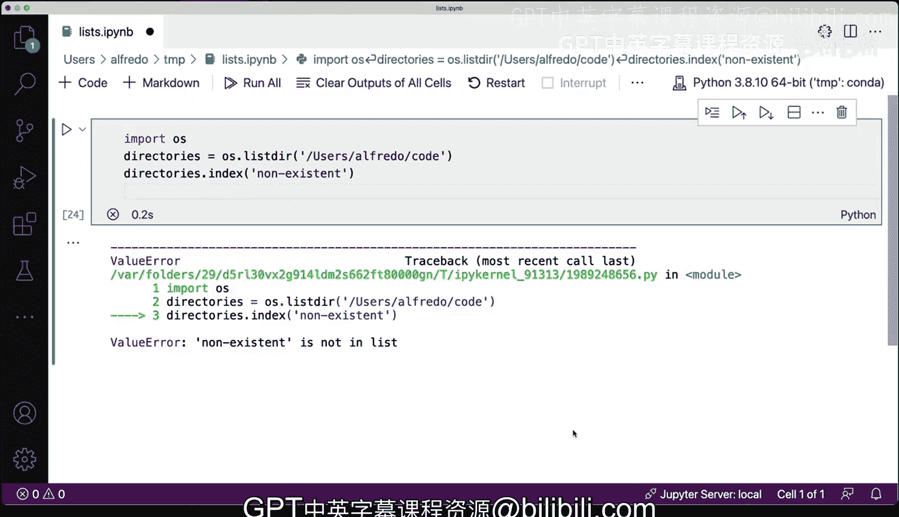

#  073：使用列表在Python中保存与检索数据 📚


在本节课中，我们将要学习Python中一个非常基础且重要的数据结构——列表。列表就像一个容器，我们可以向其中放入各种数据，也可以从中取出数据。我们将学习如何创建列表、向列表中添加元素、修改列表以及如何根据位置（索引）检索列表中的元素。

---

## 什么是列表？ 📦

列表是Python中用于存储一系列元素的数据结构。列表中的元素可以是任何数据类型，例如数字、字符串、布尔值，甚至是其他列表。列表使用方括号 `[]` 来定义。

### 创建列表

我们可以创建一个空列表，也可以创建一个包含初始元素的列表。

**创建一个空列表：**
```python
things = []
```

**创建一个包含不同类型元素的列表：**
```python
things_one = [True, 10, "hello"]
```
在上面的例子中，`things_one` 列表包含了一个布尔值 `True`、一个整数 `10` 和一个字符串 `"hello"`。

---

## 向列表中添加元素 ➕

上一节我们介绍了如何创建列表，本节中我们来看看如何向一个已存在的列表中添加新元素。Python提供了几种方法来修改列表。

为了演示，我们先导入 `os` 模块，并获取一个目录列表。

```python
import os
directories = os.listdir('./code')
print(directories)
```
这段代码会列出 `./code` 路径下的所有文件和目录。

### 使用 `append()` 方法

`append()` 方法用于在列表的**末尾**添加一个新元素。

以下是使用 `append()` 方法的示例：
```python
directories.append('example')
print(directories)
```
执行后，字符串 `'example'` 会被添加到 `directories` 列表的最后。

### 使用 `insert()` 方法

如果你想在列表的**特定位置**插入一个元素，可以使用 `insert()` 方法。该方法需要两个参数：要插入的位置（索引）和要插入的元素。

以下是使用 `insert()` 方法的示例：
```python
directories.insert(0, 'example')
print(directories)
```
这段代码会在列表的**开头**（索引0的位置）插入 `'example'`。

---

## 从列表中检索元素 🔍

现在我们已经知道如何向列表中添加元素，接下来学习如何从列表中取出我们需要的元素。这主要通过**索引**来实现。

### 理解索引

在Python中，列表的索引从 **0** 开始计数。这意味着：
*   第一个元素的索引是 **0**
*   第二个元素的索引是 **1**
*   以此类推

此外，Python支持使用**负数索引**来从列表末尾开始计数：
*   索引 **-1** 代表最后一个元素
*   索引 **-2** 代表倒数第二个元素

以下是检索元素的示例：
```python
# 获取第一个元素
first_item = directories[0]
print(first_item)  # 例如：'.DS_Store'

# 获取第二个元素
second_item = directories[1]
print(second_item) # 例如：'OReilly_videos'

# 获取最后一个元素
last_item = directories[-1]
print(last_item)   # 例如：'scraping_demo'
```

### 使用 `index()` 方法查找位置

有时，我们知道列表中的某个值，但想知道它所在的位置（索引）。这时可以使用 `index()` 方法。

以下是使用 `index()` 方法的示例：
```python
position = directories.index('scraping_demo')
print(f"'scraping_demo' 的索引是：{position}")
```
运行后，我们会得到 `'scraping_demo'` 在列表中的索引号（例如 16）。之后，我们就可以用这个索引号来获取该元素：
```python
item = directories[position]
print(item) # 输出：'scraping_demo'
```

**需要注意的是**：如果你尝试查找一个列表中不存在的值，`index()` 方法会引发一个 `ValueError` 错误。
```python
# 这行代码会报错，因为 'non_existent' 不在列表中
# directories.index('non_existent')
```

---

## 总结 ✨

本节课中我们一起学习了Python列表的基本操作。

我们首先了解了列表就像一个可以存放各种数据类型的容器。然后，我们学习了两种向列表添加元素的方法：使用 `append()` 在末尾添加，以及使用 `insert()` 在指定位置插入。

最后，我们重点学习了如何从列表中检索数据。关键点在于理解**索引从0开始**的规则，并掌握了使用正数索引、负数索引来获取元素，以及使用 `index()` 方法根据值来查找其对应位置的方法。



掌握列表的创建、修改和检索，是进行Python数据处理的基石。