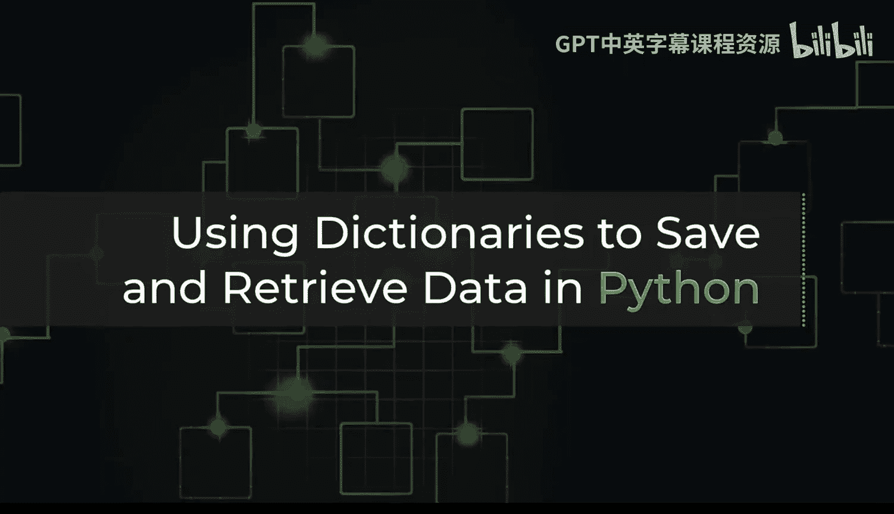
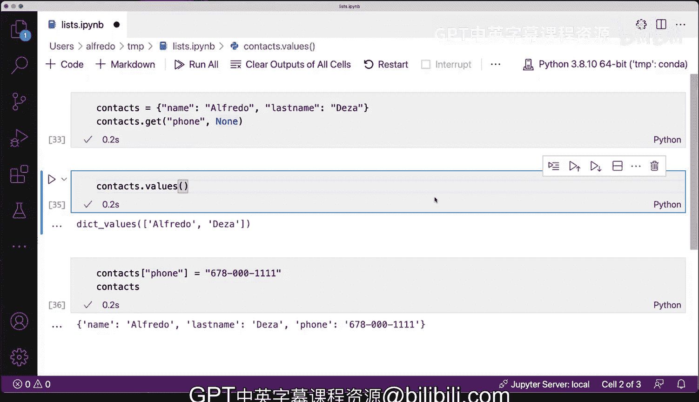

#  074：使用字典在Python中保存与检索数据 📚



在本节课中，我们将要学习Python中一个非常重要的数据结构——字典。字典可以帮助我们将一个事物映射到另一个事物，这种映射关系在数据处理中非常有用。

## 概述

字典通过“键-值对”的形式组织数据。我们可以将“键”想象成标签，而“值”就是该标签对应的具体信息。接下来，我们将从创建一个空字典开始，逐步学习如何声明、检索和修改字典中的数据。

## 声明一个字典

让我们从一个简单的例子开始：创建一个存储联系人信息的字典。联系人是理解字典的绝佳例子，因为在手机通讯录中，我们正是通过姓名（键）来查找电话号码（值）的。

以下是声明一个字典的方法：

```python
contacts = {
    “name”: “Alfredo”,
    “last_name”: “Deza”
}
```

在这段代码中，我们使用花括号 `{}` 创建了一个字典。`“name”` 和 `“last_name”` 是键，它们分别被映射到值 `“Alfredo”` 和 `“Deza”`。运行这段代码，字典 `contacts` 就包含了这两条信息。

## 从字典中检索数据

上一节我们介绍了如何创建字典，本节中我们来看看如何从中获取信息。当我们知道一个键的名称时，可以使用方括号来请求其对应的值。

以下是请求信息的示例：

```python
name = contacts[“name”]
print(name)  # 输出：Alfredo
```

这种方法同样适用于字典中的任何其他键。

```python
last_name = contacts[“last_name”]
print(last_name)  # 输出：Deza
```

## 处理不存在的键

直接使用方括号检索有一个问题：如果请求的键不存在，Python会抛出一个 `KeyError` 异常，导致程序中断。

例如，尝试获取不存在的 `“phone”` 键：

```python
# 这行代码会引发 KeyError: ‘phone’
phone = contacts[“phone”]
```

为了避免程序因键不存在而崩溃，我们可以使用 `.get()` 方法。这个方法允许我们安全地检索值，并在键不存在时返回一个默认值（或 `None`）。

以下是使用 `.get()` 方法的示例：

```python
# 键不存在时返回 None
phone = contacts.get(“phone”)
print(phone)  # 输出：None

# 键不存在时返回自定义的默认值
phone = contacts.get(“phone”, “Unknown”)
print(phone)  # 输出：Unknown
```

使用 `.get()` 方法是处理可能缺失数据的一种优雅方式，它避免了异常，让程序更加健壮。

## 探索字典的键和值

有时我们需要查看字典中所有的键或值。Python为此提供了方便的方法。

以下是获取所有键和值的示例：

```python
# 获取所有键
all_keys = contacts.keys()
print(all_keys)  # 输出类似：dict_keys([‘name‘, ‘last_name‘])

# 获取所有值
all_values = contacts.values()
print(all_values)  # 输出类似：dict_values([‘Alfredo‘, ‘Deza‘])
```

返回的 `dict_keys` 和 `dict_values` 对象类似于列表，你可以遍历它们来查看所有内容。

## 向字典中添加或修改数据

字典不是一成不变的。我们可以轻松地向其中添加新的键值对，或者修改现有键对应的值。

以下是添加新信息的示例：

```python
# 添加电话号码
contacts[“phone”] = “123-456-7890”
print(contacts)
# 输出：{‘name‘: ‘Alfredo‘, ‘last_name‘: ‘Deza‘, ‘phone‘: ‘123-456-7890‘}
```

在这段代码中，我们通过 `contacts[“phone”] = “123-456-7890”` 这行语句，在 `contacts` 字典中创建了一个新键 `“phone”` 并赋予了它一个值。现在字典中就包含了三条信息。

## 总结



本节课中我们一起学习了Python字典的核心操作。我们首先了解了字典是通过**键-值对**存储数据的映射结构。然后，我们学习了如何**声明**一个字典，如何使用方括号或 `.get()` 方法安全地**检索**数据。接着，我们探索了如何查看字典的所有**键**和**值**。最后，我们掌握了如何**添加或修改**字典中的数据。字典是Python中用于组织和管理关联数据的强大工具，在数据工程中应用广泛。