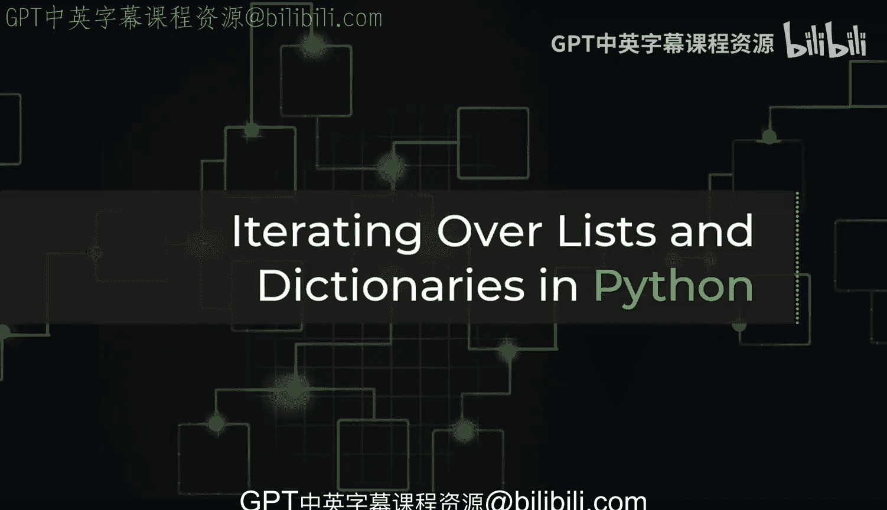
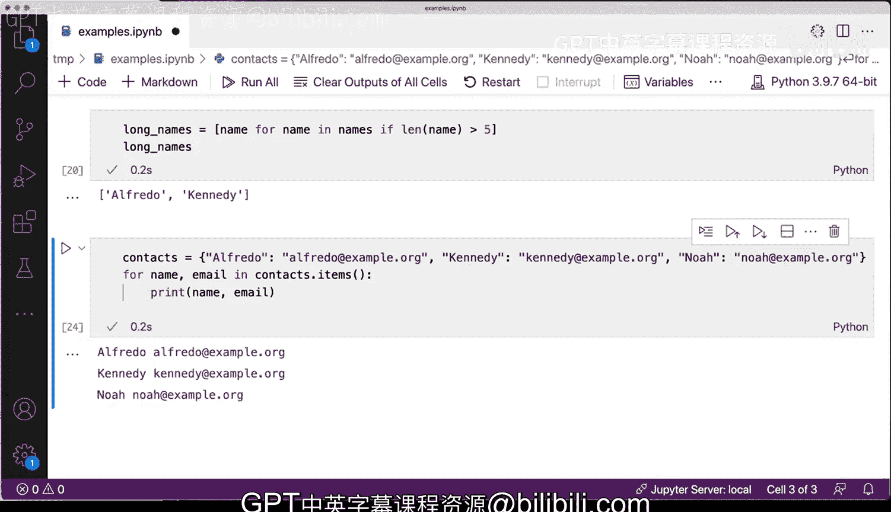

#  078：Python中列表与字典的迭代操作 🐍



在本节课中，我们将要学习如何在Python中对两种核心数据结构——列表和字典——进行迭代操作。迭代是遍历集合中每个元素并执行操作的过程，是数据处理的基础。

## 列表的迭代操作

上一节我们介绍了数据结构，本节中我们来看看如何遍历列表。列表是一种有序的元素集合，我们可以使用`for`循环来逐个访问其中的元素。

以下是一个简单的列表迭代示例：

```python
names = ['Alfredo', 'Kennedy', 'Jim']
for name in names:
    print(name)
```

这段代码会依次打印出列表中的每个名字。`for`循环的语法清晰易读，表明我们正在处理一组名字中的每一个。

### 在循环中添加条件

有时我们只想处理列表中满足特定条件的元素。这可以通过在`for`循环中加入`if`语句来实现。

以下是添加条件判断的示例：

```python
for name in names:
    if len(name) > 5:
        print(name)
```

这段代码只会打印出长度大于5个字符的名字，即“Alfredo”和“Kennedy”。

### 列表推导式

Python提供了一种更简洁的创建新列表的方法，称为列表推导式。它允许我们将循环和条件判断内联在一行代码中。

以下是使用列表推导式的示例：

```python
long_names = [name for name in names if len(name) > 5]
print(long_names)
```

这段代码会创建一个名为`long_names`的新列表，其中只包含原列表中长度大于5的名字。列表推导式非常简洁，但当逻辑复杂或存在嵌套时，可能会影响代码的可读性。

## 字典的迭代操作

现在，让我们将注意力转向字典。字典是一种键值对集合，其迭代方式与列表略有不同，取决于我们想要访问的是键、值还是两者。

### 遍历字典的键

默认情况下，直接对字典进行`for`循环会遍历其所有的键。

以下是遍历字典键的示例：

```python
contacts = {
    'Alfredo': 'alfredo@example.org',
    'Kennedy': 'kennedy@example.org',
    'Noah': 'noah@example.org'
}
for contact in contacts:
    print(contact)
```

这段代码会打印出字典中所有的键，即人名。

### 遍历字典的值

如果我们只想获取字典中的值，可以使用`.values()`方法。

以下是遍历字典值的示例：

```python
for contact in contacts.values():
    print(contact)
```

这段代码会打印出字典中所有的值，即电子邮件地址。

### 同时遍历键和值

为了同时获取字典的键和值，我们需要使用`.items()`方法，并在循环中“解包”这两个元素。

以下是同时遍历键和值的示例：

```python
for name, email in contacts.items():
    print(name, email)
```

在这段代码中，`name`变量接收键（人名），`email`变量接收值（电子邮件）。这样我们就可以在循环中同时使用两者。

## 总结

本节课中我们一起学习了Python中对列表和字典进行迭代的核心方法。
*   对于**列表**，我们掌握了使用基本的`for`循环、在循环中添加条件判断，以及使用简洁的**列表推导式**来创建新列表。
*   对于**字典**，我们学会了如何分别遍历其**键**（直接迭代或使用`.keys()`）、**值**（使用`.values()`）以及**键值对**（使用`.items()`并解包）。



理解这些迭代技巧是进行有效数据操作和处理的基石。