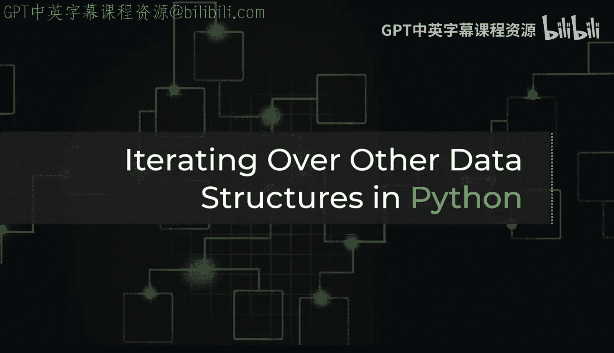
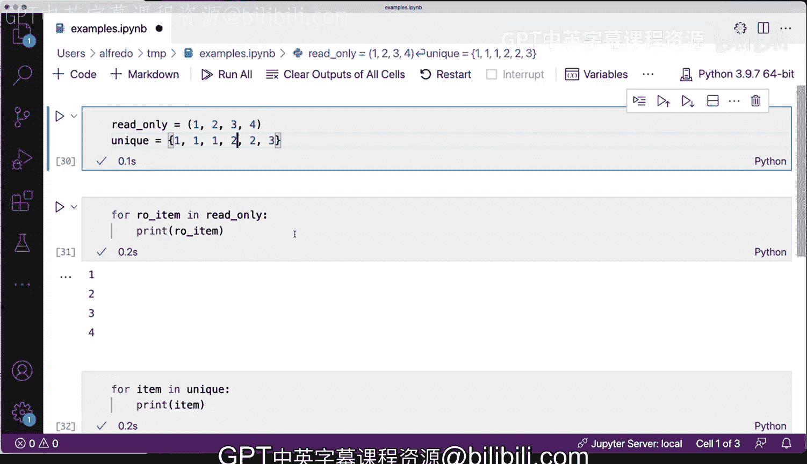

#  079：Python中其他数据结构的迭代操作 🔄



在本节课中，我们将要学习如何在Python中迭代遍历除列表和字典之外的其他数据结构，特别是元组（tuple）和集合（set）。掌握循环结构后，这些操作会变得非常简单。

## 概述

上一节我们介绍了列表和字典的迭代操作。本节中我们来看看如何对元组和集合进行类似的遍历。我们将通过定义示例变量并编写循环代码来演示其用法。

## 迭代遍历元组

首先，我们创建一个只读的元组变量，它包含四个项目：1、2、3和4。迭代遍历元组的构造与遍历列表非常相似，甚至完全相同。

以下是遍历元组的代码示例：

```python
read_only = (1, 2, 3, 4)
for ro_item in read_only:
    print(ro_item)
```

这段代码会依次打印出1、2、3和4。操作直接且简单。

## 迭代遍历集合

接下来，我们创建一个集合。集合的特点是它会自动去除重复项。我们定义一个包含重复数字1和2的集合，然后遍历它。

以下是遍历集合的代码示例：

```python
unique = {1, 1, 2, 2, 3}
for item in unique:
    print(item)
```

运行这段代码，输出结果是1、2和3。因为集合中重复的1和2只被保留了一份，所以只打印出这三个唯一的项目。

## 核心要点总结

本节课中我们一起学习了如何迭代遍历Python中的元组和集合。

*   **元组的迭代**：与列表迭代方式完全相同，使用 `for item in tuple:` 结构。
*   **集合的迭代**：同样使用 `for item in set:` 结构，但遍历的是集合中的唯一元素。



如果你已经掌握了如何处理Python中最常见的数据结构——列表，那么你就能轻松地遍历和操作像元组和集合这样不太常见的数据结构了。