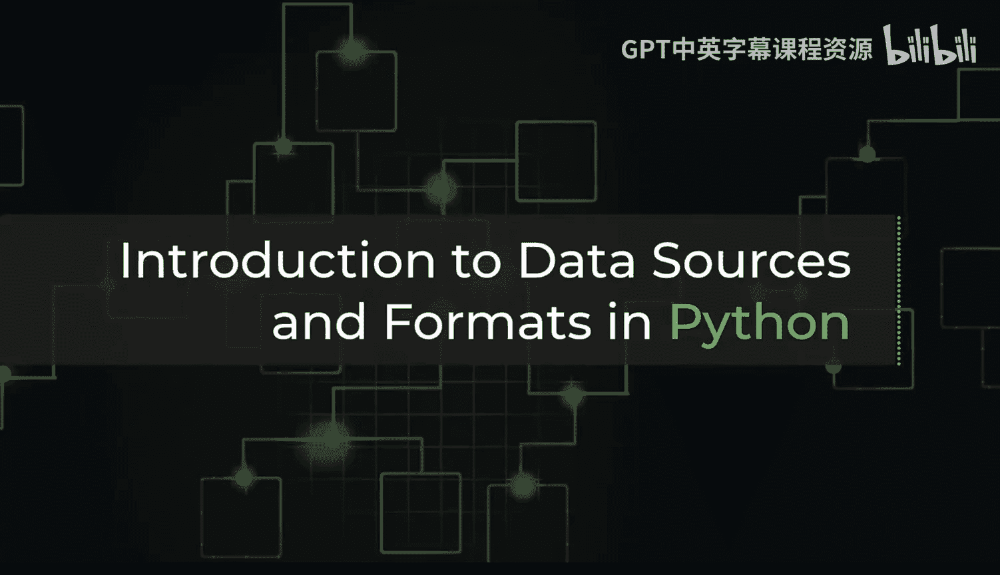

#  082：Python数据源与格式入门 📚

在本节课中，我们将学习如何使用Python从不同格式的文件中读取和加载数据。我们将重点介绍处理文本文件、CSV文件以及JSON和YAML格式数据的基本方法。

## 从文件中读取数据

读取文件并将数据加载到程序中，其具体操作方式取决于你的目标以及可用的库。

根据你的需求，你可以选择将文件作为一个整体在Python中读取，或者使用特定的库。例如，对于CSV文件，你可能会使用`pandas`库；对于JSON文件，则可以使用`json`模块直接读取并将其加载到Python中。

## 处理JSON和YAML数据

上一节我们提到了文件读取的基本概念，本节中我们来看看如何处理结构化的数据格式。

我们将介绍如何将JSON和YAML数据加载到Python的数据结构中，以便你能够对这些结构进行操作。同时，我们也会学习如何将Python数据结构中的数据转换为YAML格式，并保存到文件中。

以下是处理这些格式的核心步骤：

*   **加载JSON**：使用`json.load()`或`json.loads()`函数。
*   **加载YAML**：通常需要使用第三方库，如`PyYAML`的`yaml.safe_load()`函数。
*   **Python转YAML**：使用`yaml.dump()`函数将Python对象序列化为YAML字符串。
*   **保存到文件**：使用标准的文件写入操作，将序列化后的字符串写入文件。

## 总结

本节课中我们一起学习了Python处理不同数据源和格式的基础知识。我们了解了读取文本文件的通用思路，并掌握了使用特定库（如`pandas`处理CSV，`json`模块处理JSON）来加载数据的方法。最后，我们还探讨了如何在Python数据结构与YAML格式之间进行转换和保存。掌握这些技能是进行数据操作和分析的重要第一步。