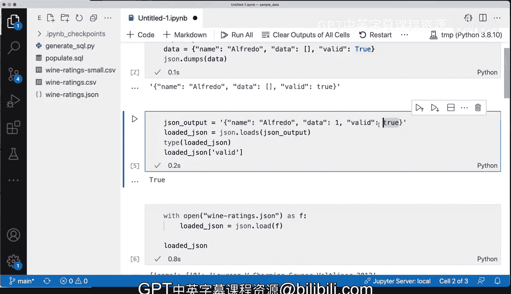

#  084：Python中的JSON数据处理 🐍📄


在本节课中，我们将学习如何在Python中处理JSON数据。JSON是一种常见的数据交换格式，Python内置的`json`模块可以方便地在JSON字符串和Python数据结构之间进行转换。我们将学习如何将Python对象序列化为JSON字符串，以及如何将JSON字符串反序列化为Python对象。

---

## Python数据结构与JSON的相似性

在Python中处理JSON时，你可能会发现许多JSON数据结构与Python的数据结构看起来非常相似。例如，一个Python字典与JSON对象在结构上基本相同，只有一些细微的差别。

接下来，我们将使用Python的`json`模块来探索这些操作。

---

## 将Python对象转换为JSON字符串

首先，我们需要导入`json`模块。假设我们有一个简单的Python字典，我们想将其转换为一个有效的JSON字符串。

以下是转换的步骤：

1.  导入`json`模块。
2.  创建一个Python字典。
3.  使用`json.dumps()`函数将字典序列化为JSON格式的字符串。

**代码示例：**
```python
import json

# 创建一个Python字典
data = {
    "name": "Alfredo",
    "other_data": []  # 一个空列表
}

# 使用json.dumps()将字典转换为JSON字符串
json_string = json.dumps(data)
print(json_string)
```
运行上述代码，你将得到一个JSON格式的字符串。这个字符串看起来与我们创建的Python字典非常相似，这正是因为两者的结构高度一致。

---

## 注意JSON与Python的细微差别

虽然JSON和Python数据结构很相似，但存在一些关键区别。例如，Python中的布尔值`True`和`False`在JSON中会转换为小写的`true`和`false`。

让我们通过一个例子来观察这个区别：

**代码示例：**
```python
import json

data_with_bool = {
    "name": "Test",
    "valid": True  # Python中的布尔值
}

json_output = json.dumps(data_with_bool)
print(json_output)  # 输出中"valid"的值将是小写的"true"
```
在这个例子中，Python的`True`在生成的JSON字符串中变成了`true`。了解这些差异对于正确处理数据至关重要。

---

## 将JSON字符串转换为Python对象

上一节我们介绍了如何将Python对象转换为JSON字符串。本节中，我们来看看反向操作：如何将JSON字符串加载回Python数据结构。

假设我们收到了一个JSON格式的字符串，并希望在Python程序中使用它。我们可以使用`json.loads()`函数（注意是`loads`，代表“load string”，而不是复数形式的loads）来实现。

以下是转换的步骤：

1.  准备一个JSON格式的字符串。
2.  使用`json.loads()`函数将其解析为Python对象。

**代码示例：**
```python
import json

# 一个JSON格式的字符串
json_output = '{"name": "Alfredo", "valid": true, "count": 1}'

# 使用json.loads()将字符串转换为Python字典
loaded_json = json.loads(json_output)

# 检查类型，确认它是一个字典
print(type(loaded_json))

# 现在可以像操作普通字典一样操作它
print(loaded_json["valid"])  # 输出：True
```
现在，原本是字符串的`json_output`已经变成了一个有效的Python字典，我们可以像访问普通字典一样访问其中的数据。注意，JSON中的`true`被转换回了Python的`True`。

---

## 从JSON文件加载数据

在实际工作中，JSON数据通常存储在文件中。接下来，我们学习如何直接从`.json`文件中读取数据并将其加载到Python中。

我们将使用`json.load()`函数（注意是`load`，不是`loads`），它可以直接从文件对象中读取并解析JSON数据。

以下是操作步骤：

1.  使用`open()`函数以读取模式打开JSON文件。
2.  将打开的文件对象传递给`json.load()`函数。
3.  函数会返回解析后的Python对象（通常是字典或列表）。

**代码示例：**
```python
import json

# 假设当前目录下有一个名为 ‘wine-ratings.json‘ 的文件
with open(‘wine-ratings.json‘, ‘r‘) as f:  # ‘f‘ 是文件对象的简写
    loaded_json = json.load(f)  # 注意是 json.load()，不是 loads

# 现在 loaded_json 包含了文件中的所有数据
print(type(loaded_json))
print(len(loaded_json))  # 查看数据量，例如可能包含774条记录
```
通过这段代码，`wine-ratings.json`文件中的所有内容都被加载到了变量`loaded_json`中，并转换成了对应的Python数据结构（如字典的列表），方便你进行进一步的分析和处理。

---

## 总结



本节课中我们一起学习了Python中处理JSON数据的核心方法。我们了解到JSON结构与Python字典、列表的相似性，并掌握了两个关键操作：使用`json.dumps()`将Python对象序列化为JSON字符串，以及使用`json.loads()`或`json.load()`将JSON字符串或文件反序列化为Python对象。记住，JSON中的布尔值（`true`/`false`）和`null`与Python的`True`/`False`/`None`存在大小写区别。掌握这些知识，你就能在数据工程任务中自如地处理JSON格式的数据了。