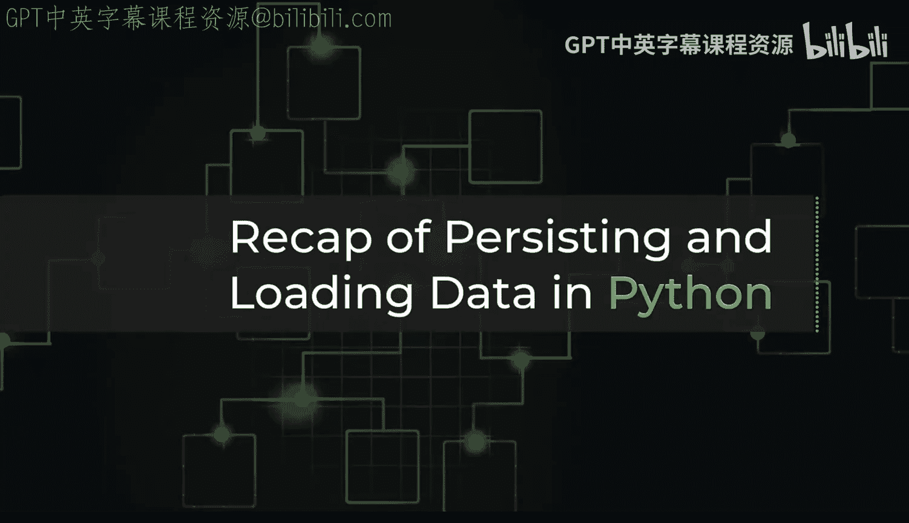

#  086：Python数据持久化与加载回顾 📚

在本节课中，我们将回顾Python中数据持久化与加载的核心概念。我们将学习如何从文件读取数据到Python，以及如何将Python中的数据保存回文件。这包括处理JSON格式和CSV格式的数据，这些是数据工程中非常常见的任务。

## 从文件加载数据到Python

上一节我们介绍了JSON的基本操作。本节中我们来看看如何将文件中的数据加载到Python程序中。这是数据处理的基础，因为您需要有能力从外部文件读取信息。

*   您可以将文件中的数据读取到Python中。
*   您可以在Python中处理这些来自文件的数据。

## 处理JSON数据

我们已经学习了如何操作JSON。这包括从JSON文件加载数据，以及将Python中的数据保存到JSON文件。

以下是处理JSON数据的关键步骤：

*   从JSON文件加载数据。
*   将来自Python的数据保存到JSON文件。
*   在Python中将相邻的数据结构（如字典、列表）转换为JSON字符串。

## 使用Pandas库处理CSV数据

最后，我们还简要介绍了如何使用Pandas库来处理CSV文件。Pandas是Python中用于数据分析和操作的一个强大库。

本节课中我们一起学习了Python数据持久化的核心流程：从文件（特别是JSON和CSV格式）读取数据到Python环境，在Python中进行处理，以及将处理后的数据保存回文件。掌握这些技能是进行有效数据工程工作的基础。