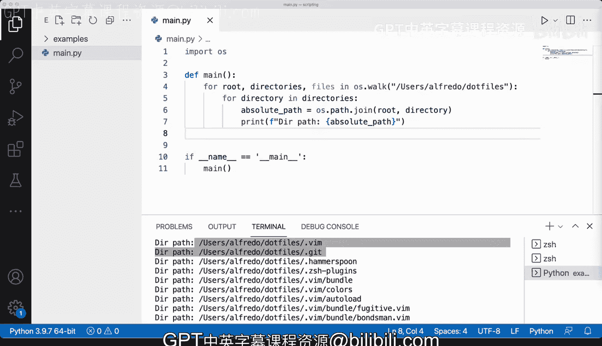

#  090：使用Python脚本遍历文件系统


在本节课中，我们将学习如何使用Python的`os`模块来编写一个脚本，该脚本能够遍历计算机的文件系统，列出目录和文件。这是数据工程中处理本地数据文件的常见任务。

## 概述

上一节我们介绍了如何编写一个基本的Python脚本。本节中，我们来看看如何利用Python内置的`os`模块，特别是其中的`os.walk()`函数，来遍历文件系统中的目录和文件。

## 导入模块

首先，我们需要导入`os`模块，它提供了与操作系统交互的实用工具。

```python
import os
```

## 使用 os.walk() 函数

`os.walk()`函数是遍历目录树的核心工具。它生成一个三元组`(root, directories, files)`，分别代表当前目录路径、该目录下的子目录列表和文件列表。

以下是使用`os.walk()`的基本结构：

```python
for root, directories, files in os.walk('/path/to/start'):
    # 处理逻辑
```

## 遍历并打印文件

为了理解`os.walk()`的输出，我们可以先编写一个简单的脚本来打印遍历过程中发现的所有文件及其完整路径。

```python
import os

def main():
    start_path = '/users/Alfredo/.files'  # 请替换为你的实际路径
    for root, directories, files in os.walk(start_path):
        for file in files:
            absolute_path = os.path.join(root, file)
            print(f"文件路径: {absolute_path}")

if __name__ == "__main__":
    main()
```

**重要提示**：必须使用绝对路径（如`/users/Alfredo/.files`），而不能使用缩写路径（如`~/.files`），否则脚本可能无法正确运行。

## 遍历并打印目录

如果你想专门处理目录，可以循环遍历`directories`列表。

```python
import os

def main():
    start_path = '/users/Alfredo/.files'  # 请替换为你的实际路径
    for root, directories, files in os.walk(start_path):
        for directory in directories:
            dir_path = os.path.join(root, directory)
            print(f"目录路径: {dir_path}")

if __name__ == "__main__":
    main()
```

## 总结

本节课中我们一起学习了如何使用Python的`os.walk()`函数来遍历文件系统。我们掌握了：
1.  导入`os`模块。
2.  使用`os.walk()`循环获取目录树的根路径、子目录和文件。
3.  通过`os.path.join()`组合出文件或目录的绝对路径。
4.  分别编写了遍历文件和遍历目录的脚本。



记住，始终使用绝对路径是确保脚本在不同环境下都能正确工作的关键。