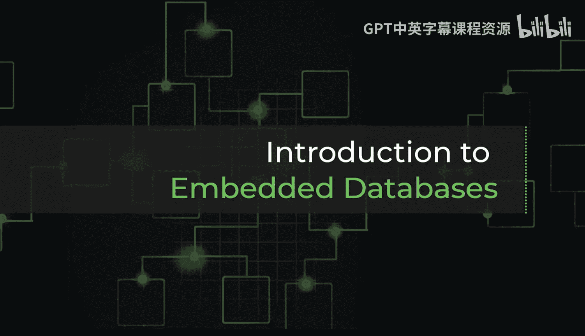

#  092：嵌入式数据库入门 🗄️

在本节课中，我们将学习嵌入式数据库的概念，并重点介绍如何使用 SQLite。SQLite 是一个轻量级、可靠且功能强大的数据库，其操作方式与常规数据库类似，但有一些细微差别。我们将学习如何通过命令行，特别是通过 Python 来操作 SQLite 数据库，以便您能轻松地在实际项目中使用数据库，而无需配置更复杂的大型数据库系统。

## 什么是嵌入式数据库？

上一节我们明确了本课的学习目标，本节中我们来看看嵌入式数据库的核心定义。嵌入式数据库是一种集成在应用程序内部的数据库系统。它不需要独立的服务器进程，所有数据库操作都在应用程序进程中完成。SQLite 是嵌入式数据库的典型代表。


以下是嵌入式数据库的几个关键特点：
*   **无服务器**：无需安装、配置或管理独立的数据库服务器。
*   **零配置**：开箱即用，数据库以单个文件形式存储在磁盘上。
*   **事务性**：支持 ACID 事务，确保数据的一致性和可靠性。
*   **跨平台**：数据库文件可在不同操作系统间自由移动和使用。

## 为什么选择 SQLite？



了解了嵌入式数据库的基本概念后，我们自然会问：为什么选择 SQLite 作为学习对象？SQLite 因其极简的设计和广泛的适用性而备受青睐。它被广泛应用于移动应用、桌面软件、乃至某些特定场景的 Web 后端，是初学数据库操作的理想选择。

以下是 SQLite 的一些主要优势：
*   **轻量级**：整个库体积小巧，易于集成。
*   **自包含**：几乎不需要外部依赖。
*   **公共领域**：代码开源，可免费用于任何目的。
*   **标准兼容**：支持大多数 SQL 标准，学习成本低。

## 通过 Python 连接 SQLite

现在，我们已经知道了 SQLite 是什么以及为何要使用它。接下来，我们将进入实践环节，学习如何使用 Python 来连接和操作 SQLite 数据库。Python 的标准库 `sqlite3` 提供了与 SQLite 交互的全部功能。

以下是通过 Python 使用 SQLite 的基本步骤：

1.  **导入模块**：首先需要导入 `sqlite3` 库。
    ```python
    import sqlite3
    ```

2.  **建立连接**：连接到数据库文件。如果文件不存在，SQLite 会自动创建它。
    ```python
    conn = sqlite3.connect('my_database.db')
    ```

3.  **创建游标**：游标对象用于执行 SQL 语句并获取结果。
    ```python
    cursor = conn.cursor()
    ```

4.  **执行 SQL**：使用游标执行创建表、插入数据、查询等操作。
    ```python
    cursor.execute("CREATE TABLE IF NOT EXISTS users (id INTEGER PRIMARY KEY, name TEXT)")
    cursor.execute("INSERT INTO users (name) VALUES ('Alice')")
    ```

5.  **提交与关闭**：完成数据修改后，必须提交事务。最后，关闭连接。
    ```python
    conn.commit()
    conn.close()
    ```

## 核心操作示例

掌握了连接数据库的方法后，我们通过一个简单的例子来演示完整的操作流程。这将帮助您理解如何将各个步骤组合起来，完成一个基本的数据持久化任务。

假设我们要创建一个存储用户信息的表，并插入一条数据，然后查询它。

```python
import sqlite3

# 1. 连接到数据库（如果不存在则创建）
conn = sqlite3.connect('example.db')

# 2. 创建一个游标对象
cur = conn.cursor()

# 3. 创建一个表
cur.execute('''CREATE TABLE IF NOT EXISTS users
               (id INTEGER PRIMARY KEY, username TEXT, email TEXT)''')

# 4. 插入一条数据
cur.execute("INSERT INTO users (username, email) VALUES (?, ?)", ('john_doe', 'john@example.com'))

# 5. 提交事务，保存更改
conn.commit()

# 6. 查询所有用户
cur.execute("SELECT * FROM users")
rows = cur.fetchall()
for row in rows:
    print(row)

# 7. 关闭连接
conn.close()
```

## 总结

本节课中，我们一起学习了嵌入式数据库的基础知识。我们从嵌入式数据库的概念入手，探讨了 SQLite 作为其经典实现的优势。随后，我们重点讲解了如何通过 Python 的 `sqlite3` 模块来连接 SQLite 数据库、执行基本的 SQL 操作（包括创建表、插入数据和查询数据），并完成了一个完整的代码示例。通过本课的学习，您已经掌握了在 Python 项目中使用轻量级数据库进行数据存储和检索的基本技能，这为处理更复杂的数据工程任务奠定了坚实的基础。