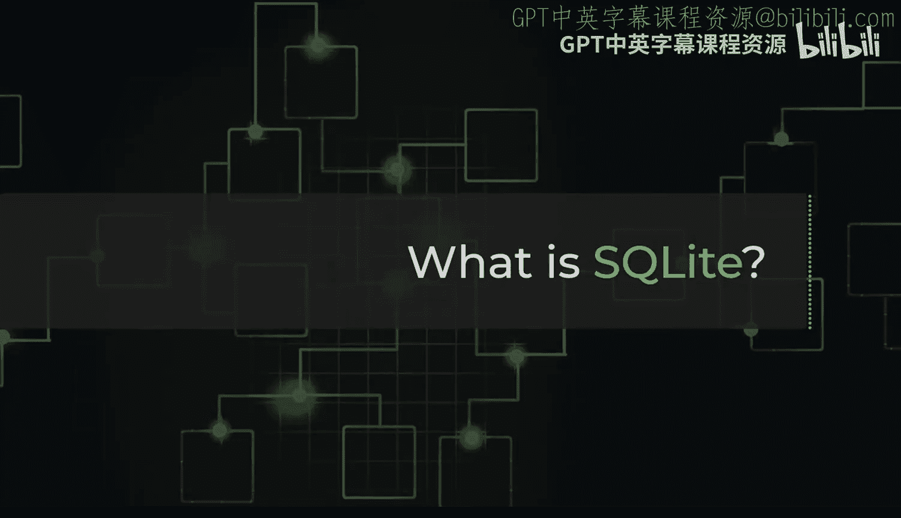

#  093：什么是SQLite 🗄️

在本节课中，我们将要学习SQLite数据库的核心概念。我们将探讨SQLite与其他主流数据库（如PostgreSQL或MySQL）的关键区别，并理解其作为“嵌入式数据库”的含义。

## SQLite的本质

上一节我们介绍了数据工程中数据库的基本角色，本节中我们来看看SQLite的具体特点。

SQLite被称为嵌入式数据库，它与PostgreSQL或MySQL等主流数据库存在一些关键差异。

以下是SQLite的几个核心特征：

*   **数据库即文件**：一个SQLite数据库在文件系统中直接体现为一个单一的文件。这是一个显著区别，因为像PostgreSQL这样的大型数据库，你无法在文件系统中找到一个直接对应的单一数据库文件。
*   **无客户端-服务器架构**：当你使用PostgreSQL或MySQL时，你需要一个数据库服务器，然后通过客户端（通常通过网络）连接到它。SQLite没有服务器进程，你直接连接到一个数据库文件。
*   **零配置**：像SQLite这样的嵌入式数据库无需任何配置。你不需要进行任何特定的设置。正如我们将在本课中看到的，从Python连接、设置以及与SQLite的交互都非常直接。

## 使用SQLite的优势

了解了SQLite的基本特性后，我们来看看它带来的便利。

从Python与SQLite的交互非常直接。虽然有一些需要注意的事项，我们接下来会看到，但总体上一切都很简单，你无需担心太多。这使得它成为处理数据、使用SQL、存储和检索数据、运行查询以及尝试使用数据库的绝佳选择。

本节课中我们一起学习了SQLite作为嵌入式数据库的核心概念，包括其以文件形式存在、无服务器架构和零配置的特点。这些特性使其成为学习和进行轻量级数据操作的理想工具。