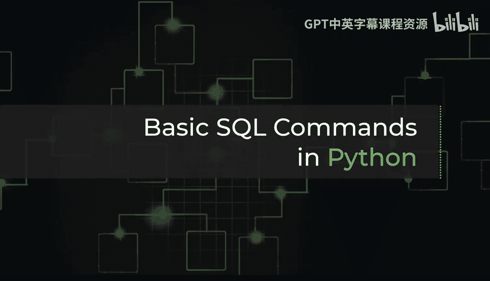
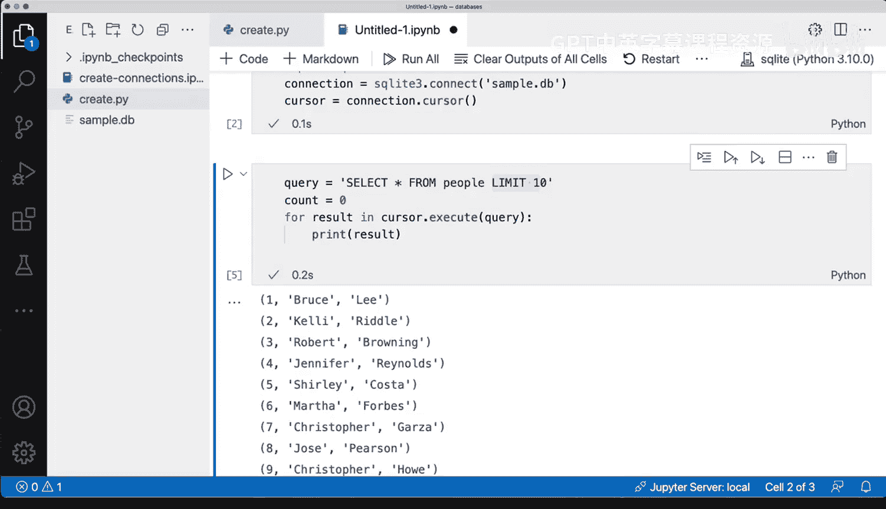

#  098：Python中的基础SQL命令 🐍

在本节课中，我们将学习如何在Python环境中使用基础的SQL命令与数据库进行交互。我们将从建立连接开始，逐步探索`SELECT`、`LIMIT`等核心语句，并了解何时可以借助Python来处理复杂的查询逻辑。

---

我们已经初步使用过一些基础的SQL命令来与数据交互。同样地，我们将在Python环境中运行代码，导入SQLite3模块，创建一个数据库连接，并设置一个游标来与数据库进行交互。我们使用的是同一个示例数据库，它已预先填充了姓名数据。

现在我们已经有了一个游标。SQL语句中有哪些基础元素呢？我们已经从`SELECT`开始了。我们将重用这里的`query`变量，以便尝试不同的查询，并重新分配其内容。

我们将执行一个简单的`SELECT`查询，就像之前做过的那样。`SELECT`意味着我们要选择什么，`*`代表所有字段，`FROM`则指定数据来自哪个表。在我们的例子中，表名为`people`。因此，最基本的查询是`SELECT * FROM people`，这将获取表中的所有数据。

为了执行这个查询，我们使用最基本的方式：`cursor.execute(query)`。然后，我们可以遍历结果。例如，使用`for result in cursor.execute(query): print(result)`。运行后，我们会得到数据库中当前的所有条目。Jupyter Notebook会非常友好地显示所有输出，即使数据量很大。

这种方法的一个强大之处在于，你现在可以通过Python来控制数据处理。例如，如果你想限制输出数量，虽然用SQL查询通常更高效，但当查询变得复杂时，你可以依赖Python。你可以设置一个计数器，当打印的条目超过一定数量（比如10个）时，就中断循环。这展示了将部分处理逻辑放在Python端的能力，而不是完全依赖SQL语句。

除了`SELECT * FROM people`，我们当然可以在SQL查询中直接使用`LIMIT`。例如，`SELECT * FROM people LIMIT 10`会产生相同的效果。这无疑是更高效的做法。这是一个非常简单的查询示例。当情况变得复杂时，你可能需要退回到Python并进行一些处理。

除了`SELECT *`，我们还可以进行更精确的查询。请记住，我们的表中有三列：`id`、`name`和`surname`。你可以构建更贴近你所需数据的查询。例如，如果你只关心名字，可以执行`SELECT name FROM people LIMIT 10`。同样地，如果你只想选择姓氏，查询将是`SELECT surname FROM people LIMIT 10`。运行这些查询，你将分别获得名字或姓氏的数据。

这些就是你可以用来与数据库交互的一些基础SQL命令。你可以执行`SELECT`查询，指定表和字段，并肯定可以使用`LIMIT`。当事情开始变得过于复杂时，你可以依靠Python来进行一些处理，就像我们之前尝试用Python限制输出而不是在SQL查询中使用`LIMIT`时所展示的那样。

---

本节课中，我们一起学习了在Python中使用基础SQL命令与数据库交互。我们掌握了如何执行`SELECT`查询、使用`LIMIT`子句以及选择特定字段。更重要的是，我们理解了在SQL查询效率不足或过于复杂时，如何灵活地借助Python进行数据处理。这为后续处理更复杂的数据工程任务奠定了基础。