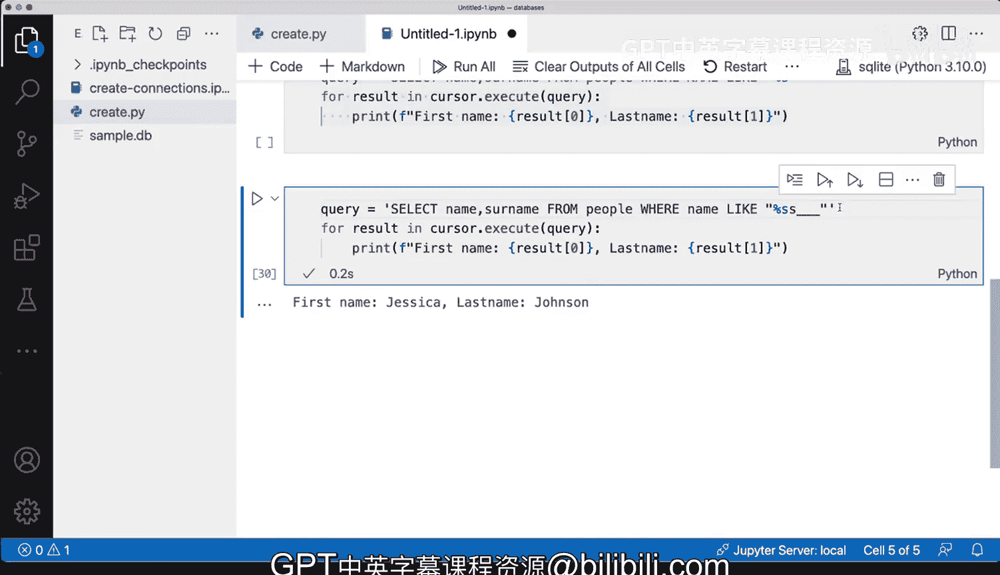

#  100：在Python中使用SQL进行搜索 🔍


在本节课中，我们将学习如何在Python中执行SQL查询时，使用`LIKE`语句和通配符进行灵活的文本搜索。这对于处理非确定性数据或进行模糊匹配非常有用。

---

上一节我们介绍了基本的SQL查询操作，本节中我们来看看如何使用`LIKE`语句进行更灵活的搜索。

`LIKE`语句是SQL中用于在`WHERE`子句中进行模式匹配的关键字。它通常与两个通配符配合使用：
*   `%`：代表零个、一个或多个字符。
*   `_`：代表一个单一的字符。

我们将使用一个名为`people`的表进行演示，该表包含`name`和`surname`字段。

## 使用 `%` 通配符

`%`通配符可以匹配任意长度的字符序列。以下是几种常见用法。

### 匹配以特定字符结尾的名字

如果我们想查找所有以“es”结尾的名字，可以使用以下查询：
```sql
SELECT name, surname FROM people WHERE name LIKE '%es'
```
此查询中，`%`匹配“es”之前的任何字符，因此会返回所有以“es”结尾的名字。

### 匹配包含特定字符序列的名字

如果想查找名字中包含“es”的记录，无论“es”出现在什么位置，可以在其前后都使用`%`：
```sql
SELECT name, surname FROM people WHERE name LIKE '%es%'
```
这个模式会匹配任何位置包含“es”的名字，例如“Wesley”（es在中间）也会被找到。

### 匹配以特定字符开头的名字

类似地，我们可以查找所有以“J”开头的名字：
```sql
SELECT name, surname FROM people WHERE name LIKE 'J%'
```
此查询返回所有首字母为“J”的名字。

## 使用 `_` 通配符

`_`通配符用于精确匹配一个字符的位置。这在需要特定格式的搜索时非常有用。

### 匹配特定长度的结尾

例如，查找以任意两个字符加上“s”结尾的名字：
```sql
SELECT name, surname FROM people WHERE name LIKE '%__s'
```
这里，两个`_`代表两个任意字符，再加上尾部的“s”。例如，“Jones”（on+s）符合此模式。

### 组合使用进行精确匹配

我们可以组合使用`%`和`_`进行更精确的搜索。例如，查找名字中在“s”后面紧跟三个字符的记录：
```sql
SELECT name, surname FROM people WHERE name LIKE '%s___'
```
这个模式会匹配如“Joseph”（s+eph）这样的名字。

## 应用场景与总结

本节课中我们一起学习了SQL `LIKE`语句与`%`、`_`通配符的用法。这些工具在以下场景中尤其强大：
*   在数据不完全确定时进行模糊搜索。
*   需要根据数据的部分特征（如开头、结尾或包含的字符）来筛选记录。
*   处理海量数据时，利用数据库的查询优化能力进行高效过滤。

掌握这些搜索技巧，能让你在Python中操作SQL数据库时更加得心应手，灵活地应对各种数据查询需求。

---



