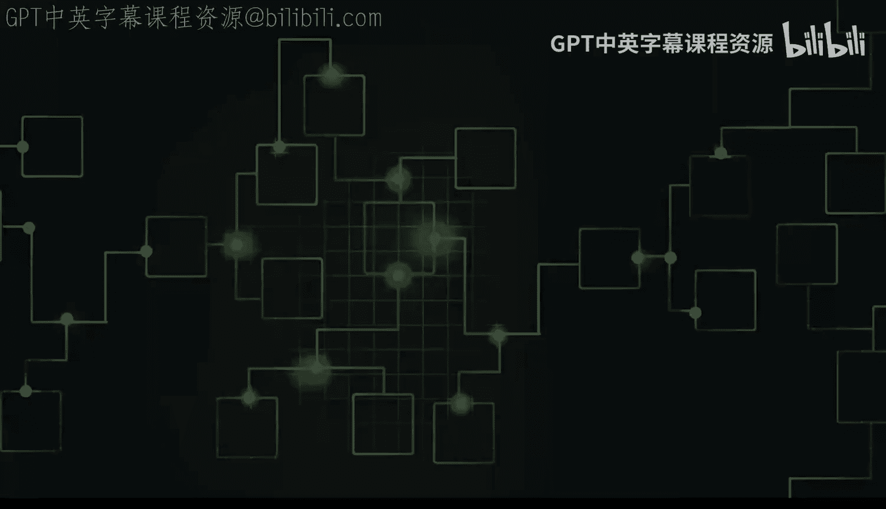
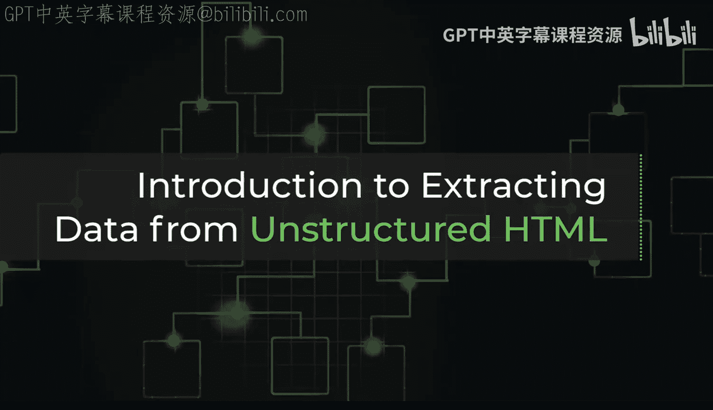

#  103：从非结构化HTML提取数据入门 🕸️

在本节课中，我们将要学习如何从非结构化HTML中提取数据。这是数据工程中处理网络数据的一项关键技能，通常在其他结构化数据源（如API）不可用时使用。





## 概述

从网络上抓取数据应被视为最后的手段。你应始终优先考虑使用API，或寻找从网络服务中提取数据的更好方法。然而，有时这是不可能的。我们可能会遇到大量非结构化的HTML，除了使用网络爬虫和抓取技术来读取数据外，别无他法。一旦成功提取数据，你就可以将其规范化并转换为其他格式，如JSON或CSV。随后，你可以对这些从非结构化HTML中有效提取的数据进行进一步的数据工程处理，这本身可能非常具有挑战性。接下来，我们将探讨如何应对这些困难，以提取并处理这些数据。

## 核心概念与挑战

上一节我们概述了网络抓取的必要性，本节中我们来看看处理非结构化HTML的核心挑战。非结构化HTML缺乏固定的数据模式，使得提取变得复杂。

以下是处理非结构化HTML数据时面临的主要困难：

*   **结构不一致**：不同网页的HTML标签和布局可能千差万别。
*   **数据嵌套**：所需信息可能深藏在多层嵌套的`<div>`或其他标签中。
*   **内容动态加载**：部分数据可能由JavaScript动态生成，初始HTML中并不存在。
*   **反爬虫机制**：网站可能采取技术手段阻止自动化抓取。

为了应对这些挑战，我们需要使用专门的工具和技术来定位和提取数据。

## 基本工作流程

了解了挑战之后，我们来看看从HTML提取数据的基本步骤。这个过程可以系统化为几个关键阶段。

以下是提取数据的基本工作流程：

1.  **获取HTML内容**：使用如`requests`（Python库）等工具向目标网页发送HTTP请求，获取原始的HTML代码。
    ```python
    import requests
    response = requests.get('https://example.com')
    html_content = response.text
    ```
2.  **解析HTML**：使用解析库（如`BeautifulSoup`）将获取的字符串HTML转换为可遍历和搜索的树形结构对象。
    ```python
    from bs4 import BeautifulSoup
    soup = BeautifulSoup(html_content, 'html.parser')
    ```
3.  **定位数据**：通过分析HTML结构，使用标签名、CSS选择器或XPath等方法精确定位到包含目标数据的HTML元素。
    ```python
    # 使用CSS选择器查找所有类名为‘title’的<h1>标签
    titles = soup.select('h1.title')
    ```
4.  **提取与清洗**：从定位到的元素中提取文本、属性（如链接的`href`），并进行必要的清洗（如去除空白字符）。
    ```python
    data_list = []
    for title in titles:
        clean_text = title.get_text().strip()
        data_list.append(clean_text)
    ```
5.  **存储数据**：将提取出的结构化数据保存为便于后续分析的格式，如CSV或JSON。
    ```python
    import pandas as pd
    df = pd.DataFrame(data_list, columns=['Title'])
    df.to_csv('extracted_data.csv', index=False)
    ```

## 总结

本节课中我们一起学习了从非结构化HTML提取数据的入门知识。我们首先明确了网络抓取是获取数据的最后选择，并讨论了处理非结构化HTML时的主要挑战。接着，我们介绍了一个标准的工作流程，包括获取、解析、定位、提取清洗和存储数据。掌握这些基础是进行更高级网络数据工程的第一步。