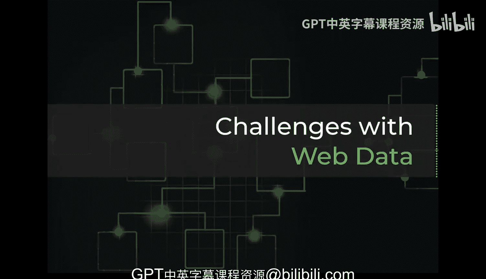
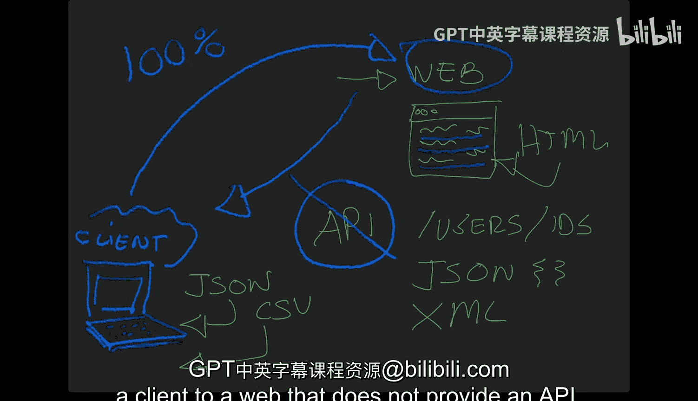

#  104：网络数据采集面临的挑战

在本节课中，我们将探讨从网络获取数据时，特别是在没有官方API（应用程序编程接口）的情况下，所面临的主要挑战。我们将了解为什么直接从网页提取数据比使用API更复杂，以及这个过程涉及哪些步骤。

## 网络数据采集的典型场景

上一节我们介绍了通过网络获取数据的基本概念。本节中我们来看看一个常见但复杂的场景：从没有提供API的网站提取数据。

想象一个网站，其数据以非结构化的HTML格式呈现。这种HTML可能难以直接提取和利用。此时，你无法使用API。API本质上是一种不可行或不可用的方案。理想情况下，你希望拥有一个API，它能提供一个简洁的URL，例如 `users/{id}`，然后你可以通过这个接口检索数据。

## API的优势

以下是API在数据交换中的主要优势：

*   **结构化数据**：API通常以格式良好的JSON或XML格式暴露数据。
*   **易于处理**：你可以直接提取JSON数据，并对其进行操作。XML是另一种用于暴露数据的流行格式。

## 无API时的数据获取挑战

但是，如果你无法访问API，该如何获取网络上那些有趣的数据呢？

如果有一个客户端（例如你的计算机），它可以像访问API一样访问网页。但你需要从网站的HTML中读取全部数据。这个过程相当复杂，它要求客户端执行以下步骤：

1.  **联系网络并读取**：客户端需要访问网页并读取其100%的内容。
2.  **进行深度解析**：对获取的HTML进行繁重的解析工作。
3.  **理解与重构**：理解HTML的含义，并以一种有意义的方式对其进行重构和规范化，使其结构化。
4.  **生成可用数据**：最终，才能生成实际的JSON数据返回给客户端。
5.  **持久化存储**：将数据持久化保存到文件或数据库中。
6.  **数据转换**：甚至可能进一步将数据转换为CSV等格式，再传回客户端。

## 核心挑战总结

本节课中我们一起学习了网络数据采集的核心挑战。

本质上，这种方法试图摆脱对暴露数据的API的依赖。但正如我们所见，这带来了非常高的复杂度。这些就是从客户端向不提供API的网站进行网络数据采集时面临的一些主要挑战。