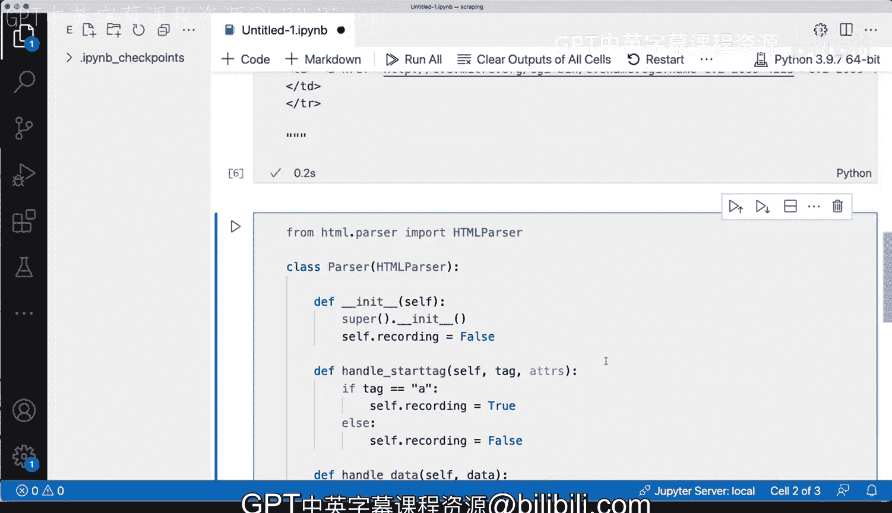

#  105：使用HTMLParser在Python中解析HTML 🕸️


在本节课中，我们将要学习如何使用Python内置的`HTMLParser`模块来解析HTML文档。我们将通过一个具体的例子，提取HTML中特定标签（如`<a>`标签）的内容。

---

## 概述

解析HTML是从网页中提取结构化数据的关键步骤。Python标准库中的`html.parser`模块提供了一个简单但强大的工具来完成这项任务。本节我们将创建一个自定义的解析器类，并学习如何精确地捕获我们所需的数据。

## 创建自定义HTML解析器类

首先，我们需要从`html.parser`模块导入`HTMLParser`类，并创建一个继承自它的自定义类。

```python
from html.parser import HTMLParser

class MyHTMLParser(HTMLParser):
    def __init__(self):
        super().__init__()
        self.recording = False
```

在上面的代码中，我们初始化了父类`HTMLParser`，并定义了一个`self.recording`属性。这个布尔值标志将帮助我们控制何时开始和停止记录数据。

## 处理开始标签

解析器在遇到每一个开始标签时，都会调用`handle_starttag`方法。我们需要在这个方法中检查是否遇到了我们感兴趣的标签。

```python
    def handle_starttag(self, tag, attrs):
        if tag == 'a':
            self.recording = True
        else:
            self.recording = False
```

这段代码的逻辑是：当解析器遇到一个`<a>`标签时，将`self.recording`设置为`True`，表示我们准备记录接下来的数据。对于其他所有标签，则将其设置为`False`。

## 处理标签内的数据

当解析器读取到标签之间的文本数据时，会调用`handle_data`方法。我们在这里检查`self.recording`标志，如果为`True`，则打印或处理这些数据。

```python
    def handle_data(self, data):
        if self.recording:
            print(f"Found A tag info: {data}")
            self.recording = False
```

注意，在打印出数据后，我们立即将`self.recording`重置为`False`。这是关键的一步，确保我们只捕获目标`<a>`标签内的文本，而不会错误地捕获后续其他标签的内容。

## 使用解析器解析HTML内容

现在我们已经定义了解析器类，接下来看看如何使用它。假设我们有一段HTML内容存储在变量`content`中。

以下是使用解析器的步骤：

1.  创建解析器类的一个实例。
2.  调用实例的`feed()`方法，并传入要解析的HTML字符串。

```python
# 假设 `content` 变量包含了你的HTML字符串
parser = MyHTMLParser()
parser.feed(content)
```

执行这段代码后，解析器会遍历整个HTML内容。每当它找到一个`<a>`标签并读取其内部的文本时，就会按照我们在`handle_data`方法中的定义，将文本打印出来。

## 总结



本节课中我们一起学习了使用Python内置的`HTMLParser`模块解析HTML的基本方法。我们创建了一个自定义解析器类，通过重写`handle_starttag`和`handle_data`方法，成功地定位并提取了HTML文档中所有`<a>`标签内的文本信息。关键点在于使用一个`recording`标志来精确控制数据捕获的时机。这种方法虽然基础，但对于许多简单的网页抓取任务来说已经足够有效。