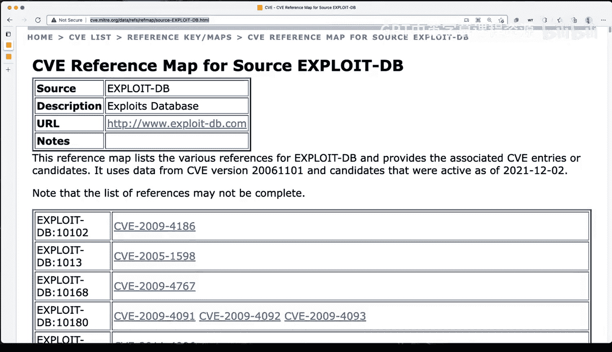
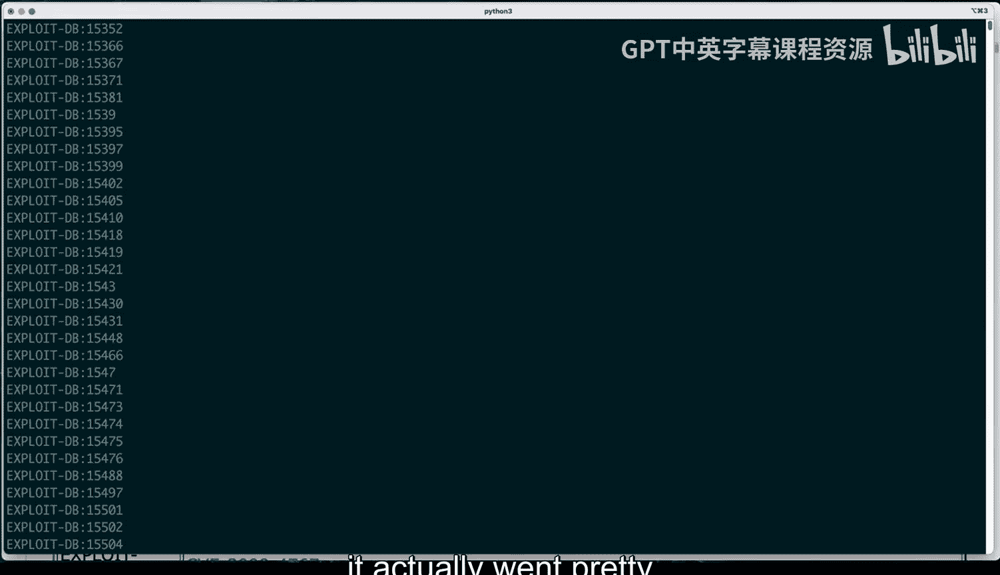

#  109：使用XPath与Scrapy Shell解析数据


在本节课中，我们将学习如何从没有API的网站上解析和提取数据。我们将以一个政府漏洞披露网站为例，使用Scrapy Shell和XPath技术来定位并提取我们所需的漏洞编号（CVE）及其对应的漏洞利用数据库ID（Exploit DB ID）。

## 概述与目标网站

从网站解析或抓取数据时，一个非常常见的场景是目标网站没有提供API来获取信息。本次教程就基于这样一个场景。我们使用的目标网站是 `cve.mitre.org`，这是一个政府网站，用于公开已报告的常见漏洞。

该网站上有一个参考映射，意味着每个CVE条目都关联着一个Exploit DB ID。我们的业务需求就是将这些数据解析并提取出来。

## 定位目标数据

首先，我们需要确定目标URL。接下来，我们需要查看网页源代码。源代码是高度非结构化的HTML，非常粗糙。我们的任务是识别出我们想要的数据所在的位置。

向上滚动页面，可以看到大量我们不关心的额外信息。数据从表格部分开始变得有意义。这里有一个表格，它没有`class`或`id`属性，这会在我们后续尝试定位目标表格时带来一些麻烦。



我们的目标是遍历每一行，并提取行内的数据，即Exploit DB ID和CVE编号。这让我们对需要做什么有了一个初步的了解。

## 启动Scrapy Shell

现在，我们复制URL，打开终端，使用Scrapy的一个功能——Scrapy Shell。Scrapy Shell是一个交互式Shell，允许你以交互方式尝试对网站进行抓取操作。

使用Scrapy Shell的一个要求是传入完整的URL。输入命令后，我们会得到大量输出，并且可以使用一些可用功能，如`fetch`、查看帮助和构建响应对象。输入`response`，可以看到一个HTTP 200响应，说明我们已经准备好开始处理数据。

## 使用XPath探索页面结构

我们将使用XPath来探索页面结构。通过向`.xpath()`方法传入字符串，我们可以访问XPath属性。我们知道要处理表格，所以使用`//table`来获取文档中的所有表格。

执行后，响应是一个包含多个元素的列表。我们检查这个列表的长度，发现返回了5个元素，这意味着文档中有5个表格。我们需要从中提取出包含多行数据的那个表格。

## 识别目标表格

有几种方法可以做到这一点。一种方法是逐个检查这些表格，看哪个包含大量行项。我们可以这样做：`response.xpath('//table')[0]`，这是第一个表格，但它没有我们需要的长度。

我们可以尝试：`response.xpath('//table')[0].xpath('.//tr')`，这是第一个表格的所有行。我们可以看到这里有10851项，但这是所有表格的总和。

因此，我们需要循环检查。我们可以尝试检索第二个表格，依此类推。当我们检查第三个表格（索引为2）时，发现它有10839行数据。这告诉我们，`response.xpath('//table')[2]`就是包含所有目标数据的表格。

## 提取并处理表格数据

我将这个表格赋值给一个变量，以便后续操作：`table = response.xpath('//table')[2]`。通过检查`table.xpath('.//tr')`的长度，可以确认我们确实选中了正确的表格，它有10839行。

接下来，我们需要遍历这个表格的每一行。在开始循环之前，我们需要识别集合中的一些项。如果我们输入`table`，只会得到一个选择器对象。

让我们执行`table.xpath('.//tr')`，这会生成大量项。我们随机选取一项，比如第110项（索引109），并将其赋值给一个变量`child_item`。

现在，我们可以在这个子项上运行另一个XPath调用：`child_item.xpath('.//td/text()')`。这会提取出该行所有单元格的文本内容，返回一个列表。

我们可以获取列表的第一项并调用`.extract()`（一个Scrapy辅助函数），得到Exploit DB ID，例如“Exploit-DB: 10102”。这非常有用。我们还需要找到CVE编号。尝试获取列表的第二项没有结果，但第三项给出了CVE编号。

## 构建数据提取循环

如果我们想遍历所有项（记住我刚才选的是第11项），可以在交互式Shell中创建一个循环。代码如下：

```python
for row in table.xpath('.//tr'):
    try:
        print(row.xpath('.//td/text()')[0].extract())
    except IndexError:
        pass
```

在Shell中操作时需要注意正确闭合括号，否则会遇到语法错误。执行上述循环后，我们可能会遇到“list index out of range”的错误。这是因为有些行可能没有我们预期的数据。

为了解决这个问题，我们使用`try...except`块。当索引错误发生时，我们选择忽略（`pass`）该行。这样，循环就会输出所有我们想要的Exploit DB ID。你可以看到终端中输出了数千个ID，这个过程非常彻底，甚至超出了我们最初的预期。

## 总结



本节课中，我们一起学习了如何在没有API的情况下从网页中解析数据。我们使用了Scrapy Shell进行交互式探索，利用XPath定位目标表格和行，并通过编写循环和异常处理逻辑，成功提取了Exploit DB ID和CVE编号。这个过程涵盖了从识别目标、探索结构到最终提取数据的完整工作流，是网页抓取中的一个实用技能。