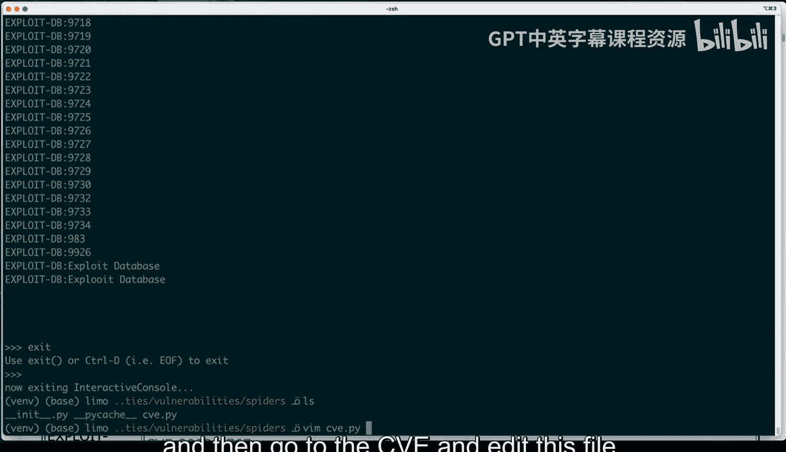
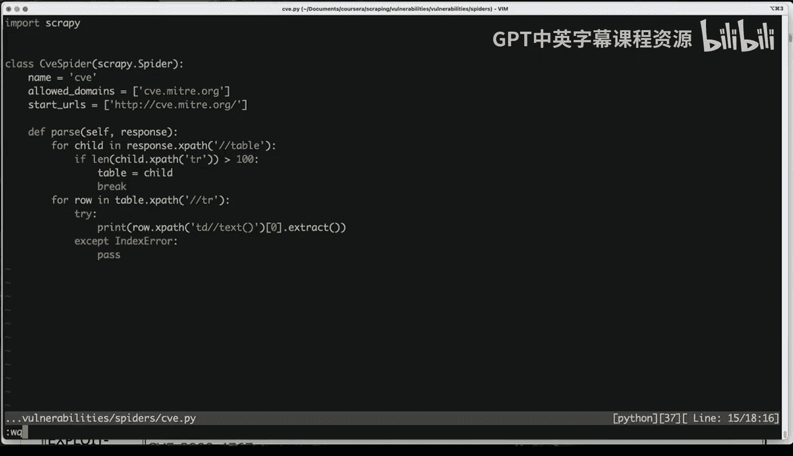
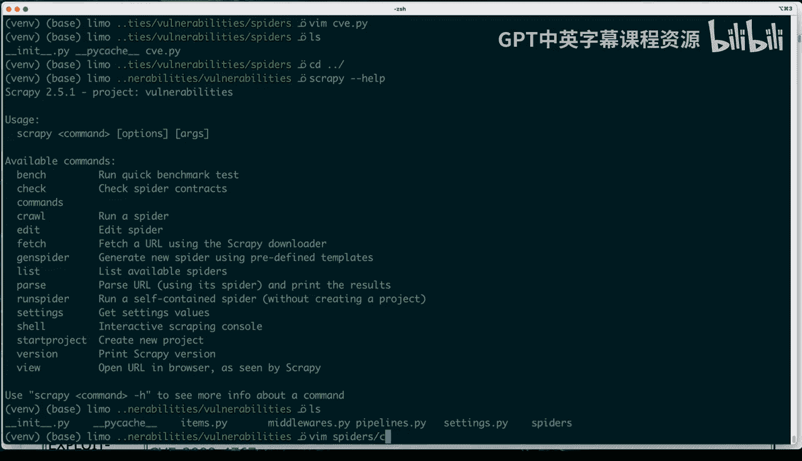
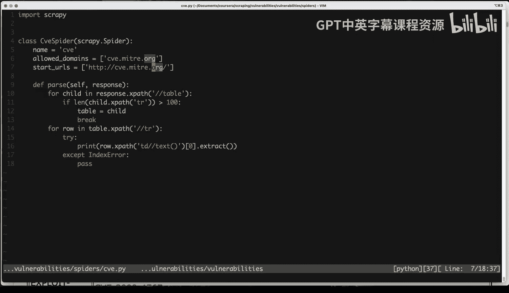
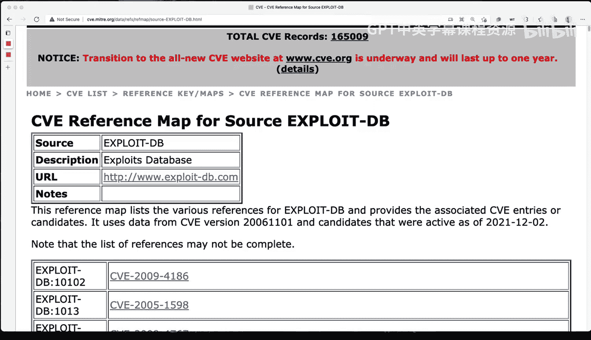
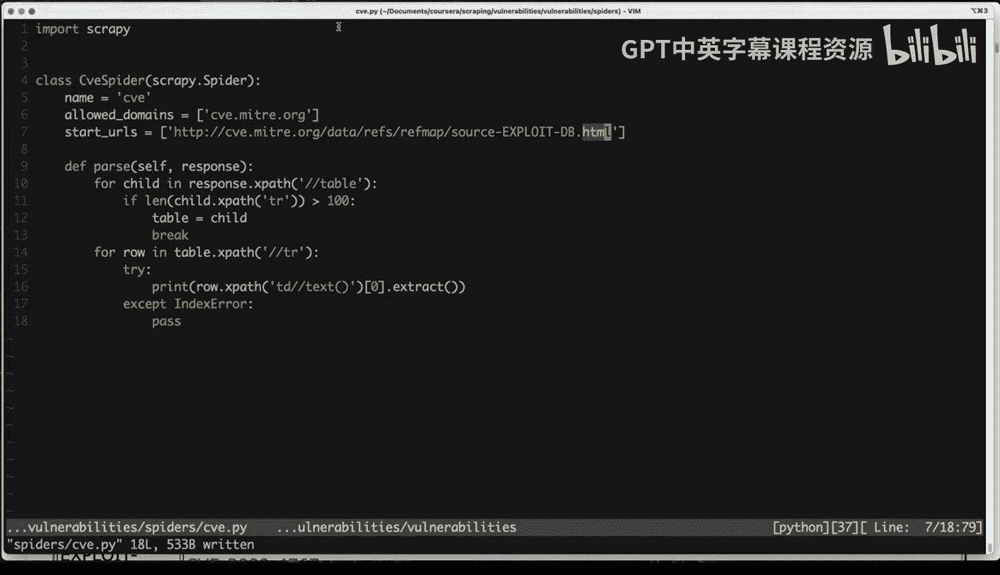
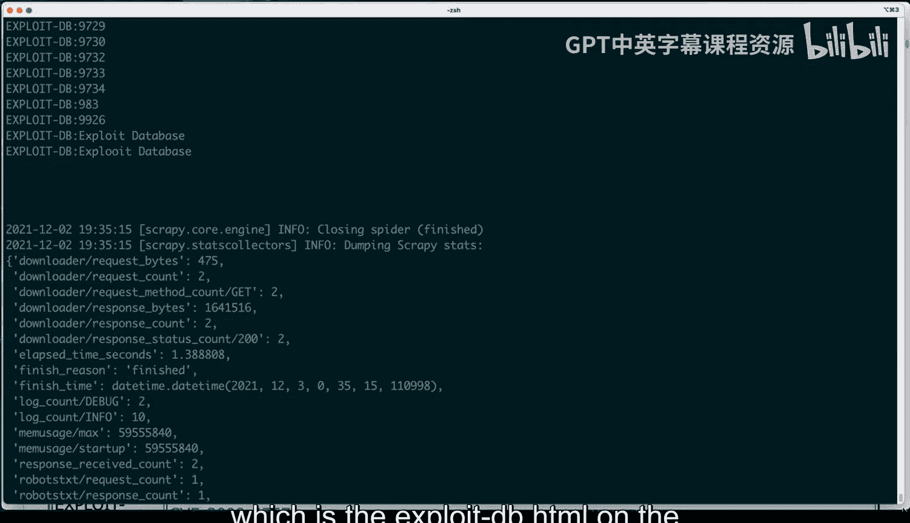
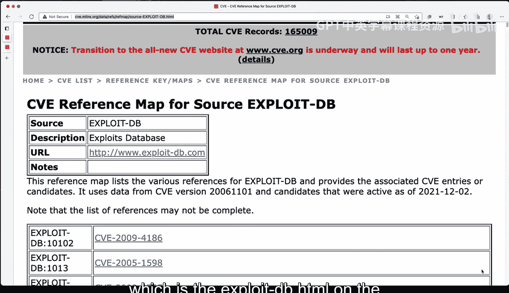
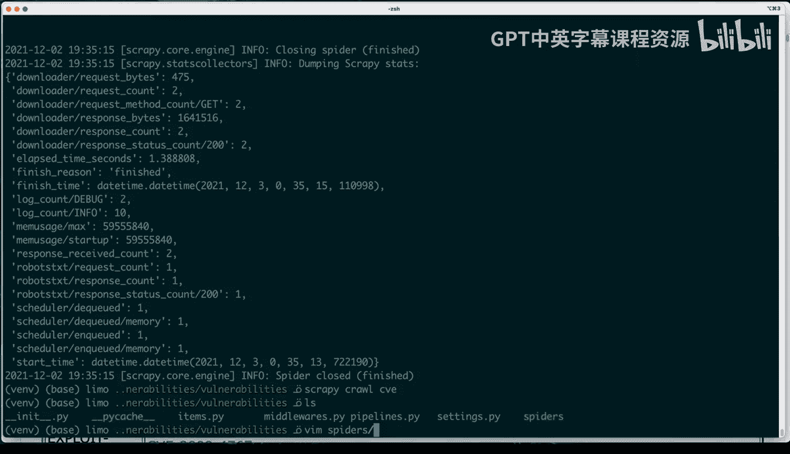
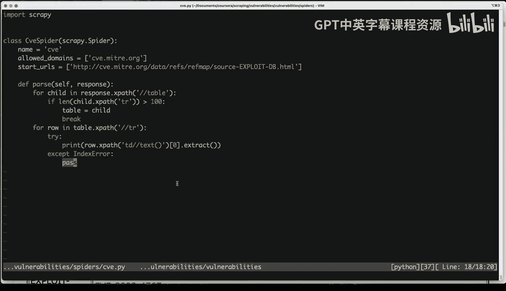

#  110：使用Scrapy Spider进行网络爬虫


在本节课中，我们将学习如何创建一个Scrapy Spider，用于从网页中提取结构化数据。我们将通过一个具体的例子，从目标网站抓取CVE漏洞信息，并详细讲解代码的编写和执行过程。



---

## 为什么Scrapy Spider有用

Scrapy Spider之所以有用，是因为它允许我们编写结构化的代码来提取网页数据。现在，我们可以退出当前环境，进入CVE Spider文件进行编辑。

---

## 编辑CVE Spider文件

接下来，我们将编辑CVE Spider文件。在`parse`方法中，`response`对象与我们之前在Shell中使用的对象功能相同。

因此，我们可以将之前编写的同步代码复制到这里。例如，我们可以编写以下代码：

```python
for child in response.xpath('//table'):
    if len(child.xpath('tr')) > 100:
        table = child
        break
```

现在，我们有了目标表格`table`，可以遍历其中的每一行：



```python
for row in table.xpath('tr'):
    try:
        print(row.xpath('td/text()').extract_first())
    except IndexError:
        pass
```

这段代码将提取并打印表格中每个单元格的文本内容。如果遇到索引错误（例如单元格为空），则跳过。

---



## 运行Scrapy Spider

现在，CVE Spider已经准备就绪，我们可以尝试运行它。这本质上与我们在Shell中使用的命令相同。

首先，我们需要返回上一级目录，然后调用`scrapy`命令。在项目目录中，`scrapy`命令会提供更多可用选项。

我们需要指定起始URL。在代码的第7行，`start_urls`应该包含目标网站的完整URL。因此，我们需要从网站复制URL，并粘贴到`start_urls`列表中。在这个例子中，我们只有一个URL。

以下是所有可用的Scrapy命令。现在，我们已经编辑了文件并设置了目标URL，可以运行Spider了。Spider的名称是`CVE`，因此我们使用`crawl`命令：

```bash
scrapy crawl CVE
```





命令执行后，会有大量输出，并且运行速度很快。我们需要向上滚动查看输出内容。



---

## 查看输出结果

在输出中，可以看到打印的`exploit_db_id`信息。虽然初始的终端滚动可能无法显示所有内容，但命令`scrapy crawl CVE`确实向目标网站`exploit-db.com`发送了请求。



一旦数据返回，Scrapy就会使用我们定义的CVE Spider进行解析。为什么是CVE Spider？因为我们在`spiders`目录下的`CVE.py`文件中定义了Spider的名称为`CVE`。



`parse`方法被执行，并打印每一个`exploit_db_id`。这就是使用XPath解析方法提取数据的方式。

---

## 总结





本节课中，我们一起学习了如何创建和运行一个Scrapy Spider来提取网页数据。我们编辑了Spider文件，使用XPath定位和提取表格数据，并通过`scrapy crawl`命令执行了爬虫任务。通过这个过程，我们掌握了使用Scrapy进行网络爬虫的基本步骤和方法。