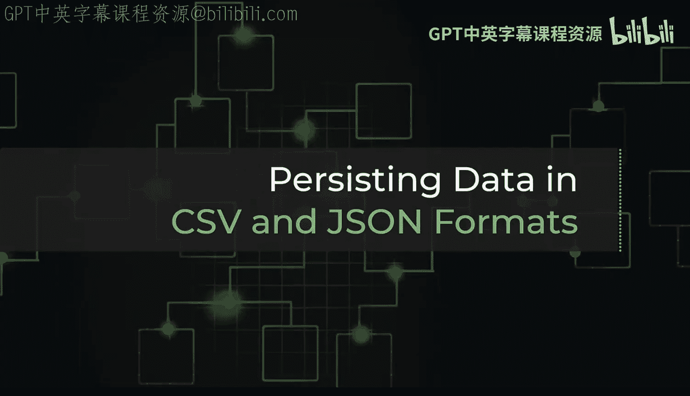
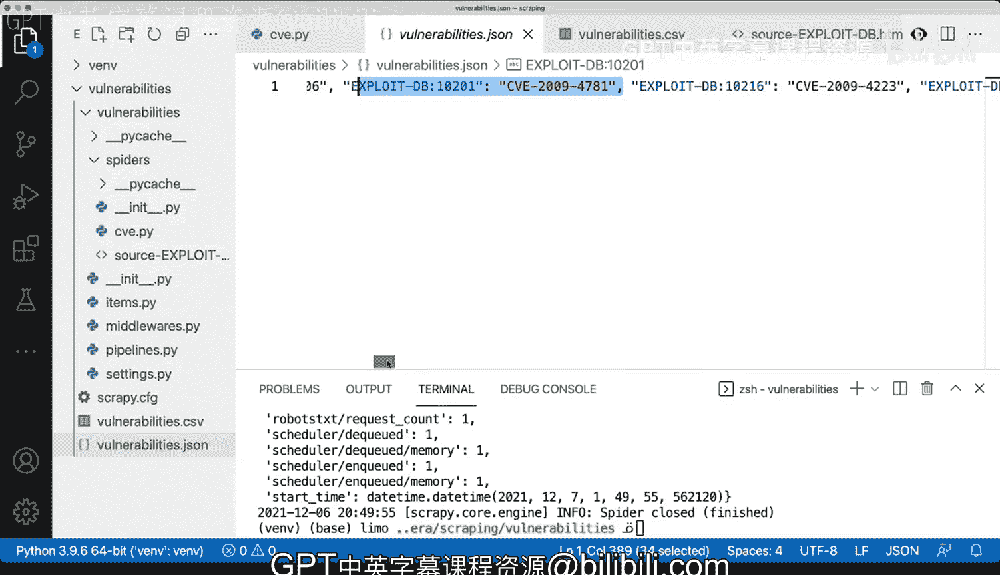

#  114：数据持久化为CSV与JSON格式 📁



在本节课中，我们将学习如何将从网站解析或抓取到的数据持久化保存。我们将重点介绍两种非常流行的数据格式：CSV文件和JSON文件。你将学会如何使用Python标准库来创建和写入这两种格式的文件，以便后续进行数据分析或可视化。

## 概述

从网页获取数据后，我们需要将其保存下来以供后续使用。CSV（逗号分隔值）和JSON（JavaScript对象表示法）是数据科学和工程中两种极为常见的格式。本节我们将通过一个具体的例子，演示如何将抓取到的漏洞数据分别保存为CSV和JSON文件。

## 保存为CSV文件

CSV文件是一种以纯文本形式存储表格数据的简单格式。我们将使用Python内置的`csv`模块来创建和写入文件。

首先，我们需要在代码顶部导入`csv`模块。

```python
import csv
```

接下来，我们需要确定在代码的哪个位置打开文件并写入数据。这里有一个关键点：我们有一个`for`循环来处理每一条数据。如果在循环内部打开文件，文件会在每次迭代时被覆盖。因此，我们必须在循环**之外**打开文件。

以下是具体步骤：

1.  **打开文件**：在循环开始前，我们使用`open()`函数以写入模式（`'w'`）打开一个CSV文件。
2.  **创建写入器**：使用`csv.writer()`函数创建一个写入器对象，它将负责将数据格式化为CSV格式并写入文件。
3.  **写入表头**：在写入具体数据行之前，我们先写入一行作为列标题。
4.  **写入数据行**：在循环内部，对于每一条处理好的数据，我们使用写入器将其作为一行写入文件。
5.  **关闭文件**：循环结束后，记得手动关闭文件。如果使用`with open(...) as ...`的上下文管理器语法，这一步会自动完成，但本例中我们使用传统方式。

以下是实现代码的核心部分：

```python
# 在循环外打开文件
csv_file = open('vulnerabilities.csv', 'w')
writer = csv.writer(csv_file)

# 写入表头
writer.writerow(['exploit_ID', 'CVE_ID'])

# 在循环内部写入每一行数据
for item in data_items:
    writer.writerow([exploit_id, cve_id])

# 循环结束后关闭文件
csv_file.close()
```

运行代码后，我们会得到一个名为`vulnerabilities.csv`的文件。打开文件，第一行是表头`exploit_ID, CVE_ID`，后面跟着我们抓取到的近100条数据记录。这个过程中，我们也可能发现一些数据清洗的问题（例如存在空行），这有助于我们在后续处理中改进。

## 保存为JSON文件

JSON是一种轻量级的数据交换格式，易于人阅读和编写，也易于机器解析和生成。它使用键值对的结构来组织数据。

现在，让我们看看如何将相同的数据保存为JSON格式。首先，在代码顶部导入`json`模块。

```python
import json
```

保存为JSON的步骤与CSV有所不同：

1.  **准备数据结构**：我们不再逐行写入文件，而是先在内存中构建一个Python字典（或列表）来存储所有数据。
2.  **打开文件**：同样，在循环外以写入模式打开一个`.json`文件。
3.  **填充数据**：在循环内部，将每一条数据作为键值对添加到之前创建的字典中。
4.  **序列化并写入**：循环结束后，使用`json.dump()`方法将整个字典对象序列化为JSON格式的字符串，并一次性写入文件。
5.  **关闭文件**：完成写入后关闭文件。

以下是实现代码的核心部分：

```python
import json

# 创建一个空字典来存储数据
data = {}

# 在循环外打开文件
json_file = open('vulnerabilities.json', 'w')

# 在循环内部将数据添加到字典中
for item in data_items:
    data[exploit_id] = cve_id  # 以exploit_id为键，cve_id为值

# 循环结束后，将整个字典写入JSON文件
json.dump(data, json_file)

# 关闭文件
json_file.close()
```

运行代码后，我们会得到一个`vulnerabilities.json`文件。打开文件，可以看到数据以`{"exploit_id_1": "cve_id_1", "exploit_id_2": "cve_id_2", ...}`的格式存储。同样，我们可能发现一些数据问题（如换行符被当作数据），这提示我们需要在数据处理阶段进行更严格的清洗。

## 总结

本节课我们一起学习了两种将数据持久化的常用方法。

*   **保存为CSV**：适合表格型数据，可以使用Python的`csv`模块逐行写入，便于用电子表格或`pandas`库打开和分析。
*   **保存为JSON**：适合结构化、嵌套的数据，使用`json`模块将整个数据结构序列化后写入文件，便于在Web应用或不同编程语言间交换数据。



两种方法都能有效地将内存中的数据保存到磁盘，并且生成的文件可以轻松导入到Jupyter Notebook等工具中进行进一步的分析、清洗和可视化。通过实践，你也能直观地看到原始数据中可能存在的问题，从而不断优化你的数据抓取和处理流程。