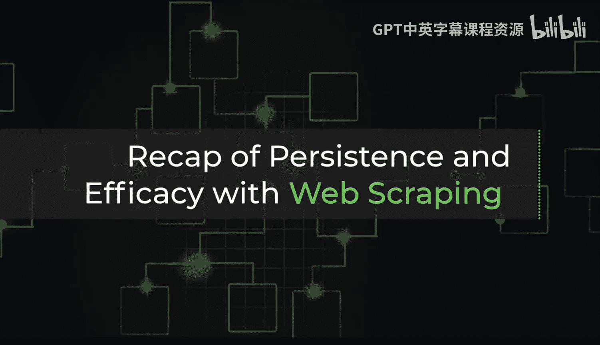

#  116：网络爬虫持久化与效能回顾

在本节课中，我们将学习网络爬虫开发中的两个核心主题：如何通过本地持久化数据来提升爬虫的稳定性和测试效率，以及如何将爬取到的数据保存到不同的存储介质中。




上一节我们介绍了网络爬虫的基础知识，本节中我们来看看如何让爬虫更健壮、更高效。

## 提升爬虫的稳定性与测试效率

在爬取不受你控制的网站时，网站内容可能随时变化。为了应对这种不确定性，你需要编写防御性代码并进行有效测试。一个关键策略是将网页数据持久化到本地文件中。

**核心概念**：将远程的、易变的网页数据保存为本地静态文件，以便进行快速、稳定的解析测试。

以下是实现此策略的主要优势：

*   **提升解析速度**：直接从本地硬盘读取文件比反复发起网络请求快得多。
*   **增强测试稳定性**：使用固定的本地文件进行测试，可以确保你的解析逻辑在网站内容变化前后保持一致，便于调试。
*   **实现离线开发**：你可以在没有网络连接的情况下，继续开发和测试数据解析代码。

## 数据持久化的多种方式

在解析网站和提取数据的过程中，你需要将结果保存下来。有多种方式可以实现数据持久化。

以下是三种常见的数据持久化方法：

1.  **保存到CSV文件**：这是一种简单的表格格式，适合存储结构化的数据。你可以使用Python内置的`csv`库来实现。
    ```python
    import csv
    with open('data.csv', 'w', newline='') as file:
        writer = csv.writer(file)
        writer.writerow(['列1', '列2'])
        writer.writerow(['数据A', '数据B'])
    ```

2.  **保存到JSON文件**：这是一种轻量级的数据交换格式，非常适合存储嵌套的、半结构化的数据。Python的`json`库让读写JSON文件变得非常简单。
    ```python
    import json
    data = {"key": "value", "list": [1, 2, 3]}
    with open('data.json', 'w') as file:
        json.dump(data, file)
    ```

3.  **保存到数据库**：对于大量或需要复杂查询的数据，数据库是更优的选择。本节课我们以SQLite为例，其原理同样适用于其他主流数据库（如MySQL、PostgreSQL）。
    ```python
    import sqlite3
    conn = sqlite3.connect('mydatabase.db')
    cursor = conn.cursor()
    cursor.execute('''CREATE TABLE IF NOT EXISTS mytable (id INTEGER, name TEXT)''')
    cursor.execute("INSERT INTO mytable VALUES (1, 'Alice')")
    conn.commit()
    conn.close()
    ```

## 渐进式保存的重要性

在爬虫运行时进行渐进式数据保存至关重要。这意味着在解析和提取数据的过程中，定期将已获取的数据片段保存起来，而不是等到整个爬取任务全部完成后再一次性保存。

**核心优势**：
*   **防止数据丢失**：如果程序中途崩溃或网络中断，你已经保存了部分成果，无需从头开始。
*   **提升处理效率**：你可以边爬取边处理已保存的数据，实现流水线作业，这比一次性处理所有数据后再保存要高效得多。

本节课中我们一起学习了提升网络爬虫效能的关键技术。我们探讨了如何通过将网页数据本地化来增强代码的防御性和测试的稳定性。同时，我们也介绍了多种数据持久化方法，包括保存到CSV、JSON文件以及SQLite数据库，并强调了在爬取过程中进行渐进式保存的重要性。掌握这些技巧，能帮助你构建出更可靠、更高效的数据采集程序。