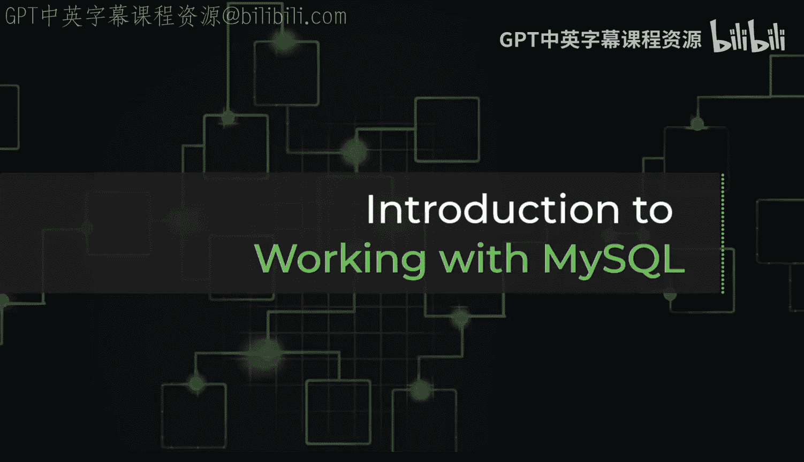

#  117：MySQL数据库操作入门 🗄️

在本节课中，我们将学习如何使用现代开发环境VS Code来连接和操作MySQL数据库。你将掌握从建立连接到执行查询，再到数据迁移的全过程。


## 概述



本周，你将学习如何使用现代开发环境VS Code。我将介绍从VS Code连接到MySQL数据库服务器所需了解的所有知识。你将能够执行查询和进行数据库操作。最后，我将介绍一些可用于从MySQL等数据库加载、提取和迁移数据的策略。

## 使用VS Code连接MySQL

上一节我们概述了课程目标，本节中我们来看看如何具体设置开发环境。首先，你需要确保已在计算机上安装VS Code和MySQL服务器。

以下是连接MySQL数据库的基本步骤：
1.  在VS Code中安装MySQL扩展。
2.  使用扩展面板创建新的数据库连接。
3.  输入主机名、用户名、密码和数据库名称等连接信息。
4.  测试连接以确保配置正确。

## 执行查询与数据库操作

成功连接数据库后，我们就可以开始与之交互了。在VS Code中，你可以直接编写并运行SQL语句。

以下是一些基础的数据库操作示例：
*   **查询数据**：使用 `SELECT * FROM table_name;` 语句检索数据。
*   **插入数据**：使用 `INSERT INTO table_name (column1, column2) VALUES (value1, value2);` 语句添加新记录。
*   **更新数据**：使用 `UPDATE table_name SET column1 = value1 WHERE condition;` 语句修改现有记录。
*   **删除数据**：使用 `DELETE FROM table_name WHERE condition;` 语句删除记录。

## 数据加载、提取与迁移策略

掌握了基本操作后，我们进一步探讨更实际的数据工程任务。从数据库中高效地移动数据是数据工程的核心工作之一。


以下是几种常用的数据迁移策略：
*   **使用SQL导出/导入**：通过 `SELECT ... INTO OUTFILE` 和 `LOAD DATA INFILE` 命令进行数据的导出和导入。
*   **编写Python脚本**：利用 `pymysql` 或 `sqlalchemy` 库连接数据库，用 `pandas` 库处理数据，实现复杂的ETL（提取、转换、加载）流程。
    ```python
    import pandas as pd
    import pymysql
    # 建立数据库连接
    connection = pymysql.connect(host='localhost', user='root', password='password', database='your_db')
    # 读取数据到DataFrame
    df = pd.read_sql('SELECT * FROM your_table', con=connection)
    # 处理数据...
    # 将数据写入新表或文件
    df.to_sql('new_table', con=connection, if_exists='replace', index=False)
    ```
*   **使用专业ETL工具**：对于大型或定期的数据迁移任务，可以考虑使用Apache Airflow、Talend等工具来编排和管理工作流。


## 总结

本节课中，我们一起学习了如何在VS Code环境中连接MySQL数据库、执行基本的SQL查询与操作，并了解了数据加载、提取和迁移的几种实用策略。这些技能是进行数据工程工作的基础，帮助你有效地管理和移动数据。