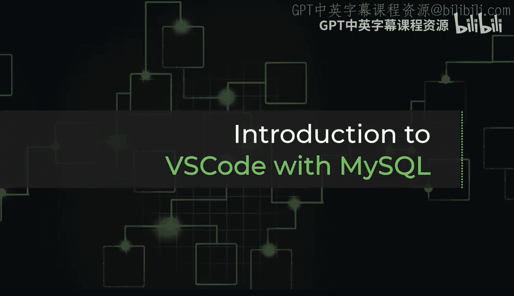

#  118：在VSCode中集成MySQL入门 🚀

在本节课中，我们将学习如何在强大的文本编辑器Visual Studio Code中连接并管理MySQL数据库。这能让你在编写代码的同一环境中直接操作数据库，极大提升工作效率。


## 连接MySQL的多种方式



有多种方法可以连接和管理MySQL数据库。你可以使用命令行工具，即所谓的MySQL客户端。也可以使用功能更全面的管理工具，例如历史悠久、提供图形用户界面的PhpMyAdmin，它允许你添加数据并与MySQL内的数据进行交互。

上一节我们介绍了连接MySQL的通用方法，本节中我们来看看如何在VSCode中实现这一目标。

## 选择VSCode的优势

在本例中，我们将使用Visual Studio Code。它是一个功能强大的文本编辑器，具备连接MySQL、并与MySQL及其内部数据进行交互的能力。

这种方法非常实用，因为它将数据库操作工具直接集成到了你的工作环境中。如果你能使用同一个文本编辑器来操作数据，那将事半功倍。接下来，我们将具体看看如何实现。

## 核心步骤概述

以下是配置VSCode连接MySQL的核心步骤：

1.  **安装扩展**：在VSCode的扩展市场中搜索并安装MySQL管理扩展。
2.  **建立连接**：在扩展面板中，点击“+”号，输入你的MySQL服务器地址、用户名、密码和端口号。
3.  **浏览与操作**：连接成功后，你可以在侧边栏浏览数据库、表，并执行SQL查询。

## 具体操作流程

以下是详细的操作流程：

*   **第一步：安装MySQL扩展**
    打开VSCode，进入扩展视图（Ctrl+Shift+X），搜索“MySQL”，选择由Microsoft或cweijan发布的官方扩展进行安装。

*   **第二步：配置数据库连接**
    安装后，左侧活动栏会出现数据库图标。点击它，然后点击“+”号添加连接。你需要填写主机名（通常是`localhost`）、用户名、密码和端口（默认`3306`）。

*   **第三步：执行SQL查询**
    连接建立后，你可以展开数据库和表。右键点击数据库或表，选择“新建查询”，即可在编辑器中编写并运行SQL命令，例如：
    ```sql
    SELECT * FROM your_table_name;
    ```

## 总结

本节课中，我们一起学习了在VSCode编辑器中集成MySQL数据库的方法。我们了解了这种方式的便利性，并逐步实践了从安装扩展、建立连接到执行查询的完整流程。掌握这一技能，能让你在数据工程工作中更加得心应手。