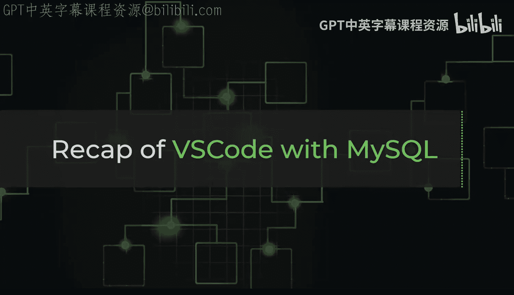

#  120：VSCode与MySQL集成回顾 🧑‍💻

在本节课中，我们将回顾如何将VSCode与一个正在运行的MySQL数据库连接起来，并了解建立连接时需要注意的关键事项。

## 连接配置要点回顾

上一节我们介绍了MySQL的基本概念，本节中我们来看看建立连接的具体配置项。在创建新连接时，有几个关键参数需要设置。

以下是创建连接时必须注意的几个方面：

*   **SSL加密**：连接是否需要加密？如果需要，你必须提供**SSL证书路径**，并通过VSCode中的相应扩展使其可用。
*   **用户名与密码**：我们使用的`root`用户密码为空。`root`是MySQL数据库中权限最高的用户。我们现已了解，这在生产环境中并非理想做法，但对于测试数据库而言完全可行。
*   **地址与端口**：我们使用了完整的端口地址。如果你的环境或生产数据库使用了不同的端口，可以在此进行更改。

## 查询执行与数据操作

完成连接配置后，我们便可以通过VSCode高效地操作数据库了。

我们运行了一些查询，并利用已设置的文本数据和连接字符串查看了结果。现在，你应该能够熟练地使用文本数据连接任何MySQL数据库，并通过VSCode检索数据、操作数据以及有效地管理数据库。

本节课中我们一起学习了在VSCode中配置与连接MySQL数据库的完整流程，包括SSL、认证信息和网络端口的设置，以及最终执行查询和操作数据的方法。