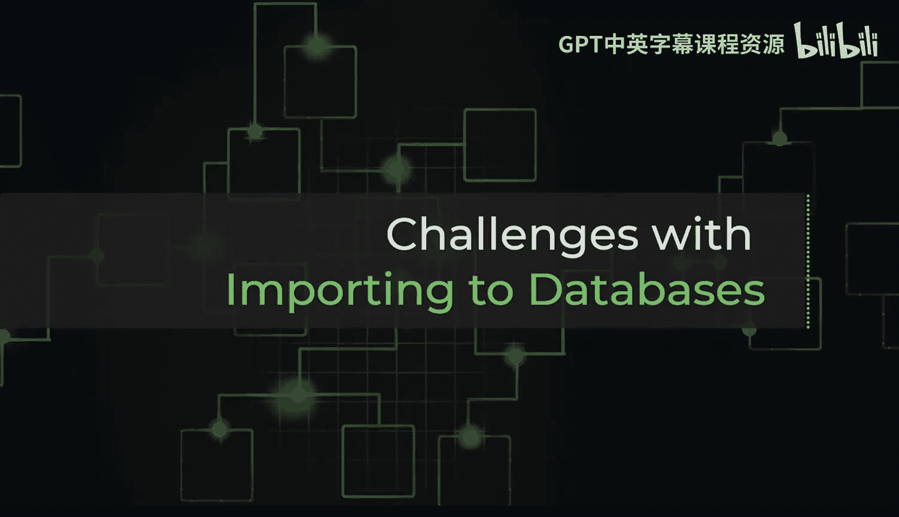

#  124：数据库导入的挑战 🧩

在本节课中，我们将要学习数据库导入过程中可能遇到的主要挑战。理解这些挑战是确保数据在不同环境（如从本地迁移到生产环境）间安全、准确转移的基础。

## 概述

数据库导入是将一个数据库的结构、配置或内容迁移到另一个数据库的过程。这在数据工程中是一项常见且关键的任务，无论是为了设置生产环境、实现高可用性，还是为了数据复用。

## 数据库迁移的常见场景

上一节我们概述了数据库导入的重要性，本节中我们来看看它通常发生在哪些具体场景中。

你可能会在本地使用一个数据库，并对其状态感到满意，准备开始定义生产环境的配置。这时，你需要将本地数据库的定义、设置和配置迁移到生产环境中。

即使不涉及生产环境迁移，将数据从一个数据库转移到另一个数据库本身也是一项复杂且必要的操作。这是实现高可用性、数据复用和多数据库协作的基础。

## 面临的挑战与必要性

了解了常见场景后，我们来看看为什么这个过程充满挑战且至关重要。

将数据库内容从一个库迁移到另一个库非常棘手，但这又是数据工程中的基础技能。你无疑会经常进行此类操作。

因此，不仅需要知道如何操作，还需要知道如何高效地操作。这不仅仅涉及你可能已经熟悉的SQL，还包括处理其他数据格式，如CSV和JSON。

## 总结

本节课中我们一起学习了数据库导入的核心挑战与场景。我们了解到，无论是从本地环境迁移到生产环境，还是在不同数据库间转移数据，都会面临复杂性。掌握高效完成这些任务的方法，包括使用SQL及处理CSV、JSON等格式，是构建可靠数据管道和实现系统高可用性的关键基础。