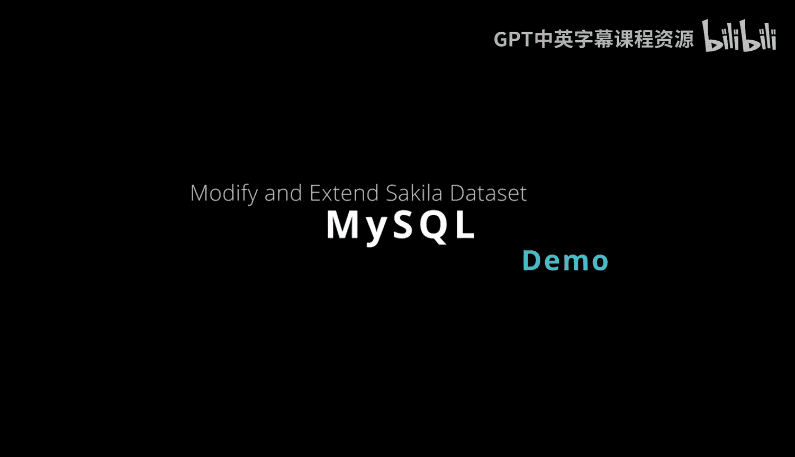
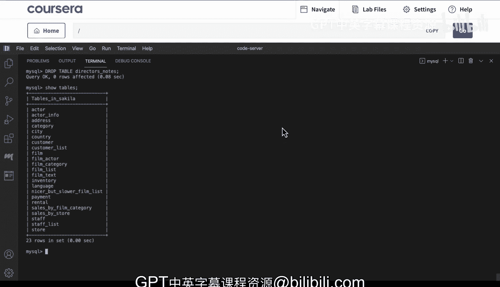

#  132：修改Sakila数据库 🗄️



在本节课中，我们将学习如何扩展一个已有的MySQL示例数据库。我们将通过创建一个新表、向其中插入数据、进行关联查询，最后清理实验性数据，来模拟一个电影导演为影片添加后期制作笔记的场景。

## 概述

我们将使用MySQL自带的`sakila`示例数据库，它模拟了一个电影租赁商店的数据。我们的目标是扩展这个数据库，为其添加一个用于存储导演笔记的新表，并进行一系列操作来演示基本的数据库修改流程。

## 连接到数据库并查看现有结构

首先，我们需要登录到MySQL服务器并查看现有的数据库和表结构。

以下是通过命令行登录MySQL的示例代码：
```bash
mysql -u root -p
```

登录后，我们可以查看所有数据库，并选择使用`sakila`数据库。

```sql
SHOW DATABASES;
USE sakila;
```

选择了数据库后，查看其中的所有表是一个好的开始，这能让我们了解现有的数据结构。

以下是查看`sakila`数据库中所有表的SQL语句：
```sql
SHOW TABLES;
```
执行后，我们可以看到诸如`actor`、`category`、`film`等表。

## 创建新表以扩展数据模型

上一节我们查看了数据库的现有结构，本节中我们来看看如何扩展它。假设我们是一名导演，希望在数据库中添加一个表来记录影片的后期制作笔记。

我们需要创建一个名为`director_notes`的新表。这个表将包含笔记ID、对应的影片ID、笔记内容以及编辑日期。

以下是创建`director_notes`表的SQL语句：
```sql
CREATE TABLE director_notes (
    note_id INT AUTO_INCREMENT PRIMARY KEY,
    film_id INT,
    director_note TEXT,
    edit_date DATE
);
```
在这条语句中：
*   `note_id` 是自动递增的主键。
*   `film_id` 是整数，用于关联`film`表。
*   `director_note` 是文本类型，用于存储自由格式的笔记。
*   `edit_date` 是日期类型。

执行此语句后，新表就创建好了。

## 向新表中插入数据

表创建完成后，我们需要向其中添加一些示例数据，使其变得有用。我们将使用`INSERT`语句来添加两条导演笔记。

以下是向`director_notes`表插入数据的SQL语句：
```sql
INSERT INTO director_notes (film_id, director_note, edit_date)
VALUES
    (1, 'Fix the sound in minute 20.', '2023-10-26'),
    (2, 'Shorten the battle scene.', '2023-10-27');
```
这两条记录模拟了导演对ID为1和2的影片提出的修改意见。

## 关联查询以获取有用视图

仅仅查看笔记表本身信息有限。通常，我们需要将新表与原有数据关联起来，以获得更有意义的视图。例如，将导演笔记与影片名称一起显示。

以下是通过`JOIN`关联`film`表和`director_notes`表进行查询的SQL语句：
```sql
SELECT f.title, dn.director_note, dn.edit_date
FROM film f
LEFT JOIN director_notes dn ON f.film_id = dn.film_id
ORDER BY dn.edit_date DESC;
```
这条查询语句：
*   从`film`表中选择影片标题（`title`）。
*   从`director_notes`表中选择笔记内容（`director_note`）和编辑日期（`edit_date`）。
*   使用`LEFT JOIN`将两个表通过`film_id`连接起来，确保即使某些影片没有笔记也会被列出。
*   结果按编辑日期降序排列。

执行后，我们可以看到所有影片的列表，但只有`Academy Dinosaur`和`Ace Goldfinger`这两部影片旁边显示了导演笔记。这个查询结果本身就可以作为一个非常有用的视图，供导演浏览所有影片及其待办事项。

## 清理实验性数据

在完成实验或测试后，清理创建的实验性表是一个好习惯。这可以通过`DROP TABLE`语句轻松完成。

以下是删除`director_notes`表的SQL语句：
```sql
DROP TABLE director_notes;
```
执行后，我们可以再次运行`SHOW TABLES;`来确认`director_notes`表已被成功移除。

## 总结



本节课中我们一起学习了如何修改一个现有的MySQL数据库。我们完成了从登录数据库、查看结构，到创建新表、插入数据、进行关联查询，最后清理临时表的完整流程。这个过程是数据库开发和数据工程中常见的操作模式。尝试在自己的环境中对示例数据库进行类似的扩展练习，是熟悉这些基本概念的好方法。