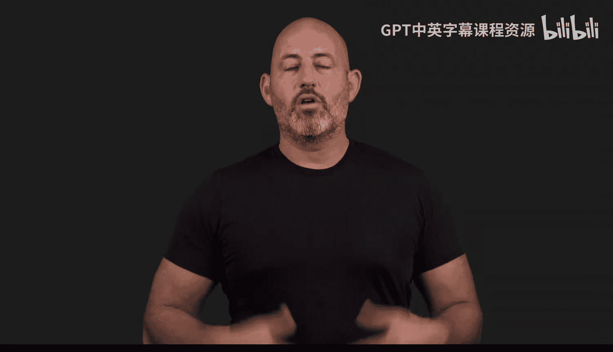

#  135：Web应用程序与数据工程命令行工具导论

在本节课中，我们将学习如何将之前课程的知识整合起来，构建实用的命令行工具来解决数据工程问题。课程还将邀请客座讲师，分享进阶技巧。

大家好，我是诺亚·吉夫特，欢迎来到第四门课程。我们将在这门课程中涵盖数据工程的许多应用层面，重点整合第一门、第二门和第三门课程的内容，构建命令行工具来创建解决方案。我们还将与一些客座讲师交流，他们将展示如何提升到更高水平。让我们开始吧。

## 课程概述 🗺️

本课程是数据工程系列课程的第四部分。在前三门课程中，我们学习了Python、Bash和SQL的基础知识。现在，我们将把这些知识结合起来，专注于构建实际可用的命令行工具。这些工具是数据工程师日常工作中自动化任务、处理数据和构建解决方案的核心。

## 核心目标 🎯

本课程的核心目标是应用所学知识。我们将不再停留在理论层面，而是动手创建能够解决真实数据问题的工具。这意味着你需要准备好编写代码、调试脚本，并将不同的技术栈（如Python与Bash的交互）融合在一起。

## 你将学到什么 📚

以下是本课程将涵盖的主要内容：

*   **命令行工具开发**：学习如何设计、编写和打包功能强大的命令行界面工具。
*   **技术整合**：实践如何将Python脚本、Bash命令以及SQL查询有效地组合在一个工作流中。
*   **解决实际问题**：通过项目案例，学习如何应对数据提取、转换、加载以及系统自动化等常见工程挑战。
*   **专家见解**：聆听行业专家的经验分享，了解高级技巧和最佳实践。

## 学习准备 💻

为了跟上本课程的节奏，你需要：

1.  熟练掌握前三门课程中关于Python编程、Bash shell和SQL数据库的基础内容。
2.  准备好一个代码编辑器或集成开发环境。
3.  在本地或云端配置好Python和数据库环境。

## 总结 ✨

本节课我们一起了解了第四门课程的总体框架和学习目标。我们明确了本课程的重点是**应用与实践**，即将分散的知识点整合起来，构建实用的数据工程命令行工具。从下一节开始，我们将深入命令行工具的设计理念，并动手创建我们的第一个工具。

准备好了吗？让我们进入构建环节。