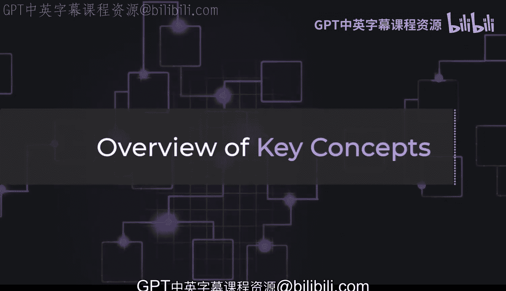
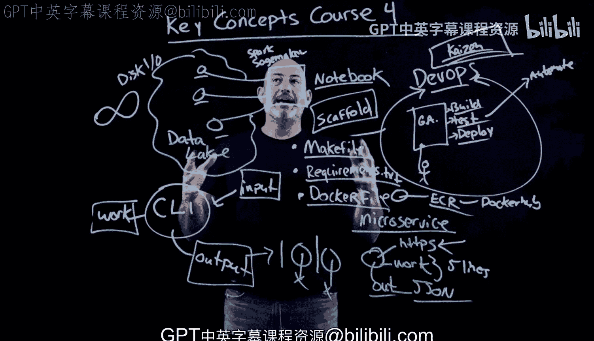

#  136：核心概念概览 🧠

在本节课中，我们将要学习数据工程领域的几个核心概念。这些概念对于理解整个专业领域的知识体系至关重要，它们包括：Notebook的作用、命令行工具、DevOps理念、项目脚手架以及微服务。我们将逐一探讨它们的重要性及其在实践中的应用。

## Notebook：冰山一角 🧊

上一节我们介绍了课程的整体框架，本节中我们来看看Notebook。为什么Notebook如此重要，值得我们详细讨论？

一个理解Notebook的好方法是将其视为“冰山一角”。它是你代码的执行界面，但在幕后，有许多复杂的过程正在发生。以SageMaker这样的环境为例，它利用数据湖的能力，提供近乎无限的存储和计算资源，并在机器学习或数据工程项目中反复移动和处理数据。Spark或SageMaker等工具都由Notebook来编排，但在后台，进行的是大规模的数据操作，例如启动计算节点来训练机器学习模型或进行预测推理。

因此，了解Notebook不仅要知道其表面功能，更要理解其底层运行机制。

## 命令行工具：高效原型设计的关键 🔧

接下来，我们将探讨命令行工具界面。对于数据和工程领域的原型设计而言，这是最重要、最需要了解的工具。

命令行工具之所以关键，是因为你可以获取一个输入，应用一个工作单元（可以简单到一个Python函数），然后获取结果并输出。接着，你可以通过管道操作将这个输出传递给另一个工作单元。这个工作单元可以是另一个命令行工具，它可以再次通过管道传递数据并执行任务。

因此，命令行界面对于构建快速、高效、单一用途的工具至关重要。

## DevOps：持续改进与自动化 🤖

另一个至关重要但常被忽视的概念是DevOps。你可能听说过这个术语，让我们来定义一下它。

DevOps的核心是**持续改进**。其理念是通过将自动化应用于你的流程，来不断优化工作。这意味着，假设我们使用一个常见的构建系统（例如Github Actions），你会构建代码、测试代码，然后将其部署到生产环境。整个过程会持续优化，这是一个高效且完全自动化的流程。

一个检验是否实践了DevOps的试金石是：如果你的代码在推送到生产环境的过程中没有实现完全自动化，那么你做的就不是DevOps。DevOps是关于高质量代码的**完全自动化**，并持续使其变得更好，这也就是“改善”的概念。

## 项目脚手架：稳固的基石 🏗️

那么，如何实践DevOps呢？其中的一些细节我称之为“脚手架”。就像在海滩社区，房屋会建在桩基上以防洪水一样，Python项目也需要构建这样的结构。

以下是Python项目中最重要的三个组成部分：

*   **Makefile**：它允许你在其中定义一系列“配方”，以抽象出非常复杂的代码执行序列。这能为你节省时间，而不是耗费时间。在项目生命周期中，我建议所有Python开发者都使用Makefile来简化操作。在后续的部署过程中，你只需输入 `make install`、`make test`、`make lint` 等命令即可。
*   **requirements.txt 文件**：这个文件至关重要，因为它不仅记录了项目依赖的包，还记录了这些包的具体版本。动态拉取包的最新版本很容易导致项目崩溃，这在现实场景中屡见不鲜。通过使用requirements文件，你可以锁定版本号来避免这个问题。
*   **Dockerfile**：这个文件非常有用，因为它定义了项目的运行时环境，使你可以将项目容器化。然后，你可以将这个容器推送到容器注册表（例如亚马逊的ECR，或公共的Docker Hub）。其核心思想是，通过Dockerfile将你的代码和容器环境打包在一起。

因此，我认为大多数Python项目，特别是在数据工程和机器学习工程领域，都应该具备Makefile、requirements.txt文件和Dockerfile。

## 微服务：数据工程的网络接口 🌐

最后，我们将深入探讨微服务，这对于掌握数据工程至关重要。

微服务允许你将**网络作为输入**。这可以是一个HTTP端点：你访问一个网站，执行一些工作。这项工作可能小到只有五行Python代码，文件大小并不重要，重要的是它解决了什么问题。然后，大多数情况下，你会将输出以**JSON**数据结构的形式返回。这样，你就可以将这些数据发送给其他人。

在微服务部分，我们将讨论Flask、FastAPI，以及你可以构建的数据可视化服务。这些是掌握第四门课程内容的关键最后步骤。

## 总结 📝

本节课中，我们一起学习了数据工程的五个核心概念。我们了解了Notebook作为执行界面和编排工具的双重角色；认识了命令行工具在构建高效、模块化工具中的价值；深入理解了DevOps所倡导的自动化与持续改进理念；探讨了使用Makefile、requirements.txt和Dockerfile构建稳健Python项目的“脚手架”方法；最后，我们预览了微服务如何利用网络接口（HTTP/JSON）来构建灵活、可交互的数据应用。掌握这些概念，将为你在数据工程领域的深入学习和实践打下坚实的基础。