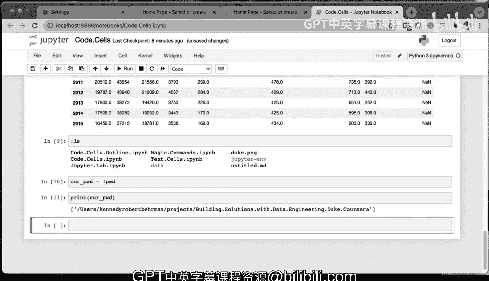

#  139：Jupyter中的代码单元格

在本节课中，我们将学习Jupyter Notebook中代码单元格的核心功能与操作。你将了解如何编写、运行代码，使用代码补全和查看文档，以及如何在Python环境中执行Shell命令。

## 概述

Jupyter Notebook的默认单元格类型是代码单元格。我们可以在其中编写和执行Python代码。代码单元格支持语法高亮、代码补全和即时文档查看。运行代码后，结果会直接显示在单元格下方。此外，我们还可以在Notebook中直接执行Shell命令，并将命令的输出捕获为Python变量，实现Python与系统环境的交互。

## 代码单元格基础

当你首次打开或创建一个新的Notebook时，默认创建的单元格就是代码单元格。

我们可以在代码单元格中编写代码。请注意，代码具有语法高亮功能。

我们可以通过点击运行按钮来执行代码。

请注意，如果当前单元格下方已存在其他单元格，点击运行按钮会选中下方的单元格。我们也可以使用键盘快捷键 **Shift + Enter** 来达到同样的效果。

## 代码辅助功能

如果我们输入一个点号，然后按下 **Tab** 键，会触发代码补全功能。

开始输入时，可以看到系统会显示该模块下所有可用的函数。

如果我们在一个函数名后输入一个问号，然后按下 **Shift + Enter**，它会打开该函数的文档。

## 代码输出

我们调用的函数或方法的结果，会显示在单元格正下方的输出区域。

需要注意两点：首先，如果我们在一个单元格中定义了变量，这个变量的状态会被创建并保存。其次，该变量将在后续的单元格中持续存在。

输出可以是数值或文本，但也可以是更复杂的形式。例如，如果我们导入pandas库并打开一个CSV文件，我们刚刚加载的DataFrame的输出实际上是HTML格式的。你可以看到它是交互式的，并且内容比纯文本更丰富。

## 执行Shell命令

我们可以在Notebook内部运行Shell命令，方法是在命令前加上感叹号 **!**。

这里，我们在运行此Notebook的当前目录上执行了`ls`命令，可以看到该目录中的所有文件。

我们还可以通过将Shell命令的输出赋值给一个变量来捕获它。

我们可以看到，该变量现在作为一个Python对象存在，我们可以用普通的Python代码来使用它。

## 总结

本节课我们一起学习了Jupyter Notebook中代码单元格的基本操作。我们掌握了如何运行代码、使用代码补全和查阅文档。我们还了解了代码输出的多样性，以及如何在Notebook中执行并捕获Shell命令的结果，从而将Python代码与操作系统环境无缝结合。这些技能是进行高效数据分析和工程的基础。