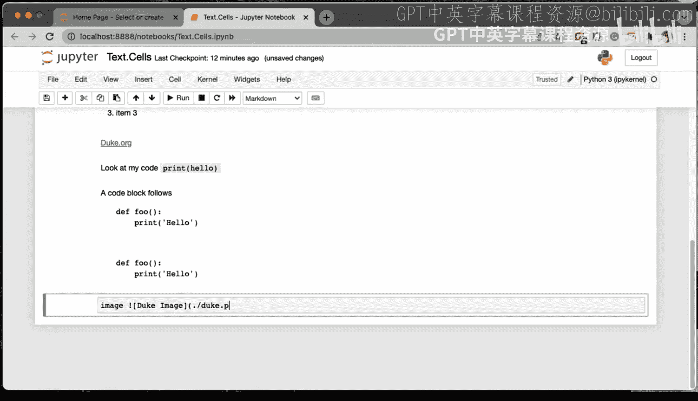

#  140：Jupyter Notebook中的文本单元格 📝

在本节课中，我们将学习如何在Jupyter Notebook中使用Markdown语言创建格式丰富的文本单元格。这能帮助我们更好地记录代码、解释分析过程并创建结构清晰的文档。

## 概述


Jupyter Notebook不仅是一个代码执行环境，也是一个强大的文档工具。通过将单元格转换为文本模式并使用Markdown语法，我们可以创建标题、列表、链接、图片等多种富文本内容，使我们的分析报告和笔记更具可读性和专业性。

## 创建文本单元格

首先，我们需要将单元格从代码模式转换为文本模式。

使用菜单栏中的选项，选择“Markdown”，即可将当前单元格转换为文本单元格。

## 标题的创建

要创建一个标题，在文本单元格的开头使用井号`#`。

*   一级标题使用一个井号：`# 标题`
*   二级标题使用两个井号：`## 标题`
*   以此类推，可以创建更多层级的标题。

## 引用块

我们可以创建引用块。

在段落开头添加右尖括号`>`即可。

当然，首先需要将单元格转换为Markdown模式。

## 文本强调

我们可以为单词添加强调效果。

用单个星号`*`包裹单词，会使其变为*斜体*。

用两个星号`**`包裹单词，会使其变为**粗体**。

或者，我们可以用两个波浪线`~~`包裹单词来~~删除~~它。

## 创建列表

我们可以创建两种类型的列表。

以下是用短横线`-`创建的项目符号列表：
*   项目一
*   项目二

我们也可以创建编号列表。

实际上，你输入什么数字并不重要。

列表的编号会自动生成。
1.  第一项
2.  第二项

## 添加链接

我们可以添加URL链接。

将链接文本放在方括号`[]`内，紧接着将URL地址放在圆括号`()`内，格式为：`[链接文本](URL地址)`。

你可以点击这个URL来访问网站，即跟随链接。

## 嵌入代码

如果我们想在文本中嵌入代码。

我们可以用反引号`` ` ``将其包裹起来，例如：`print(“Hello”)`。

或者，如果我们想创建一个代码块。

我们可以用三个反引号```` ``` ````将其包裹起来。
```python
print(“这是一个代码块”)
```
或者，直接通过缩进也可以创建代码块。

## 添加图片

要添加一张图片。

在方括号`[]`前添加一个感叹号`!`，方括号内填写图片的替代文本，紧接着在圆括号`()`内填写图片的路径地址，格式为：``。




可以看到，图片已经显示出来。

## 总结

本节课我们一起学习了在Jupyter Notebook中使用Markdown语法创建文本单元格的核心方法。我们掌握了如何设置标题、引用、强调文本、创建列表、插入链接与图片，以及嵌入代码。熟练运用这些技巧，能极大地提升Notebook文档的可读性和组织性，是进行数据分析和撰写报告的重要基础。