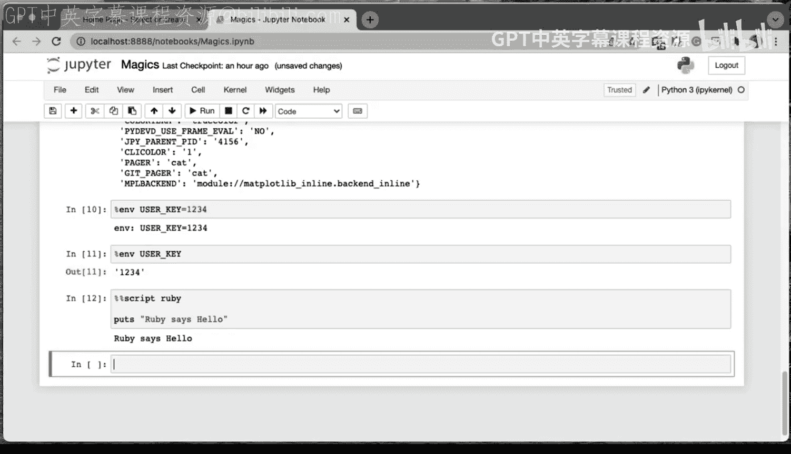

#  141：Jupyter中的魔法命令 🪄


在本节课中，我们将要学习Jupyter Notebook中的“魔法命令”。魔法命令是Jupyter从IPython内核继承的一种特殊指令，可以极大地提升我们的工作效率和代码灵活性。

## 什么是魔法命令？

魔法命令是一种以特殊符号开头的命令，Jupyter从IPython内核获取这些命令。它们主要分为两类：
*   **单行魔法命令**：以单个百分号 `%` 开头。
*   **单元格魔法命令**：以两个百分号 `%%` 开头。


接下来，我们通过一些具体例子来了解它们的用法。

## 探索魔法命令

首先，我们可以使用一个魔法命令来列出所有可用的魔法命令。

以下是查看所有可用魔法命令的方法：
*   `%lsmagic`：此命令会列出所有可用的单行魔法命令和单元格魔法命令。

与Python中的其他函数类似，我们也可以通过添加问号 `?` 来获取魔法命令的帮助文档。例如，输入 `%alias?` 可以查看 `%alias` 命令的详细说明。

## 计时与性能分析

在编写和优化代码时，了解代码的执行时间非常重要。Jupyter提供了方便的计时魔法命令。

最受欢迎的魔法命令之一是计时魔法 `%timeit`，它用于测量一条语句的运行时间。

以下是 `%timeit` 的两种用法：
*   **单行模式**：`%timeit` 会计算同一行中紧随其后的语句的执行时间。例如，`%timeit sum(range(1000))`。默认情况下，它会运行7次，每次循环执行语句10000遍，并返回7次运行中的最佳平均时间。
*   **单元格模式**：`%%timeit` 会计算当前单元格内剩余所有代码的执行时间。在这种模式下，它通常运行7次，但每次只循环1000遍。

## 文件操作魔法命令

Jupyter魔法命令还能方便地与文件系统进行交互，例如读写文件。

一个有用的单元格魔法是 `%%writefile`，它允许我们将单元格中的内容写入磁盘文件。

例如，我们可以在单元格中定义一个函数，然后使用 `%%writefile hello.py` 将该单元格的所有内容（包括函数定义）保存到名为 `hello.py` 的文件中。

写入文件后，我们可以使用 `%run` 这个单行魔法命令来执行磁盘上的文件。例如，`%run hello.py` 会在Jupyter环境中运行该脚本并显示输出。

另一个处理文件的有用命令是 `%load`。这个命令可以将磁盘上文件的内容加载到当前单元格中。例如，`%load hello.py` 会将 `hello.py` 文件的内容插入到当前单元格，之后我们就可以直接调用其中定义的函数了。

## 环境变量管理

有时我们需要在Notebook中查看或设置系统环境变量，魔法命令也能轻松完成这个任务。

我们可以使用 `%env` 命令来管理环境变量。

以下是 `%env` 命令的常见用法：
*   **查看所有环境变量**：直接输入 `%env` 会列出当前环境中定义的所有环境变量。
*   **设置新环境变量**：我们可以像在命令行中一样设置变量，例如 `%env USER_KEY=my_secret_value`。
*   **查看特定环境变量**：使用 `%env USER_KEY` 可以检查该变量的值。

## 多语言支持

Jupyter的魔法命令还有一个强大的功能，就是能在同一个Notebook中运行不同编程语言的代码。

我们可以使用 `%%script` 这个单元格魔法来指定用另一种语言解释器运行代码。

例如，如果我们想用Ruby语法打印一些内容，可以这样写：
```
%%script ruby
puts "Hello from Ruby!"
```
Jupyter会使用Ruby解释器执行这段代码，并将输出结果显示在单元格下方。

## 总结



本节课中，我们一起学习了Jupyter Notebook中强大的魔法命令。我们了解了单行魔法（`%`）和单元格魔法（`%%`）的区别，并实践了如何列出所有命令、获取帮助、为代码计时、读写文件、管理环境变量，甚至运行其他语言的代码。掌握这些魔法命令，能让你的数据分析和工程工作流程更加高效和灵活。