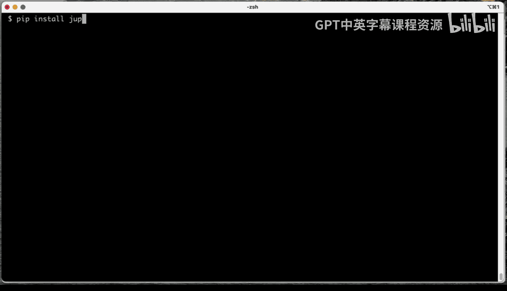
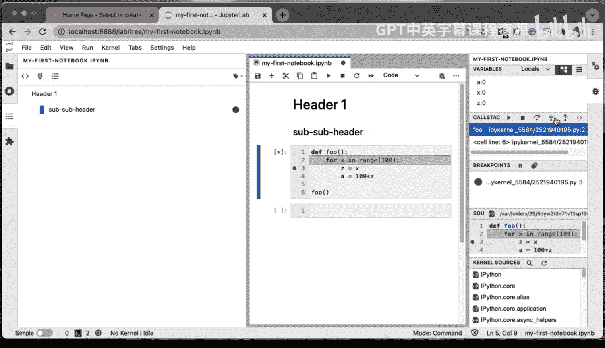
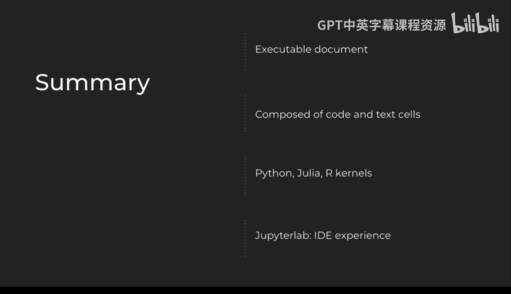

#  142：Jupyter Lab概览 🧪


在本节课中，我们将要学习Jupyter Lab，这是一个功能强大的交互式开发环境，特别适合数据科学和工程任务。我们将介绍如何安装、启动Jupyter Lab，并探索其核心界面和功能。



## 安装与启动

首先，我们可以通过pip安装Jupyter Lab。

```bash
pip install jupyterlab
```

安装完成后，使用以下命令启动Jupyter Lab。

```bash
jupyter lab
```

启动后，我们将看到Jupyter Lab的界面。

## 界面概览

Jupyter Lab的界面中央是一个启动器。启动器提供了多种创建新项目的选项。

以下是启动器中的主要选项列表：
*   创建一个新的Notebook。
*   开启一个交互式Python会话。
*   打开一个终端会话。
*   创建一个文本文件。
*   创建一个Markdown文件。
*   创建一个Python文件。
*   显示上下文帮助。

如果我们打开一个Python文件，可以看到侧边栏会提供我们正在使用的函数的文档。这在我们输入代码时会实时显示。

在界面左侧，我们有一个导航栏，其中包含一个文件浏览器，用于显示本地网络中的文件。我们可以右键点击文件或Notebook进行重命名，并且重命名操作会同步反映在文件浏览器中。

导航栏还显示了当前正在运行的内核和终端。此外，这里还列出了已安装到Jupyter Lab中的各种扩展和插件。Jupyter Lab是一个完整的生态系统，尤其对于Jupyter Notebook和这些扩展的支持非常出色。

## 多文档与布局

现在，让我们打开另一个Notebook。这样我们就同时拥有了两个Notebook。实际上，你可以通过拖放来自由地布局这些文档，按照你喜欢的方式排列它们。

## 文本单元格与导航

如果我们在Notebook中输入一些文本单元格，可以在侧边栏看到一个生成的大纲。这个大纲可以帮助我们导航，直接跳转到特定的单元格。对于大型、复杂的文档来说，这个功能使得浏览变得非常容易。

右键点击一个单元格，我们可以看到所有可以对该单元格执行的操作命令。

## 内置调试器

Jupyter Lab还内置了一个调试器。让我们输入一些代码来演示。



这里有一个简单的函数，它遍历一个数字范围并设置一些变量。

```python
def example_function():
    total = 0
    for i in range(5):
        total += i
    return total
```

我们可以在这里打开调试器，然后设置一个断点。设置后，我们可以在侧边看到调试信息面板，它提供了单步执行代码、查看局部变量值以及步入/步出函数的能力。

## 总结




本节课中，我们一起学习了Jupyter Notebook是一个由代码单元格和文本单元格组成的可执行文档。代码单元格由内核执行，这些内核可以是Python、Julia或R。此外，为了获得更接近集成开发环境的体验，我们可以使用Jupyter Lab。