#  145：Colab中的数据与文档管理 📁

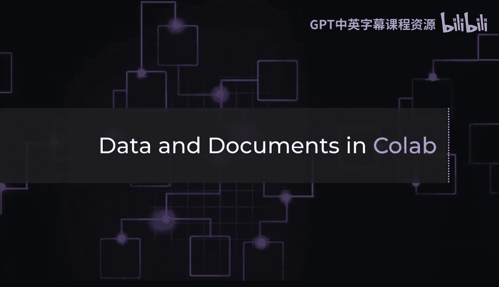

在本节课中，我们将学习如何在Google Colab环境中处理文档和文件。我们将了解如何访问预加载的示例数据、连接个人Google Drive、上传本地文件以及管理笔记本的版本。

---

## 文件管理界面

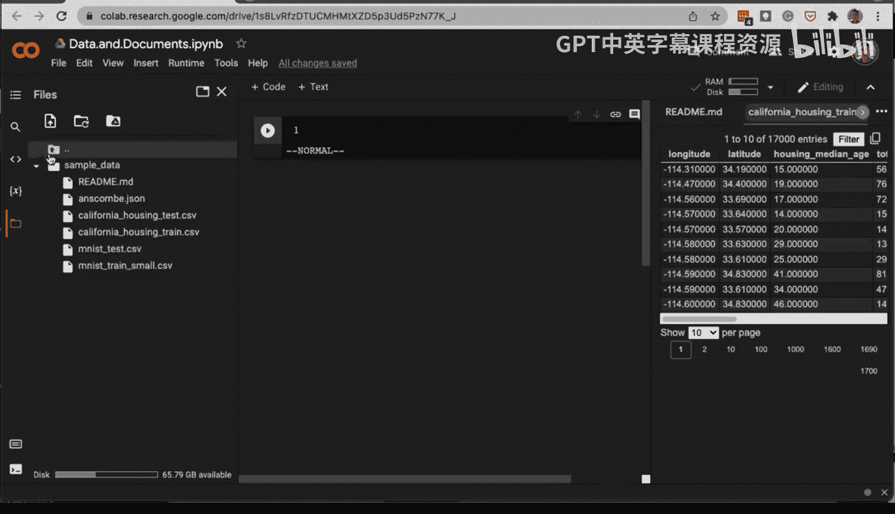

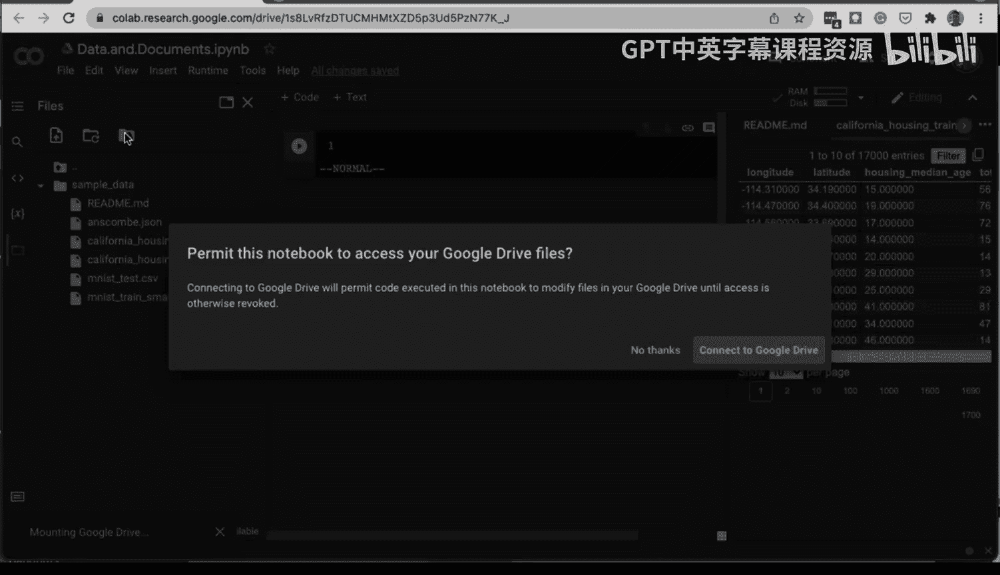

上一节我们介绍了Colab的基本界面，本节中我们来看看其左侧的文件管理功能。

在左侧标签页中，有一个“文件”区域。该区域预加载了Google提供的一些示例数据，供用户试用。

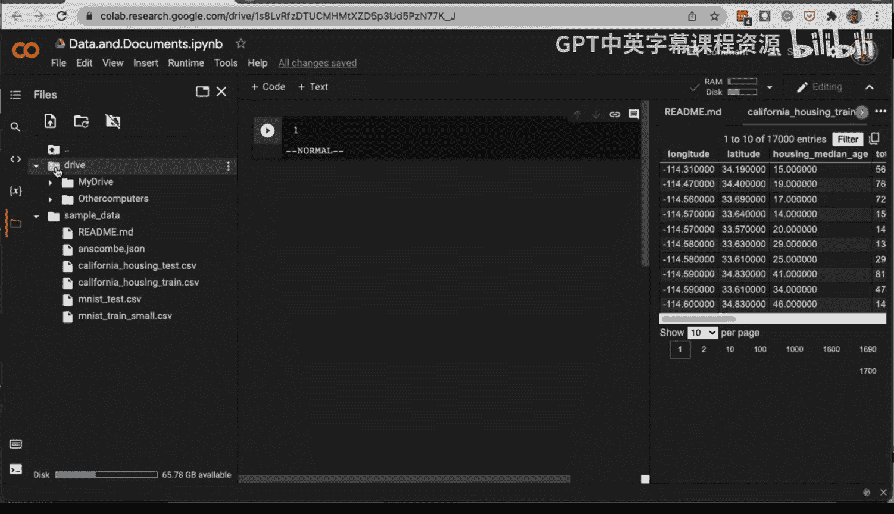

例如，双击“README.md”文件，右侧窗格会打开并预览该文件内容。这允许我们阅读描述示例数据的说明文档。同样，打开任何一个示例文件，它也会在右侧显示预览。

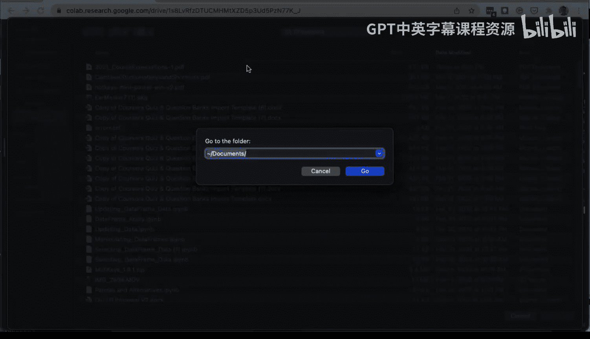

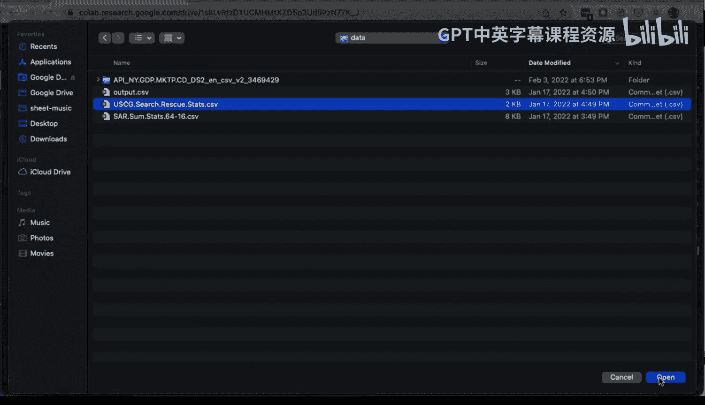

## 导入外部数据

除了系统提供的示例数据，我们还有其他方式可以将数据导入到Colab文档中。

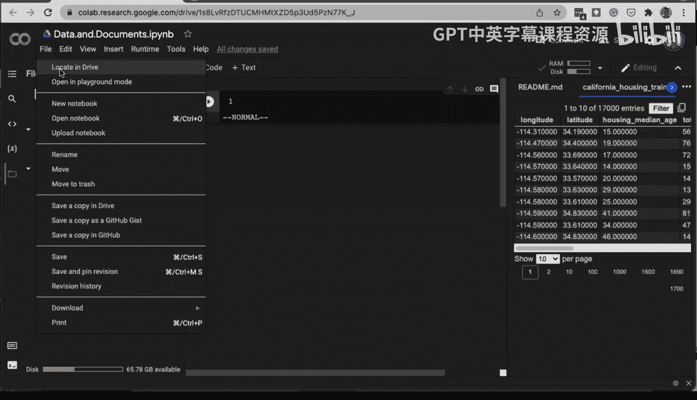

以下是几种主要的数据导入方式：

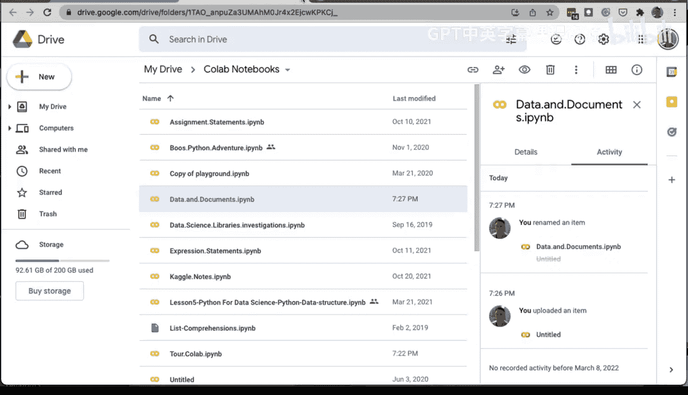

*   **挂载Google Drive**：点击“Mount Drive”按钮，可以将你的Google Drive连接到Colab。连接完成后，你便可以访问Drive中的所有文件，并拥有将输出文件写入Drive的权限。
*   **上传本地文件**：你可以从个人电脑硬盘上传单个文件。例如，上传一个CSV文件后，它会出现在文件列表中，从而允许我们在代码中访问它。需要注意的是，**在不同会话之间，上传的文件不会被保留**。如果你想再次使用，必须重新上传。
*   **文件保存位置**：默认情况下，Google Colab文档会自动保存在Google Drive中。你可以在Drive中找到一个由Colab自动创建的“Colab Notebooks”目录，你的笔记本文件就保存在那里。

## 笔记本的版本管理与共享

除了将笔记本保存在Google Drive，我们还有其他管理选项。

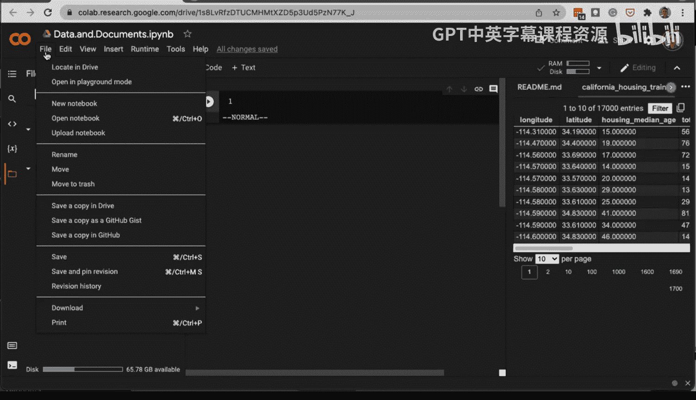

以下是可用的操作：

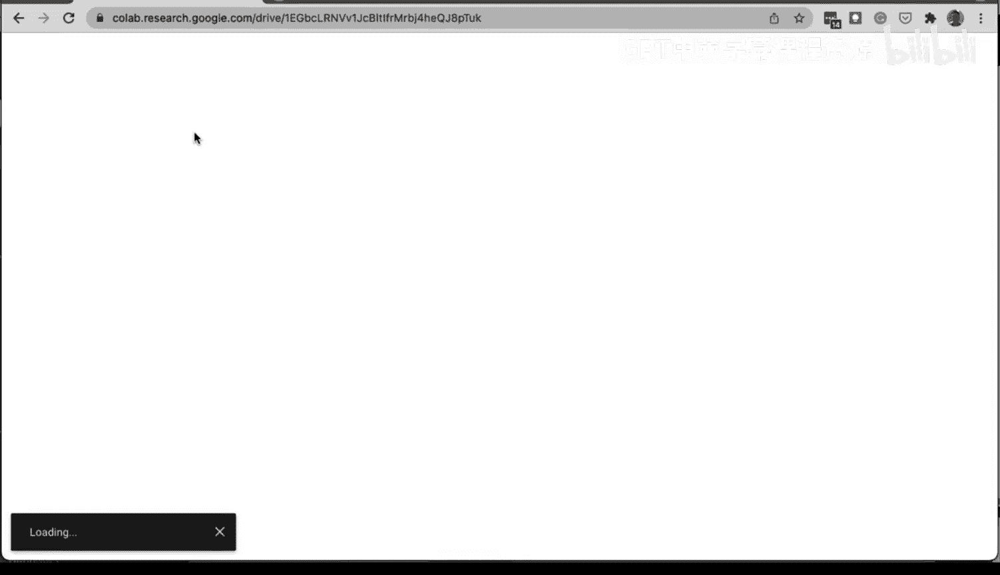

*   **保存到GitHub**：可以将笔记本的副本保存到GitHub，进行版本控制。
*   **下载副本**：可以将笔记本下载为Jupyter Notebook文件（.ipynb），或下载为可在命令行执行的Python文件（.py）。
*   **版本历史**：文件会自动保存，但我们也可以随时手动保存并创建一个修订版本。之后可以查看修订历史，比较不同版本之间的更改。
*   **上传现有笔记本**：可以从本地磁盘上传一个在标准Jupyter环境中创建的笔记本文件，并将其导入到Google Colab的云端环境中。

---

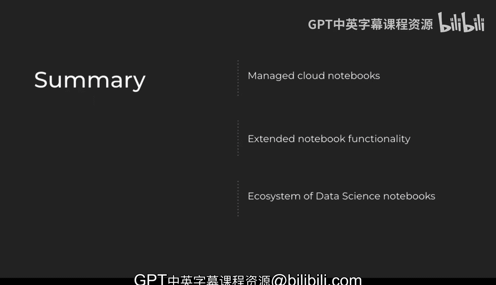

本节课中我们一起学习了Google Colab中的数据与文档管理。我们了解到Colab是一种托管的、基于云端的笔记本服务，它扩展了Jupyter Notebook的功能。通过其文件系统，我们可以方便地访问示例数据、个人云端存储和本地文件，并有效地管理笔记本的版本。Colab还拥有一个包含大量数据科学信息的笔记本生态系统，可供学习和研究特定主题。