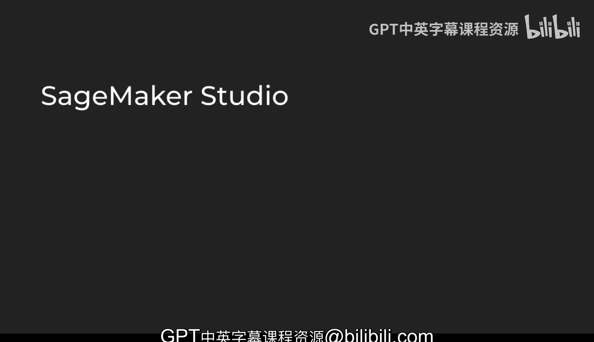
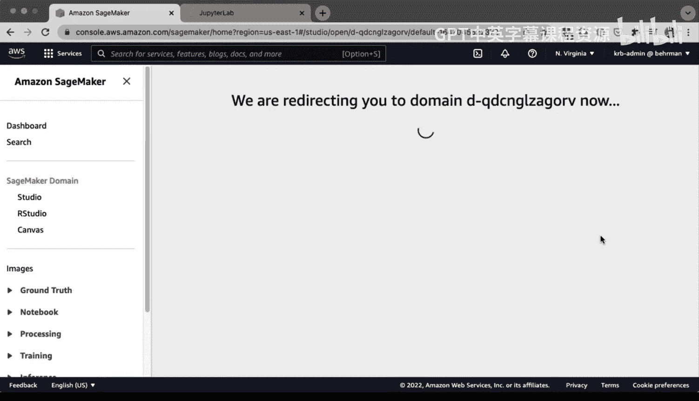
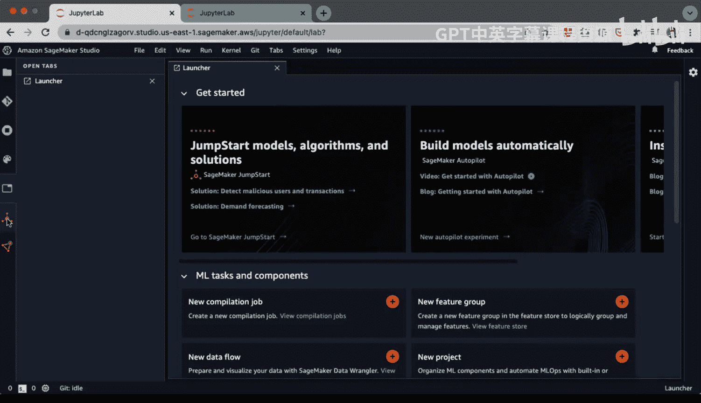
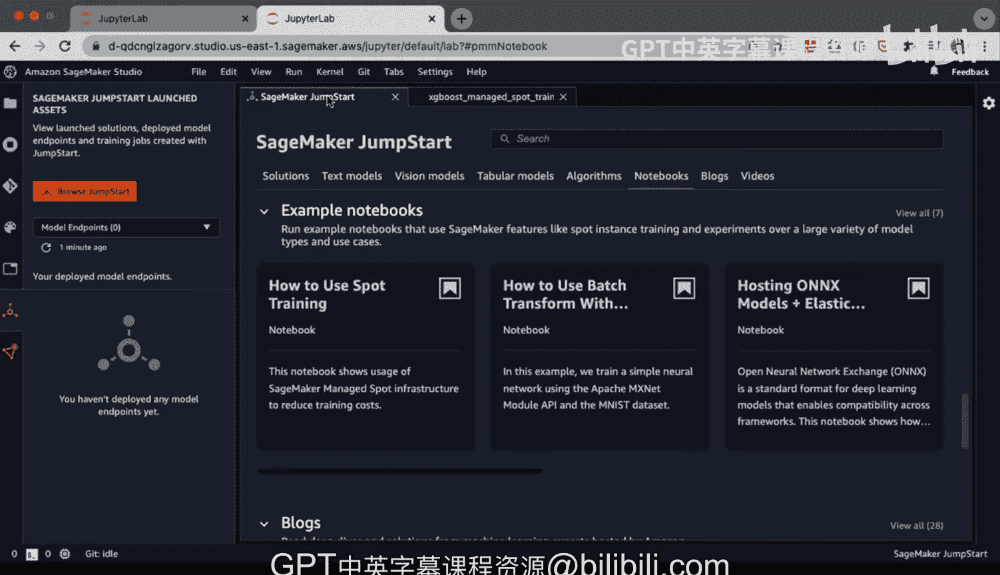

#  147：SageMaker Studio导览 🧭

在本节课中，我们将学习如何启动和导航Amazon SageMaker Studio。这是一个基于JupyterLab的云端集成开发环境，专为机器学习工作流设计，并集成了许多AWS的特定功能。

## 启动SageMaker Studio

要启动SageMaker Studio，我们需要回到SageMaker控制台中的“域”页面。在那里，我们可以找到并点击“启动Studio”的选项。

当你的Amazon SageMaker Studio实例创建完成后，你将看到一个类似下图的界面。

## 界面概览

这个界面看起来应该很熟悉。它非常像JupyterLab。实际上，它就是在JupyterLab的基础上，通过一些扩展添加了新功能和能力。

如果我们观察左侧，会看到一些在JupyterLab中见过的熟悉控件，例如文件浏览器。

## 核心功能面板

以下是SageMaker Studio左侧面板的主要功能区域：

*   **文件浏览器**：用于浏览和管理项目文件。
*   **Git仓库**：如果我们将域连接到了Git仓库，可以在这里与仓库进行交互。
*   **运行中的应用/内核**：可以在这里查看任何正在运行的应用程序、实例和内核会话。在SageMaker Studio中，我们可以同时运行多个笔记本和多个内核。
*   **命令面板**：这里提供了一个有用的界面，用于查找在SageMaker Studio中可用的命令。其中很多命令与我们之前见过的相同，但这个面板让查找变得更容易。

## 启动器与资源

当前我们正在查看的是“启动器”页面。它提供了创建新笔记本、终端、控制台等资源的快捷入口。

启动器旁边是SageMaker JumpStart的接口。此外，这里还列出了其他SageMaker资源。

## 探索SageMaker JumpStart

现在，让我们来看看SageMaker JumpStart。JumpStart包含了一系列示例模型、笔记本、视频和博客，能让你快速上手。

在这里，我们可以浏览这些模型。我们可以选择一个模型，查看如何部署它，并了解如何训练它。每个模型都附有描述，帮助我们理解其功能。这是一个快速入门的便捷功能。

例如，我们可以打开一个笔记本。如果我们想使用这个笔记本，可以将其导入到我们的工作区，以便进行修改。这个笔记本将教会我们如何使用XGBoost，这是一个在机器学习中常用的模型。

## 总结

本节课中，我们一起学习了SageMaker Studio的基本界面和核心功能。除了上述这些新增功能，你完全可以将SageMaker Studio视为运行在AWS托管云端的、功能增强版的JupyterLab。它集成了模型开发、训练和部署的工具，为数据科学和机器学习工程提供了完整的工作环境。