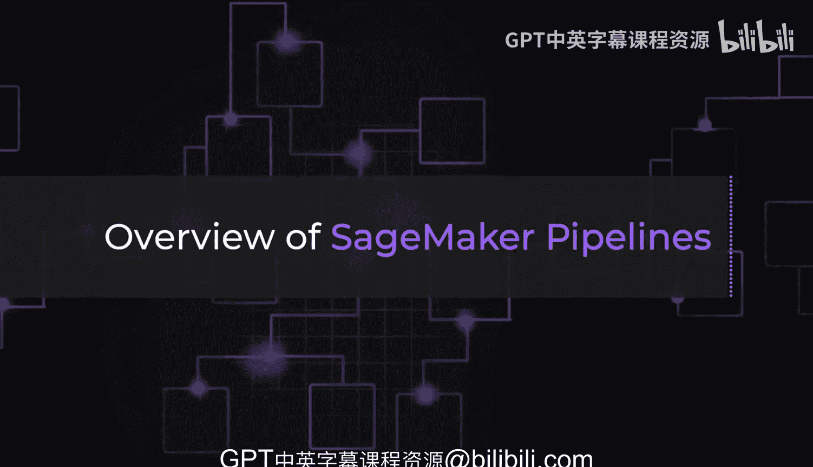
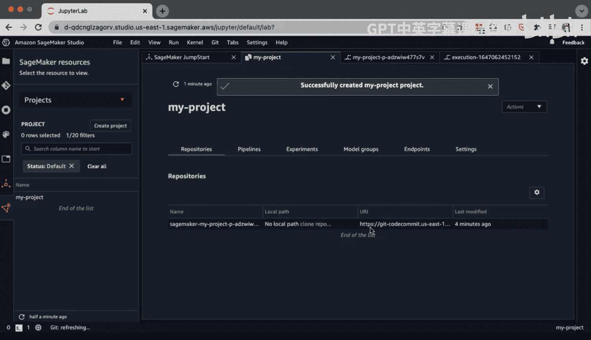
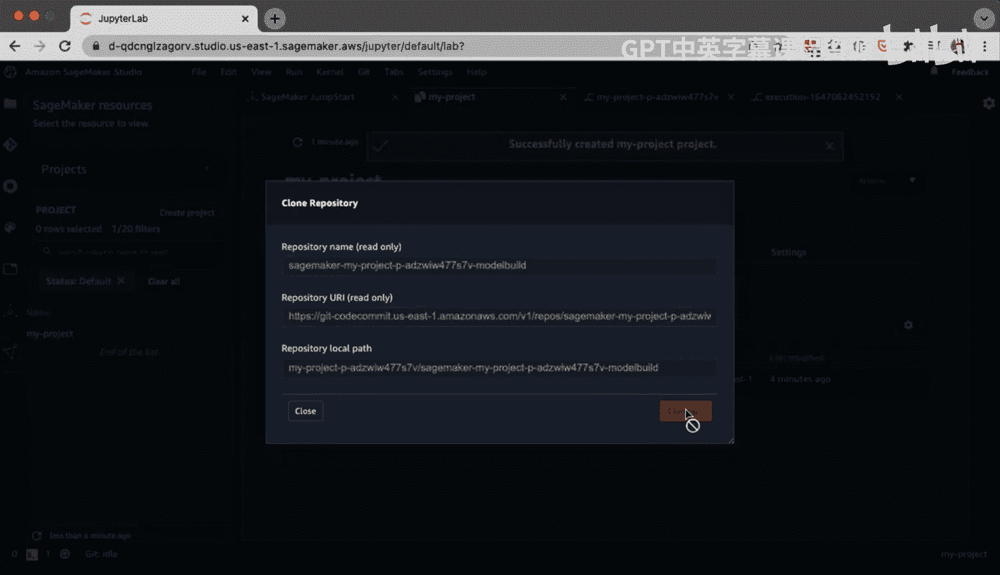
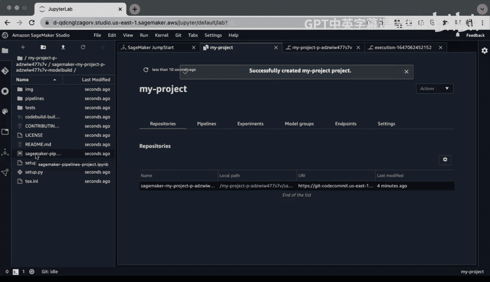
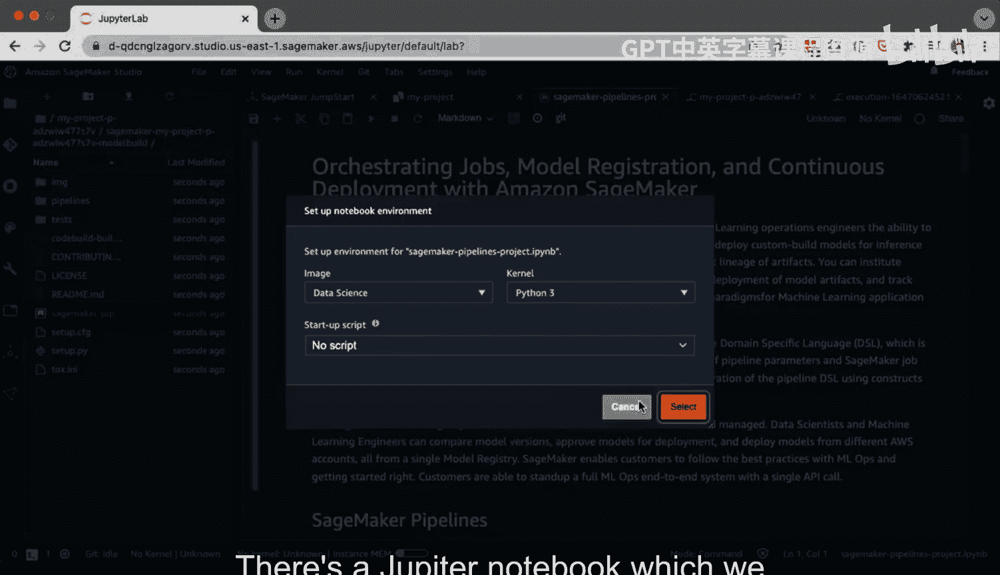
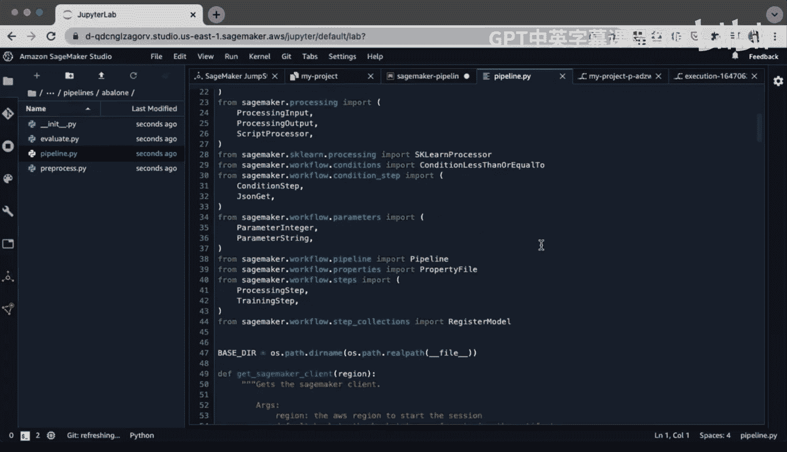
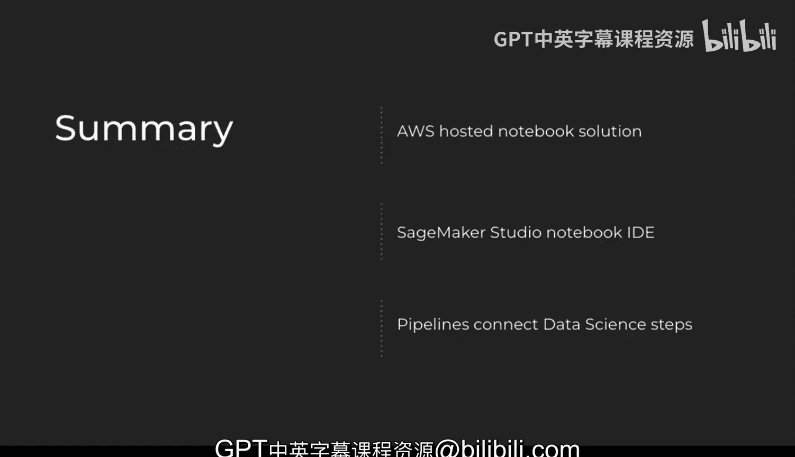

#  148：SageMaker Pipelines概览 🚀

在本节课中，我们将学习AWS SageMaker Pipelines的基本概念和工作流程。我们将了解如何在SageMaker Studio中创建项目、定义管道，以及如何通过管道将数据科学操作步骤连接起来，形成一个可重复、可部署的自动化流程。

---

现在，让我们来看看SageMaker Pipelines。我们回到了SageMaker Studio环境中。要使用管道，我们需要先创建一个项目。SageMaker Studio提供了模板项目，可以作为许多常见场景的基础。

我们将选择一个用于构建和训练机器学习模型的项目。为项目指定一个名称。项目创建需要几分钟时间。

现在，我们的项目已经创建完成。这是我们项目的管道。我们可以检查管道是否正在执行，这在创建新管道时会自动进行。

在这里，我们可以看到管道的图形化表示，其中包含了管道中定义的所有步骤。这些步骤以节点的形式呈现在图中。我们可以点击一个节点，获取关于该节点的信息，包括发送给节点的输入、节点产生的任何输出，以及节点可能产生的日志。

如果我们返回，可以在这里看到代码仓库，其中存放着定义此项目的代码。我们可以复制这份代码，以便查看并为我们自己的项目进行修改。

以下是此项目中的代码和文件。有一个Jupyter笔记本，我们可以打开它。笔记本中解释了项目的功能，并提供了关于SageMaker Pipelines的信息。

如果我们进入`pipelines`目录，管道本身定义在这个文件中。可以看到，它是使用Python定义的。每个步骤都有自己的类，并在这里进行定义。

这就是SageMaker Pipelines如何为您提供一种方式，将数据科学操作封装成可重复、适合生产代码的可部署形式。

---

## 总结 📝

本节课中，我们一起学习了SageMaker Notebooks，这是AWS托管的Notebook解决方案。我们了解了SageMaker Studio，它本质上是一个用于创建和管理Notebook的集成开发环境。我们还引入了SageMaker Pipelines的概念，它能够连接数据科学解决方案中的不同步骤。