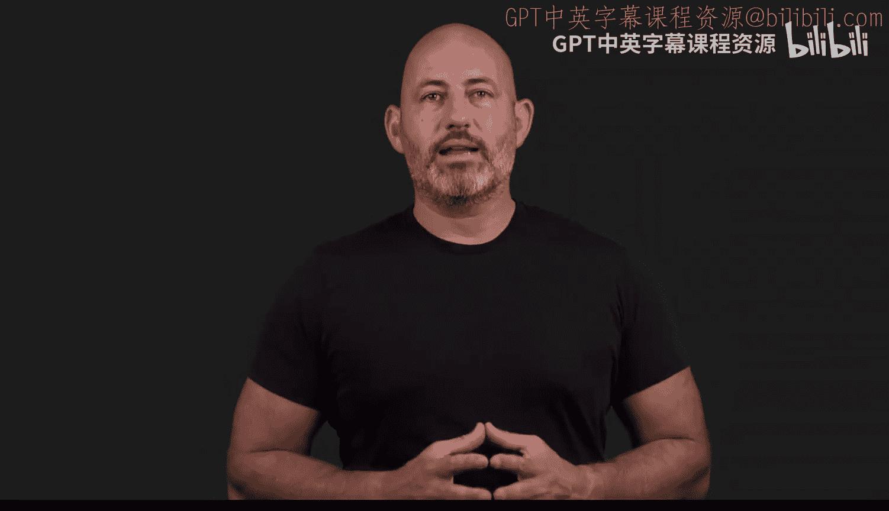

#  149：Python微服务构建导论 🚀

在本节课中，我们将学习如何使用Python构建HTTP API微服务。我们将涵盖如何打包Python项目、将其部署为API，以及如何应用持续集成/持续交付和DevOps最佳实践来构建健壮的Web服务。

---

## 项目打包与API构建 📦

上一节我们介绍了微服务的基本概念，本节中我们来看看如何将Python项目打包并构建成API。

我们将学习如何将Python项目打包，并将其部署为一个API。


以下是构建API的关键步骤：

1.  使用`setuptools`或`poetry`等工具定义项目依赖和元数据。
2.  创建`setup.py`或`pyproject.toml`文件来管理项目配置。
3.  使用Web框架（如Flask或FastAPI）编写API端点。
4.  将业务逻辑封装在独立的模块中，并通过API暴露功能。

例如，一个简单的Flask API结构如下：

```python
# app.py
from flask import Flask, jsonify

app = Flask(__name__)

@app.route('/api/data', methods=['GET'])
def get_data():
    # 业务逻辑
    data = {"message": "Hello from the API!"}
    return jsonify(data)

if __name__ == '__main__':
    app.run(debug=True)
```

---

## 应用CI/CD与DevOps最佳实践 ⚙️

在将项目打包为API后，我们需要确保其能够可靠地构建、测试和部署。本节我们将探讨如何应用持续集成和持续交付。

我们将应用持续集成和持续交付，并使用DevOps实践来构建Web服务的最佳实践。

以下是实施CI/CD的关键环节：

1.  在代码仓库中设置自动化构建和测试流程。
2.  配置CI服务器（如Jenkins、GitHub Actions）在每次代码提交时运行测试。
3.  使用Docker等容器化技术确保环境一致性。
4.  设置自动化部署流水线，将通过测试的代码部署到生产或预生产环境。

一个基础的GitHub Actions工作流配置示例如下：

```yaml
# .github/workflows/ci.yml
name: Python CI

on: [push]

jobs:
  build:
    runs-on: ubuntu-latest
    steps:
    - uses: actions/checkout@v2
    - name: Set up Python
      uses: actions/setup-python@v2
      with:
        python-version: '3.9'
    - name: Install dependencies
      run: |
        pip install -r requirements.txt
    - name: Run tests
      run: |
        python -m pytest
```



---

## 总结 📝

本节课中我们一起学习了Python微服务构建的核心内容。我们首先了解了如何将Python项目打包并构建成HTTP API。接着，我们探讨了如何通过应用持续集成、持续交付和DevOps最佳实践，来确保Web服务的质量、可靠性和高效部署。掌握这些技能是构建现代化、可维护数据工程应用的基础。