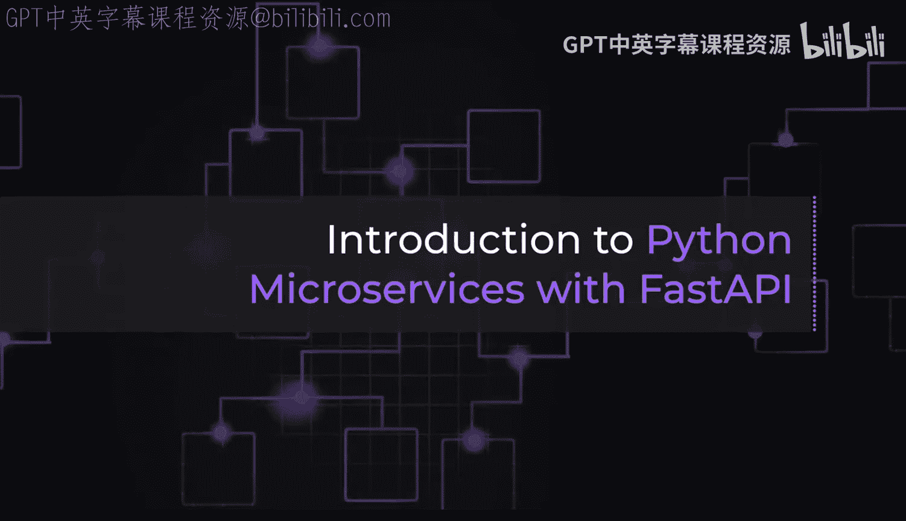

Python微服务基础：2-4：Python微服务导论与最佳实践

在本节课中，我们将学习构建Python微服务的最佳实践，探讨Python为何是快速构建和部署微服务的优秀语言，并介绍FastAPI、Flask以及AWS Lambda等现代框架。



---

### 为什么选择Python构建微服务？

Python因其简洁的语法和丰富的生态系统，成为快速构建微服务的理想选择。开发者可以快速将业务逻辑映射到服务框架（如FastAPI或Flask），并高效地投入生产环境。

### 微服务架构的核心优势

微服务架构将应用程序拆分为一组小型、独立的服务。每个服务运行在自己的进程中，并通过轻量级机制（通常是HTTP API）进行通信。这种架构的主要优势包括：
*   **独立部署**：每个服务可以独立更新和部署。
*   **技术异构性**：不同服务可以使用不同的技术栈。
*   **可扩展性**：可以针对特定服务进行扩展。

### 构建Python微服务的最佳实践

以下是构建健壮、可维护的Python微服务的一些关键实践：

1.  **单一职责原则**：每个微服务应专注于一个特定的业务功能或领域。
2.  **定义清晰的API**：服务间通过定义良好的API（如RESTful API或gRPC）进行通信。
3.  **实现弹性设计**：服务应能处理上游服务的故障，例如通过实现重试机制和断路器模式。
4.  **集中化配置管理**：使用配置服务器或环境变量来管理不同环境的配置。
5.  **全面的日志记录与监控**：集中收集日志和指标，以便于调试和性能监控。

### 现代Python微服务框架

上一节我们介绍了最佳实践，本节中我们来看看实现这些实践的具体工具。Python社区提供了多个优秀的框架来简化微服务的开发。

*   **FastAPI**：一个现代、快速（高性能）的Web框架，用于基于标准Python类型提示构建API。它自动生成交互式API文档。
    ```python
    from fastapi import FastAPI
    app = FastAPI()
    @app.get("/")
    def read_root():
        return {"Hello": "World"}
    ```
*   **Flask**：一个轻量级的WSGI Web应用框架，以其简单性和灵活性著称，适合构建小型到中型的微服务。
*   **AWS Lambda（无服务器计算）**：这是一种事件驱动的计算服务，让你无需预置或管理服务器即可运行代码。你可以将业务逻辑封装为函数，由特定事件（如HTTP请求、文件上传）触发执行，是实现微服务架构的另一种高效范式。

---

### 总结


本节课中我们一起学习了使用Python构建微服务的核心概念。我们了解了Python在此领域的优势，探讨了微服务架构的最佳实践，并介绍了FastAPI、Flask和AWS Lambda等关键框架与平台。掌握这些知识，你将能够开始设计和实现自己的高效、可扩展的Python微服务。