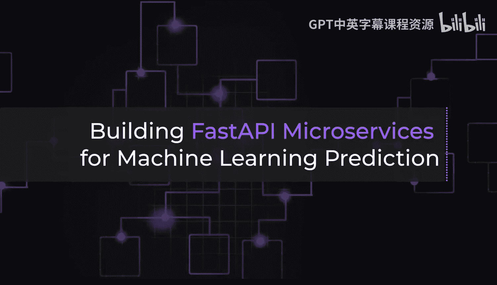
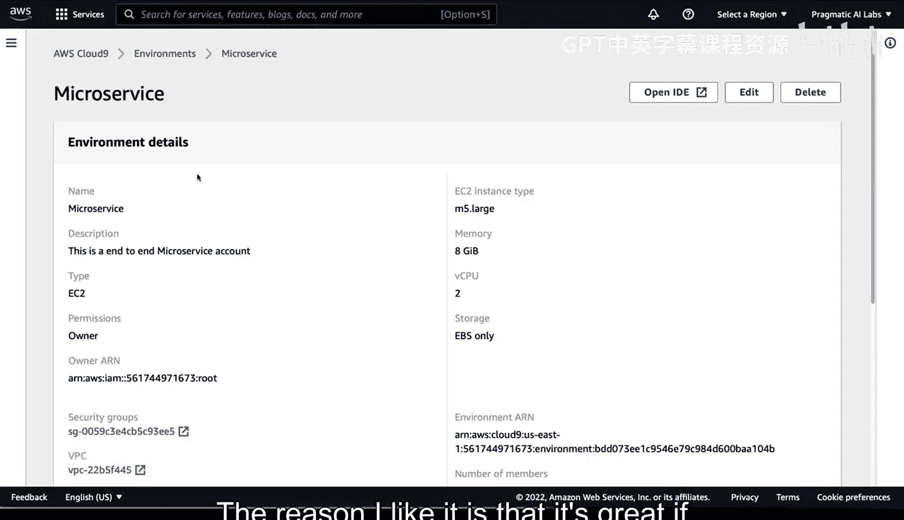
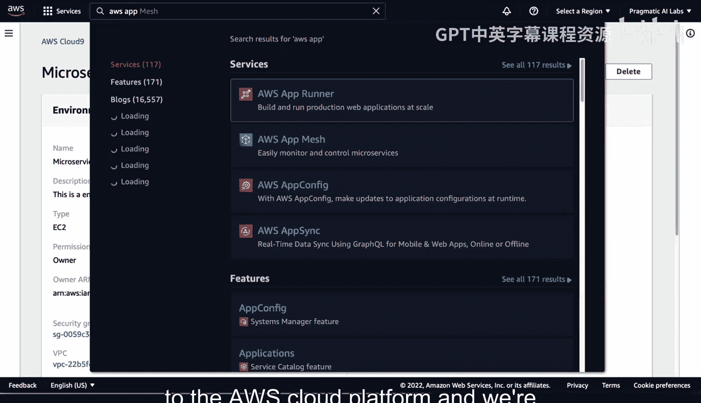
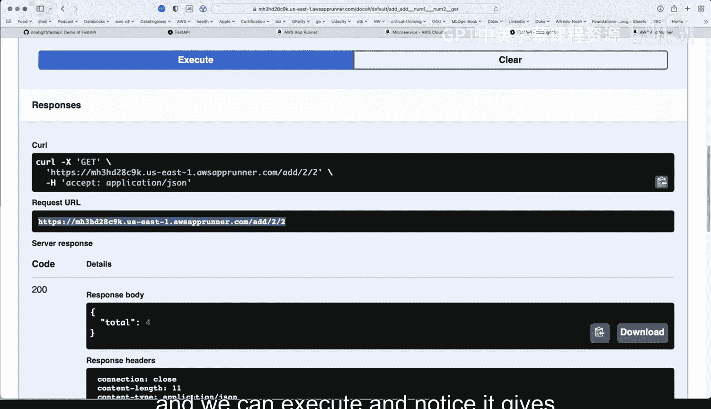
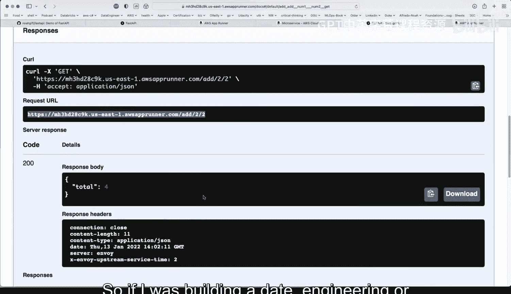
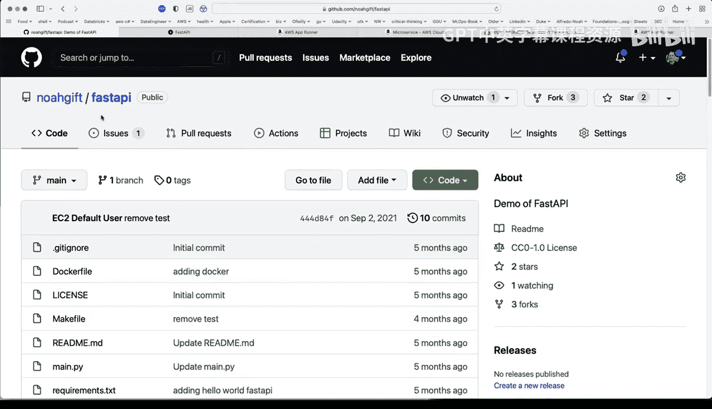

#  154：构建用于机器学习预测的FastAPI微服务 🚀



在本节课中，我们将学习如何使用FastAPI框架构建一个简单的微服务，并将其部署到AWS App Runner云平台上。整个过程将涵盖从本地开发环境设置到云端部署的完整流程。

---

## 项目与环境准备

首先，我们有一个名为“NOAA Gi fast API”的代码仓库，它基于FastAPI框架。FastAPI是一个流行的Python Web框架，它支持类型注解、集成了Swagger API文档，并且使用简单。以下是它的一些关键特性。

接下来，我将使用AWS Cloud9作为开发环境。选择它的原因是，如果计划将微服务部署到AWS云平台，它会非常方便。我们最终将使用AWS App Runner进行部署，这是一个新兴的、优秀的AWS微服务部署托管服务。





关于App Runner，可以看到我这里已经运行了多个应用程序。现在，让我们开始搭建环境。

我的Cloud9环境已经设置好，并且创建了一个Python虚拟环境。我喜欢为项目建立一个脚手架结构。让我们看一下这个Makefile，我设置了`install`、`test`、`format`和`lint`等命令。我认为这是一个很好的实践。

此外，我还使用了GitHub Actions来自动测试代码，这被称为持续集成。我强烈建议你也这样做。你可以在“NoAgift fast API”仓库中查看具体配置。

---

## 编写并运行微服务

下一步，我将运行这个微服务。首先，让我们查看一下代码。

```python
from fastapi import FastAPI

app = FastAPI()

@app.get("/")
def hello_world():
    return {"message": "hello Duke"}

@app.get("/add")
def add_numbers(a: int, b: int):
    total = a + b
    return {"total": total}
```

代码解析如下：
*   从`fastapi`导入`FastAPI`。
*   定义了一个根路由`/`，返回“hello Duke”信息。
*   定义了一个`/add`路由，它接收两个整数参数`a`和`b`，并返回它们的和。
*   服务将运行在外部接口的8080端口上。

运行这个服务非常简单。进入微服务目录后，只需执行命令`python main.py`。现在服务已经运行起来了。

在基于终端的环境中，一个很实用的技巧是，我可以打开一个新的终端窗口，然后使用`curl`命令测试服务。例如，测试根路由：

```bash
curl http://localhost:8080/
```

返回结果正常。接着测试`/add`端点：

```bash
curl “http://localhost:8080/add?a=2&b=2”
```

可以看到加法功能也正常工作。

---

## 部署到AWS App Runner

现在服务已在本地运行，接下来我们将其部署到AWS App Runner环境。这个过程非常直接。

首先，在AWS控制台创建App Runner服务，选择“源代码仓库”作为部署源。然后，选择我们的“NOAA giftft Fast API”仓库。

加载仓库后，有几个配置选项。有“自动部署”选项，这对应着持续交付的理念，即代码会自动推送到生产或原型环境。目前，为了演示清晰，我选择“手动”部署。

运行时选择Python 3。启动命令设置为`python install -r requirements.txt`，以安装依赖包。然后运行命令设置为`python main.py`，这与我们在Cloud9环境中做的完全一样。

接着，为服务命名，例如“microservice-2”。最后，点击“创建并部署”即可。

部署过程大约需要五分钟。我之前已经部署过一个服务，现在可以访问它的默认域名（一个完全加密的URL）。FastAPI的一个优点是内置了Swagger文档。访问`/docs`路径，就可以看到一个交互式API文档界面。

在文档界面中，可以点击“Try it out”来测试`/add`端点，例如输入2和2，然后执行。它会显示对应的curl命令、请求URL和响应详情等信息，这对于构建数据工程或机器学习API非常有用。同样，也可以直接测试根路由`/`。

---





## 总结



本节课我们一起学习了如何构建一个基础的FastAPI微服务，包括编写API端点、在本地运行测试，以及最终将其部署到AWS App Runner云平台。整个过程展示了从开发到部署的现代微服务工作流。