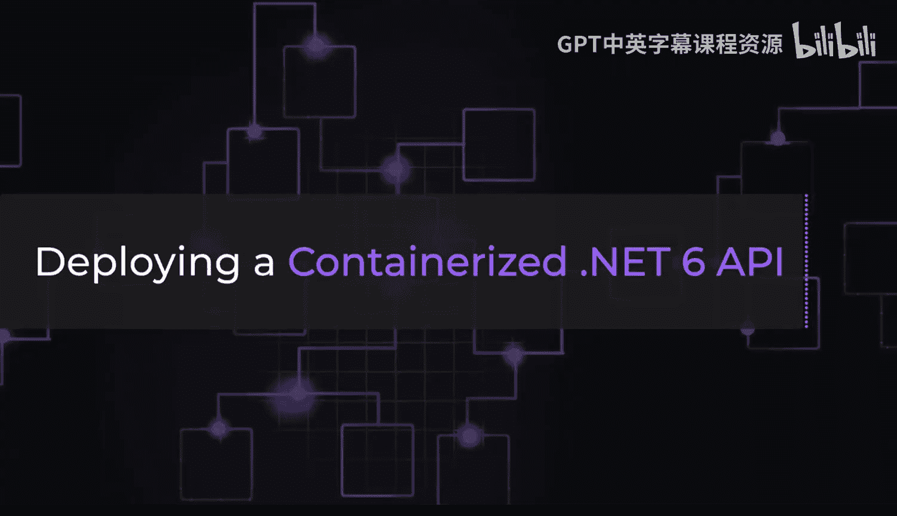
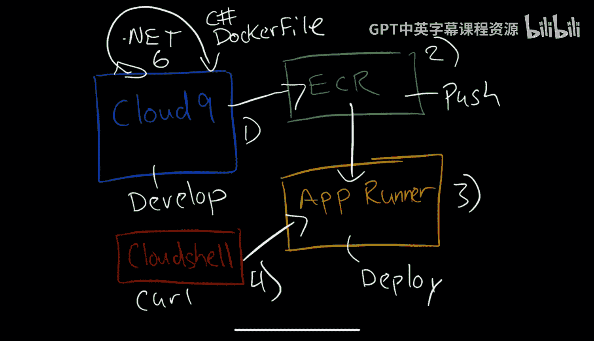
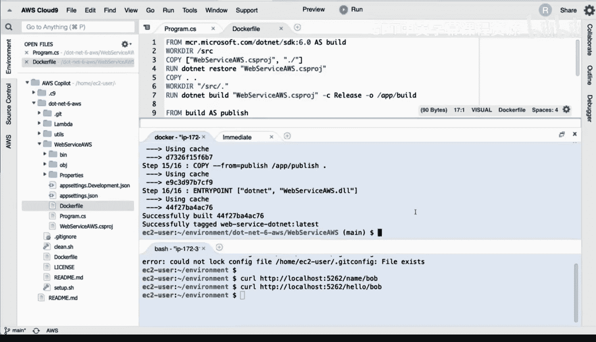
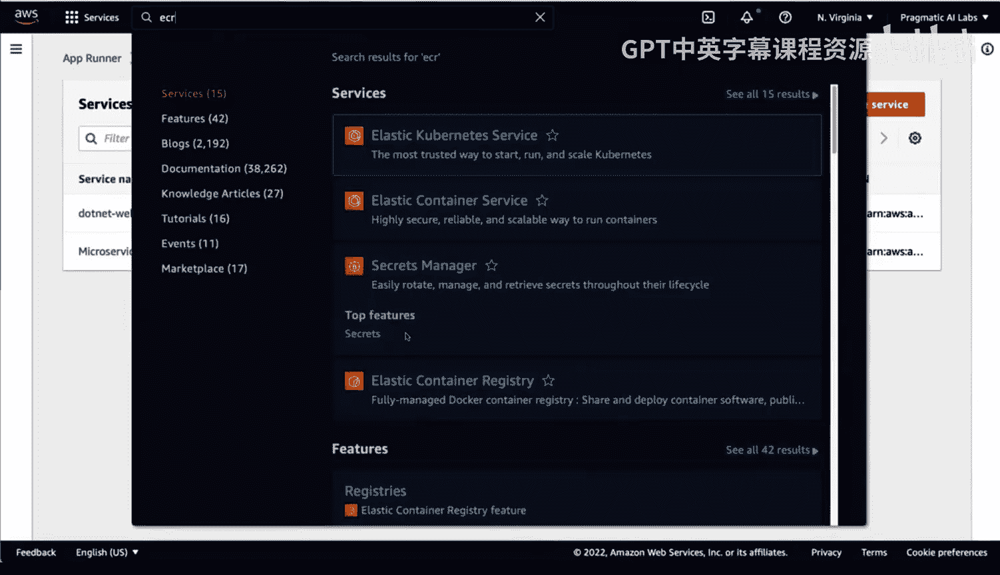
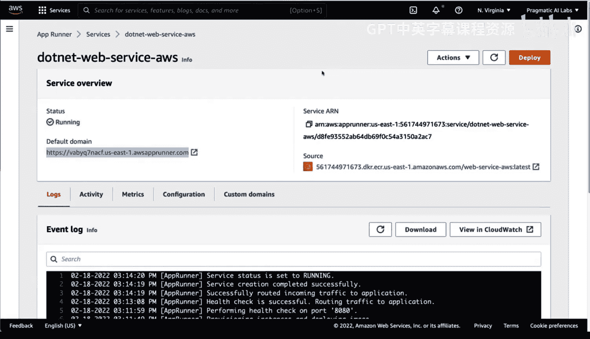
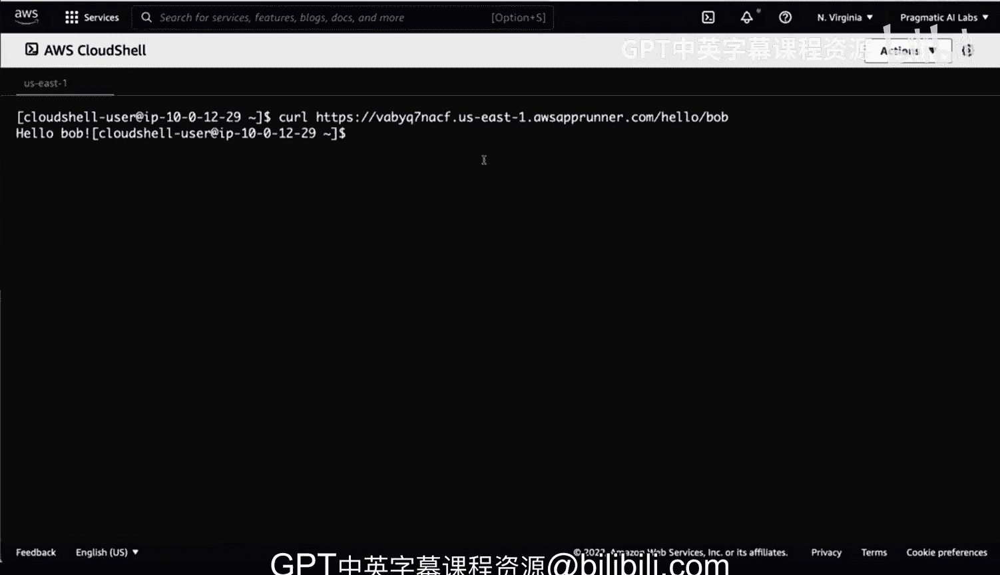

#  158：部署容器化.NET 6 API

在本节课中，我们将学习如何为C#开发者构建一个完全云原生的、基于容器的工作流，并部署一个微服务。我们将使用AWS的一系列服务，从开发到部署，全程在云端完成。

我们将启动AWS Cloud9，构建一个包含.NET 6 Web服务的Docker容器，将其推送到Amazon Elastic Container Registry (ECR)，然后通过AWS App Runner将其部署为微服务并进行测试。整个过程可以在几分钟内完成。

## 🚀 云原生容器化工作流概述

上一节我们介绍了课程目标，本节中我们来看看实现这一目标的完整工作流架构。

如果你观察上图所示的四个服务：AWS Cloud9、Amazon ECR、AWS App Runner和CloudShell，你就拥有了一个纯粹的云端开发环境。

这意味着你无需接触任何本地重型开发环境。即使你只有一台性能很弱的设备，比如一台Chromebook，通过Cloud9，你也能在一个与最终部署环境高度相似的、隔离的环境中进行开发。由于Cloud9与ECR之间有高速网络连接，一旦你将.NET应用容器化并推送到ECR，就基本准备就绪了。

当镜像存在于ECR后，你可以将其连接到生产部署流程。App Runner允许你自动部署推送到ECR的新镜像。部署完成后，服务将通过HTTPS完全加密。你可以打开CloudShell，通过curl命令调用并测试它。这代表了.NET和C#开发的下一代工作方式，是值得你掌握的工具。

## 🛠️ 准备开发环境与代码

上一节我们了解了工作流，本节中我们来看看具体的代码仓库和环境设置。

让我们看一下这个代码仓库：`Noagift/donet-6-AWs`。在Cloud9中启动后，你需要安装一些.NET 6的包，之后就可以开始部署了。

首先，我已经设置好了一个Cloud9环境。我建议你设置一个性能较强的实例。需要指出的是，安装好.NET后，我可以运行`dotnet`命令。这里有一个非常简单的程序，它接受一个URL参数`/hello?name=`，并替换字符串输出。我可以直接运行它。

如果你想将其作为容器化应用运行，这也很简单，因为环境已经设置好了。当然，我们也可以先将其作为常规的.NET应用运行。

以下是运行常规应用的步骤：

1.  在项目目录下，运行命令：`dotnet run`。
2.  程序启动后，控制台会显示服务监听的URL（例如 `http://localhost:5000`）。
3.  打开另一个终端，使用`curl`命令测试：`curl “http://localhost:5000/hello?name=Bob”`。

你应该能看到返回结果：`Hello Bob`。这表明应用程序正在正常工作。

## 🐳 构建与运行Docker容器

上一节我们成功运行了常规应用，本节中我们来看看如何将其容器化。

如果我想运行容器化版本，同样相当简单。我只需要查看这个Dockerfile。这个Dockerfile基于.NET 6 SDK构建。它查看`CSproj`文件，进行构建，并设置一个发布版本，暴露端口8080。`WebService.dll`会在容器化应用中被暴露。

这个环境的优点在于构建非常直接。实际上，我可以在本地直接使用Docker命令构建。

以下是构建和运行Docker镜像的步骤：

1.  确保你在包含`Dockerfile`的项目目录中。
2.  运行构建命令，为镜像打上标签：`docker build -t web-service:latest .`
3.  构建完成后，运行容器：`docker run -p 8080:8080 web-service:latest`

现在，我们可以使用相同的`curl`命令进行测试，但端口改为8080：`curl “http://localhost:8080/hello?name=Bob”`。你将再次看到`Hello Bob`，证明容器化应用运行成功。

## 📦 推送镜像到Amazon ECR

上一节我们完成了本地容器化，本节中我们将把镜像推送到云端仓库以便部署。

接下来，我们可以将镜像推送到ECR环境。ECR代表Elastic Container Registry。

操作步骤如下：

1.  在AWS控制台进入ECR服务。
2.  创建一个新的存储库（Repository），例如命名为`test`。
3.  创建完成后，点击存储库，选择“查看推送命令”。
4.  系统会给出完整的推送步骤，包括认证、打标签和推送。

由于我已经认证过，我可以直接复制最后的推送命令并执行：`docker push <你的账户ID>.dkr.ecr.<区域>.amazonaws.com/web-service:latest`。

推送速度会非常快，因为我们在同一网络内。镜像进入ECR后，你可以与团队共享，或使用ECS、App Runner等服务进行部署。接下来我们将使用App Runner。

## ⚡ 使用AWS App Runner部署服务

上一节我们将镜像推送到了ECR，本节中我们使用App Runner来部署它。

在App Runner中设置一个新的.NET服务非常简单。

部署步骤如下：

1.  在App Runner控制台点击“创建服务”。
2.  选择“容器注册表”作为源，并选择“Amazon ECR”。
3.  浏览并选择你刚刚推送的容器镜像（例如 `web-service`）。
4.  在配置页面，可以设置服务名称（如 `deploy-dotnet`），并启用“自动部署”。这意味着当ECR中有新镜像被推送时，App Runner会自动部署新版本。
5.  点击“创建并部署”。

部署是微不足道的。App Runner集成了软件开发的最佳实践，如日志、活动指标和配置管理。部署完成后，服务会获得一个可访问的URL。

## ✅ 通过CloudShell测试部署的服务

上一节我们完成了服务部署，本节中我们进行最终测试。

现在，我可以访问这个URL。我将利用另一个云服务——CloudShell来进行测试。

测试步骤如下：

1.  在AWS控制台打开CloudShell。
2.  在CloudShell中，运行curl命令测试我们部署的服务：`curl “https://<你的App-Runner-URL>/hello?name=Bob”`

你将再次看到返回的`Hello Bob`。这表明服务正在云端正常运行。

## 📝 课程总结

本节课中，我们一起学习了如何利用Cloud9、ECR、App Runner和CloudShell这一系列云原生服务，为C#/.NET开发者构建一个完整的端到端开发与部署工作流。

我们实现了从代码编写、本地容器化测试、镜像推送、云端自动化部署到最终测试的完整流程，全程无需中断，且能获得极快的性能。对于.NET开发者来说，尝试这套工作流是很有价值的。