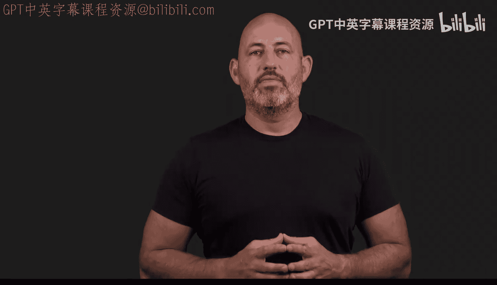
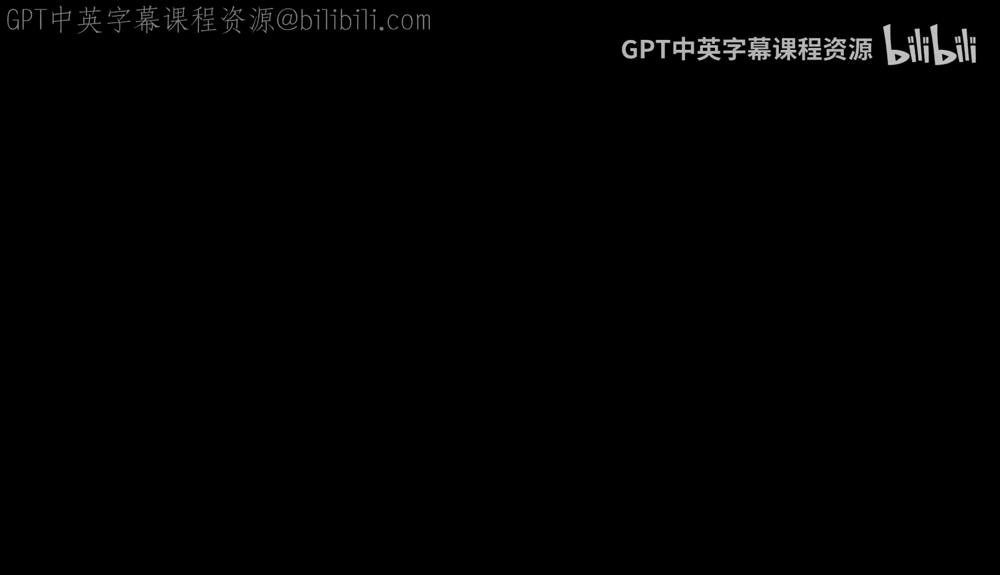

#  160：Python打包与命令行工具导论

在本节课中，我们将学习一个非常流行的命令行工具框架——`click`。我们将首先了解`click`的一些高级功能，然后深入探讨如何使用`click`进行测试。最后，我们也会介绍`click`的入门技巧，这些技巧可以帮助你从一个简单的函数开始构建命令行工具。

## 什么是Click？

`click`是一个Python包，用于以可组合的方式创建美观的命令行界面。它的设计目标是让编写命令行工具的过程变得快速而有趣，同时又能确保工具具有一致性且功能完备。

## Click的核心概念


`click`的核心是使用装饰器来将普通Python函数转换为命令行接口。最基本的元素是命令和参数。

*   **命令**：通过`@click.command()`装饰器定义，它标记一个函数作为命令行命令的入口点。
*   **参数**：通过`@click.argument()`或`@click.option()`装饰器定义，用于从命令行接收输入。

以下是一个简单的代码示例：

```python
import click

@click.command()
@click.option('--count', default=1, help='Number of greetings.')
@click.option('--name', prompt='Your name', help='The person to greet.')
def hello(count, name):
    """Simple program that greets NAME for a total of COUNT times."""
    for _ in range(count):
        click.echo(f"Hello, {name}!")

if __name__ == '__main__':
    hello()
```

## Click的高级功能

上一节我们介绍了`click`的基本用法，本节中我们来看看它的一些高级功能，这些功能能让你的命令行工具更加强大和用户友好。

以下是`click`提供的一些高级特性：

1.  **参数类型**：`click`支持多种参数类型，如`click.INT`、`click.FLOAT`、`click.File`等，能自动验证和转换用户输入。
2.  **命令组**：使用`@click.group()`可以创建一组子命令，这对于组织复杂的工具非常有用。
3.  **上下文**：`click`提供了上下文对象（`ctx`），允许在不同命令和回调函数之间传递数据。
4.  **自定义帮助**：你可以轻松地自定义命令的帮助信息格式和内容。
5.  **Shell补全**：`click`支持为Bash、Zsh和Fish等shell生成自动补全脚本。

## 使用Click进行测试

为命令行工具编写测试是保证其可靠性的关键。`click`提供了`CliRunner`实用程序，可以方便地在隔离环境中调用和测试你的命令。

以下是使用`CliRunner`进行测试的基本步骤：

1.  从`click.testing`导入`CliRunner`。
2.  创建一个`CliRunner`实例。
3.  使用`runner.invoke()`方法调用你的命令，并传入参数。
4.  检查返回结果，如退出代码、输出内容或可能出现的异常。

```python
from click.testing import CliRunner
from your_module import hello

def test_hello():
    runner = CliRunner()
    result = runner.invoke(hello, ['--count', '3', '--name', 'World'])
    assert result.exit_code == 0
    assert 'Hello, World!' in result.output
    assert result.output.count('Hello, World!') == 3
```

## Click入门技巧

对于初学者，从简单开始往往是最好的方式。`click`允许你从一个没有任何参数的简单函数快速构建出可用的命令行工具。



你只需要做两件事：
1.  导入`click`。
2.  用`@click.command()`装饰你的函数。

这样，你的函数就变成了一个可以通过命令行直接调用的命令。随着需求的增加，你可以逐步添加选项（`@click.option`）和参数（`@click.argument`）来丰富其功能。



## 总结

本节课中我们一起学习了`click`框架。我们从其核心概念——使用装饰器定义命令和参数开始，然后探索了诸如参数类型、命令组等高级功能。我们还了解了如何使用`CliRunner`为`click`工具编写自动化测试。最后，我们回顾了从单个函数起步的简单入门方法。掌握`click`能帮助你高效地构建出既专业又易用的命令行工具，这对于数据工程中的任务自动化和脚本管理至关重要。