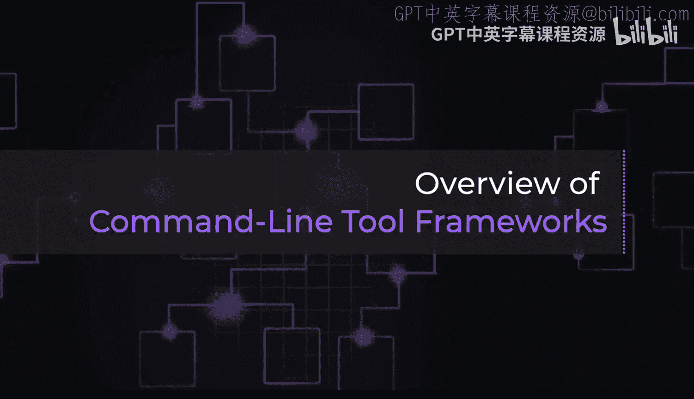
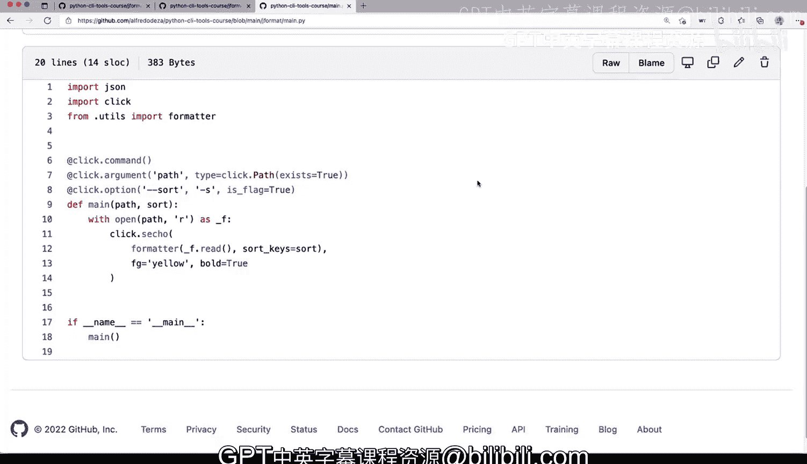

#  163：Python命令行工具框架概览 🛠️



在本节课中，我们将要学习使用Python构建命令行工具的几种不同方法。我们将从最基础的方式开始，逐步介绍更高级、功能更完善的框架，帮助你理解如何选择适合自己项目的工具。

## 概述

命令行工具是数据工程师日常工作中不可或缺的一部分。Python提供了多种方式来创建这些工具，从直接使用内置模块到借助功能强大的第三方库。本节我们将对比三种主要方法：直接使用 `sys` 模块、使用Python标准库中的 `argparse`，以及使用第三方库 `click`。我们将分析每种方法的优缺点，并理解它们各自的适用场景。

## 命令行工具的三种构建方式

### 1. 使用 `sys` 模块（最基础的方法）

上一节我们介绍了命令行工具的基本概念，本节中我们首先来看看最基础、不依赖任何框架的构建方法：直接使用Python内置的 `sys` 模块。

这种方法的核心是手动解析通过 `sys.argv` 获取的命令行参数。`sys.argv` 是一个列表，其中包含了命令行输入的所有参数。

```python
import sys
import json

def main():
    # 手动检查参数数量
    if len(sys.argv) == 1:
        print("Usage: python tool.py <json_string>")
        sys.exit(0) # 退出程序

    # 获取输入参数
    json_string = sys.argv[1]
    data = json.loads(json_string)
    print(json.dumps(data, indent=2))

if __name__ == "__main__":
    main()
```

以下是使用 `sys` 模块的主要特点：

*   **完全手动**：你需要自己检查参数数量（`len(sys.argv)`），并据此打印帮助信息或处理逻辑。
*   **灵活性高但代码复杂**：对于极其简单的工具（只有一个固定参数）来说，这种方法足够直接。但一旦需要添加可选标志（如 `--sort`）或处理多个参数，代码会迅速变得复杂且容易出错。
*   **无自动帮助**：框架不会自动为你生成 `--help` 菜单，所有帮助文本都需要手动编写和触发。

当工具的逻辑非常简单时，这种方法完全可行。但当需求增长时，维护这种手动解析的代码会变得困难。

### 2. 使用 `argparse` 框架（Python标准库）

既然手动解析参数在复杂场景下很麻烦，那么让我们来看看Python标准库中自带的解决方案：`argparse` 框架。它提供了结构化的参数定义和自动生成的帮助菜单。

`argparse` 的核心是创建一个 `ArgumentParser` 对象，然后通过 `add_argument` 方法定义工具接受的参数和选项。

```python
import argparse
import json

def main():
    # 1. 创建解析器
    parser = argparse.ArgumentParser(description="格式化JSON字符串。")
    # 2. 添加参数定义
    parser.add_argument("json_string", help="需要格式化的JSON字符串")
    parser.add_argument("--sort", action="store_true", help="是否按键排序输出")
    # 3. 解析参数
    args = parser.parse_args()

    # 使用解析后的参数
    data = json.loads(args.json_string)
    if args.sort:
        data = dict(sorted(data.items()))
    print(json.dumps(data, indent=2))

if __name__ == "__main__":
    main()
```

以下是 `argparse` 的主要工作流程：

*   **定义解析器**：创建 `ArgumentParser` 对象，并可添加工具描述。
*   **声明参数**：使用 `add_argument` 定义位置参数（如 `json_string`）和可选标志（如 `--sort`）。你可以指定参数类型、帮助文本和动作（如 `store_true` 表示布尔标志）。
*   **解析与使用**：调用 `parse_args()` 后，所有参数会被解析并存储在一个命名空间对象（`args`）中。通过访问该对象的属性（如 `args.json_string`, `args.sort`）来使用这些值。

`argparse` 自动生成了专业的帮助信息（通过 `--help` 调用），极大地减轻了开发负担。它是Python内置的，无需安装任何额外依赖。

### 3. 使用 `click` 框架（第三方库）

最后，我们来看一个更现代、声明式的第三方库：`click`。它通过使用装饰器（`@`）让命令行工具的定义变得非常简洁和直观。

`click` 使用装饰器将普通Python函数直接转换为命令行接口。`@click.command()` 装饰器声明这是一个命令行命令，`@click.argument()` 和 `@click.option()` 则分别用于定义参数和选项。

```python
import click
import json

@click.command()
@click.argument("json_string")
@click.option("--sort", is_flag=True, help="是否按键排序输出")
def format_json(json_string, sort):
    """格式化JSON字符串的工具。"""
    data = json.loads(json_string)
    if sort:
        data = dict(sorted(data.items()))
    click.echo(json.dumps(data, indent=2))

if __name__ == "__main__":
    format_json()
```

以下是 `click` 框架的突出特点：

*   **装饰器语法**：使用 `@click.command()` 等装饰器来定义命令、参数和选项，代码清晰且贴近函数本身的功能。
*   **参数自动注入**：定义的参数和选项会自动作为参数传递给被装饰的函数，无需手动从某个对象中提取。
*   **功能丰富**：内置了对环境变量、提示输入、子命令等高级功能的支持。
*   **需要安装**：`click` 是一个第三方库，需要使用 `pip install click` 安装，并需要在项目依赖中声明。

`click` 的语法让代码更易读、易写，特别适合构建具有多个命令和复杂选项的CLI工具。

## 总结

本节课中我们一起学习了使用Python构建命令行工具的三种主要方法：

1.  **`sys` 模块**：最基础，适合极其简单的场景，但需要完全手动处理参数解析和帮助信息，复杂度随功能增加而急剧上升。
2.  **`argparse` 框架**：Python标准库的一部分，无需额外安装。它提供了结构化的参数定义和自动帮助生成，是构建中等复杂度命令行工具的标准选择。
3.  **`click` 框架**：一个强大的第三方库，通过装饰器提供了一种声明式、直观的API。它让代码更简洁，并支持许多高级功能，是构建复杂、用户友好型命令行工具的绝佳选择。



选择哪种方式取决于你的具体需求：对于快速脚本可用 `sys`；对于需要分发、且希望无额外依赖的工具，`argparse` 是可靠选择；而对于追求最佳开发体验和强大功能的项目，`click` 非常值得引入。