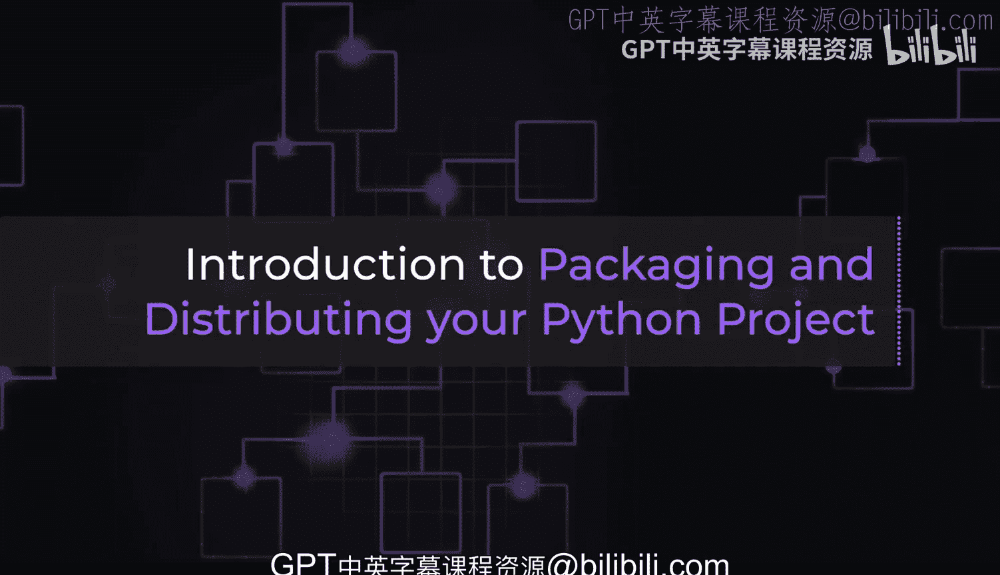

#  167：Python项目打包与分发导论 🚀

在本节课中，我们将学习Python项目打包与分发的基础知识。了解如何将你的代码项目进行封装，并使其能够被他人轻松安装和使用，是分享和复用代码的关键步骤。

## 概述

Python打包在两种情况下对你的项目非常有用。

第一种情况是声明依赖项。我们之前见过安装`click`这样的工具，它是一个命令行工具框架。你可能希望安装这个特定的库，并将其声明为你的用户需要安装的外部依赖项。这是原因之一。

第二个原因当然是分发你的项目。当你不再满足于单个文件来完成某些自动化或有用的任务，并希望将其分发给其他系统或可能觉得它有用的用户时，就到了进行打包的时候。

在本课中，我们将利用Python的工具集和其他库，帮助你不仅打包项目，还能将项目注册到Python包索引上，以便任何人轻松安装和分发。

## 打包的核心概念

上一节我们介绍了打包的两个主要目的。本节中，我们来看看实现打包需要理解的核心概念。

以下是打包过程中涉及的关键组件：

*   **`setup.py`**：这是打包的“配方”文件。它包含了关于你项目的元数据，如名称、版本、作者、依赖项等。它使用`setuptools`库来定义如何构建和安装你的包。
*   **`pyproject.toml`**：一个较新的配置文件，用于声明项目构建系统和依赖项。它正逐渐成为现代Python项目的标准配置方式。
*   **依赖项管理**：明确列出你的项目运行所需的外部库。这确保了其他用户能在他们的环境中复现项目运行所需的条件。
*   **Python包索引**：一个公共的软件仓库，开发者可以上传他们的Python包，供全世界的用户下载和安装。

## 总结

本节课中，我们一起学习了Python项目打包与分发的基本概念。我们了解到，打包不仅是为了管理项目依赖，确保环境一致性，更是为了将你的代码成果有效地分享给他人。通过使用`setup.py`、`pyproject.toml`等工具，并利用Python包索引，你可以使自己的项目变得易于安装和使用。掌握这些基础知识，是迈向创建可复用、可分发软件库的第一步。