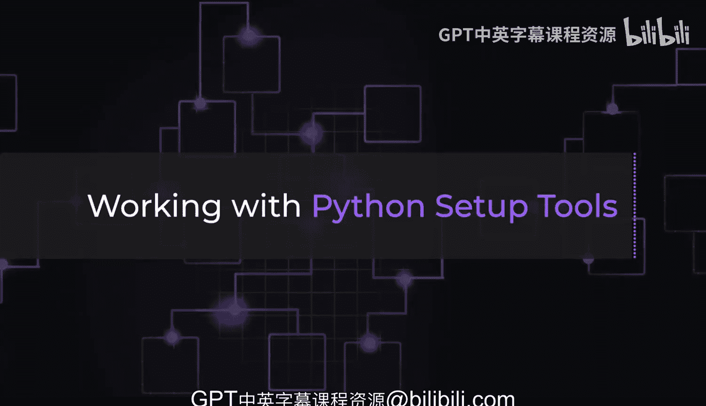
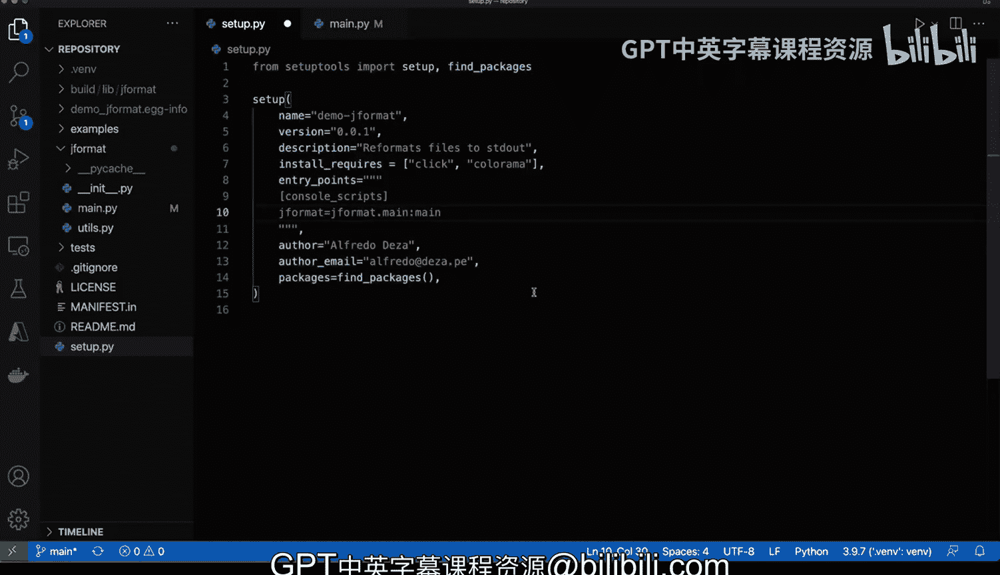

#  169：Python Setuptools实战 🛠️




在本节课中，我们将学习如何使用Python的`setuptools`库来打包和分发你的Python项目。我们将通过一个名为`demo-jformat`的命令行工具示例，一步步了解`setup.py`文件的构成，以及如何利用`setuptools`在本地安装和开发你的工具。

## 概述 📋

`setuptools`是Python生态中用于构建和分发包的核心工具。通过定义一个`setup.py`文件，你可以指定项目的元数据、依赖关系以及如何将你的代码转换为可安装的包或命令行工具。本节将引导你完成一个基本的`setup.py`配置，并演示其核心功能。

## 定义setup.py文件

要使用`setuptools`，首先需要在项目中创建一个`setup.py`文件。这个文件定义了项目的所有配置信息。

以下是`setup.py`文件的一个示例，我们将逐行解析其关键部分：

```python
from setuptools import setup, find_packages

setup(
    name='demo-jformat',
    version='0.1.0',
    description='A little command line tool for JSON formatting.',
    install_requires=[
        'click>=7.1',
        'colorama'
    ],
    entry_points={
        'console_scripts': [
            'jformat=jformat.main:main',
        ],
    },
    author='Your Name',
    author_email='your.email@example.com',
    packages=find_packages(),
)
```

现在，让我们逐一解释上述代码中每个参数的作用。

### 参数详解

以下是`setup`函数中各个关键参数的说明：

*   **`name`**: 这是项目的名称，用户将使用这个名字来安装你的包。例如，用户会运行 `pip install demo-jformat`。
*   **`version`**: 项目的版本号，用于跟踪发布和变更。
*   **`description`**: 项目的简短描述。
*   **`install_requires`**: 项目运行所依赖的其他Python包列表。你可以指定版本约束，例如 `'click>=7.1'`。
*   **`entry_points`**: 这是一个重要的配置项，用于创建命令行工具。`console_scripts`部分定义了一个名为`jformat`的终端命令。当用户输入`jformat`时，它会执行`jformat`模块内`main.py`文件中的`main`函数。
*   **`author` 与 `author_email`**: 用于标识项目作者信息。
*   **`packages`**: 使用`find_packages()`辅助函数，可以自动发现项目中的所有包，无需手动列出。

## 本地安装与开发模式

理解了`setup.py`的构成后，接下来我们看看如何利用它来安装和测试我们的工具。

在终端中，确保已激活项目的虚拟环境，然后运行以下命令进行本地开发安装：

```bash
python setup.py develop
```

运行此命令后，`setuptools`会将你的项目以“开发模式”安装到当前环境中。这意味着它不会将文件复制到Python的`site-packages`目录，而是创建一个链接指向你的源代码目录。

**为什么使用`develop`模式？** 这允许你在修改源代码后，无需重新安装包，更改就能立即在命令行工具中生效，非常适合开发阶段。

安装成功后，你可以通过`which jformat`命令来验证工具是否已加入系统路径。现在，运行`jformat --help`就可以看到我们工具的帮助信息了。

## 构建与打包

除了开发安装，`setuptools`还能将你的项目构建成可分发的包。

要构建一个可分发的包（如源码包或wheel包），可以运行：

```bash
python setup.py build
```

这个命令会在项目目录下创建一个`build`文件夹，里面包含了打包所需的所有文件结构。这是将项目上传到PyPI（Python包索引）或其他仓库进行分发前的必要步骤。

你还可以通过`python setup.py --help-commands`查看`setuptools`支持的所有命令和选项，功能非常丰富。

## 总结 🎯

本节课我们一起学习了Python `setuptools`的基础实战。我们首先了解了如何编写一个`setup.py`文件来定义项目的元数据、依赖和命令行入口点。接着，我们使用`python setup.py develop`命令在本地以开发模式安装项目，实现了代码修改的即时生效。最后，我们提到了使用`python setup.py build`命令来构建可分发的包。



虽然Python打包生态非常复杂，但掌握`setuptools`的这些基础知识，足以让你开始构建、分享自己的命令行工具和Python项目。在接下来的课程中，我们将探索如何将打包好的项目发布到公共仓库。