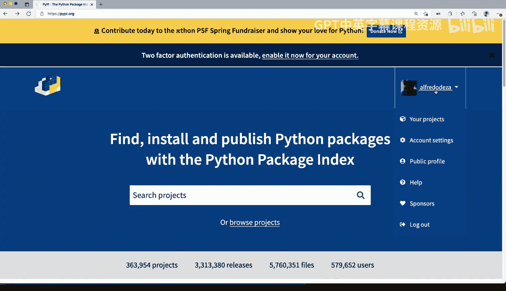
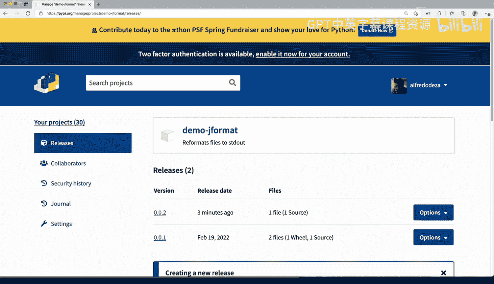
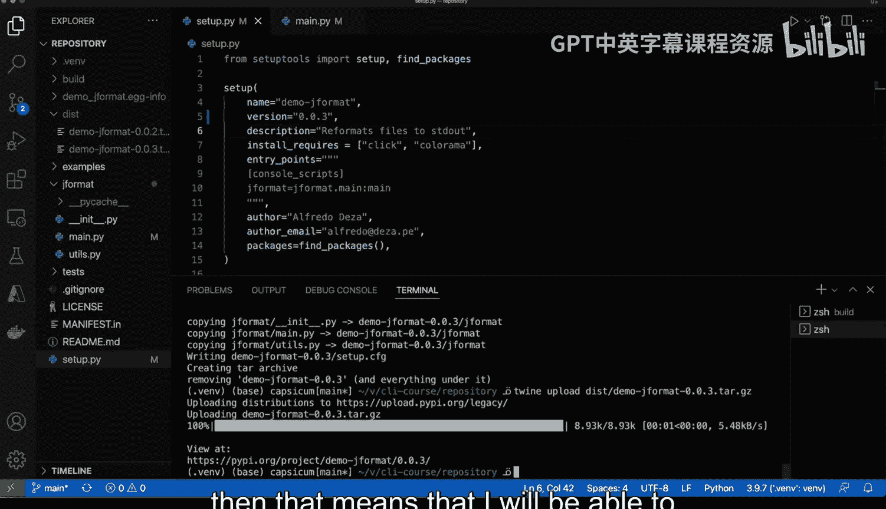
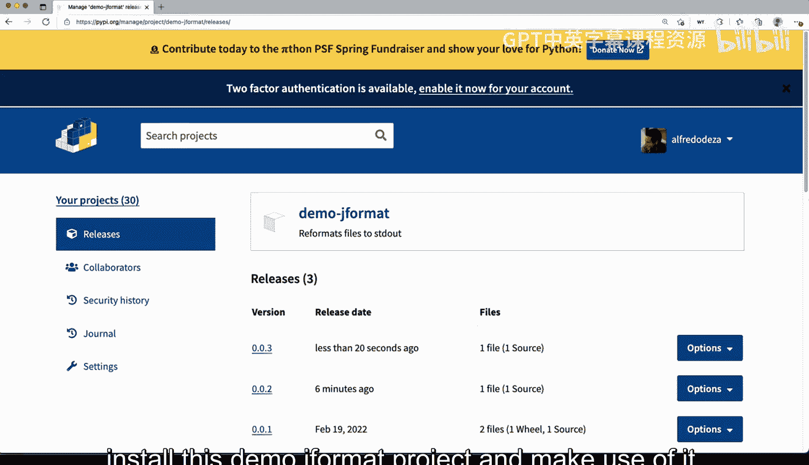
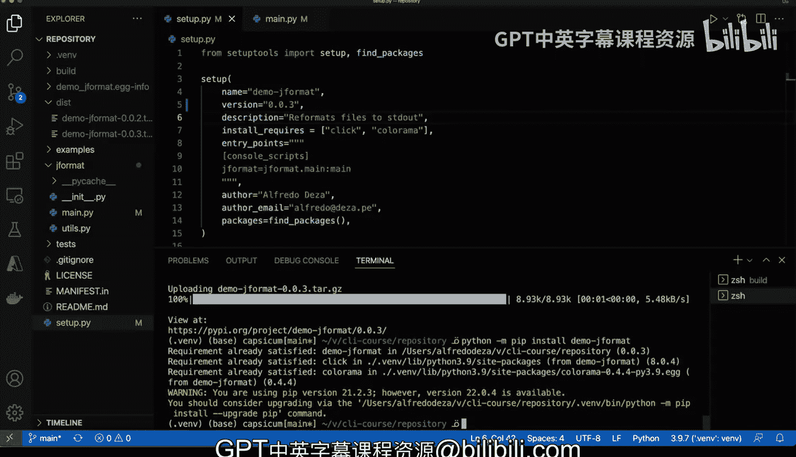

#  170：将Python包上传至注册中心 📦

在本节课中，我们将学习如何将开发完成的Python项目打包，并上传到Python包索引（PyPI）等公共注册中心，以便全球用户都能方便地安装和使用你的工具。

上一节我们介绍了如何构建和测试Python项目。本节中，我们来看看如何将项目发布到线上。

## 准备上传

项目开发完成后，下一步是将其分发并推送到一个注册中心。理想情况下，这个注册中心是Python包索引（PyPI），网址是 `https://pypi.org`。你需要提前准备好一个账户。

例如，我创建了一个名为“Alfredodessa”的账户。登录后，你可以看到自己所有的项目。以我一直在测试的 `demojformat` 项目为例，它最近已经发布。点击“管理”按钮，可以看到该项目的多个发布版本，这让你能很好地控制上传的内容。

## 创建分发包

那么具体如何上传呢？目前推荐的做法是创建一个源码分发包。你也可以创建轮子分发包并上传。

以下是创建源码分发包的步骤：

1.  使用 `python setup.py sdist` 命令创建源码分发包。这个命令会在 `dist` 目录下生成一个 `.tar.gz` 文件（即源码分发包）。
2.  源码分发包不包含任何编译内容。如果你的项目需要编译，可能需要使用轮子或其它编译系统。源码分发包兼容性较好，能在多种系统上工作。

## 使用Twine上传

创建好分发包后，需要使用一个名为 **Twine** 的工具来上传。首先需要安装Twine。

以下是安装和上传的步骤：

1.  使用 `python -m pip install twine` 命令安装Twine。
2.  Twine安装完成后，就可以上传包了。它会提示你输入PyPI的用户名和密码，除非你已经在主目录的 `.pypirc` 配置文件中设置了凭证。
3.  使用 `twine upload dist/<包文件名>` 命令上传。如果尝试上传一个已存在相同版本号的包，系统会报错提示“文件已存在”。
4.  此时，你需要更新项目中的版本号（例如在 `setup.py` 文件中），然后重新创建分发包，再使用Twine上传新版本。

上传成功后，你可以立即返回PyPI网站刷新页面，看到新版本（例如 `0.0.3`）已经显示在项目发布列表中。

## 发布的意义

上传成功意味着什么？这意味着世界上的任何用户现在都可以通过Python包索引安装你的 `demojformat` 项目。

用户只需运行 `python -m pip install demojformat` 命令即可安装。虽然我们本地已经安装，所以不会重复获取，但这演示了从PyPI安装的流程。

这个过程不仅让你学会了如何上传包，还能验证包是否已成功发布到Python包索引，并允许其他人从该索引安装你的工具。

---

本节课中我们一起学习了将Python项目打包、使用Twine工具上传至PyPI注册中心，以及管理项目版本的完整流程。这是分享你的代码和工具给全球Python社区的关键一步。