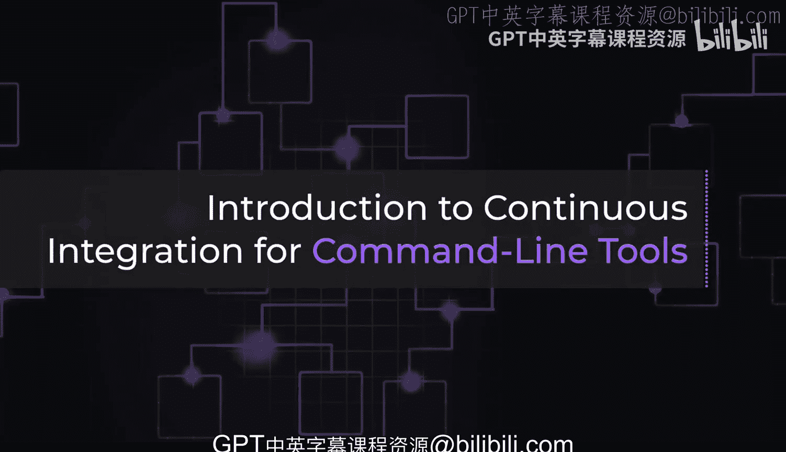

#  172：命令行工具持续集成导论

在本节课中，我们将学习持续集成的基本概念，特别是如何将其应用于命令行工具的开发。持续集成是构建健壮软件的关键环节，它能帮助你更轻松地维护项目，并在发布或修改应用时增强你的信心。

上一节我们介绍了命令行工具开发的基础，本节中我们来看看如何通过持续集成来提升其质量和可靠性。



## 什么是持续集成？

持续集成是一种软件开发实践，要求开发人员频繁地将代码变更合并到共享的主干分支中。每次合并都会触发一个自动化的构建和测试流程，以便尽早发现集成错误。

对于命令行工具项目而言，持续集成意味着每次你推送代码到版本库时，都会自动运行一系列检查，确保你的工具依然按预期工作。

## 持续集成的核心优势

以下是采用持续集成的主要好处：

1.  **及早发现问题**：自动化测试能在代码合并后立即运行，快速定位错误。
2.  **简化集成过程**：频繁的集成避免了在项目后期处理大量冲突。
3.  **提升发布信心**：通过了一系列自动化测试的代码，让你对发布新版本更有把握。
4.  **改善代码质量**：强制运行测试和代码风格检查，有助于维持代码库的整洁。

## 如何为命令行工具设置持续集成

为命令行工具配置持续集成通常涉及以下几个关键步骤。以下是具体操作流程：

1.  **编写自动化测试**：为你的工具功能创建测试脚本。例如，一个简单的Python测试可能如下所示：
    ```python
    import subprocess
    def test_tool_output():
        result = subprocess.run([‘my_tool’, ‘--help’], capture_output=True, text=True)
        assert ‘usage’ in result.stdout.lower()
    ```

2.  **选择CI/CD平台**：选择一个持续集成服务，如GitHub Actions、GitLab CI或Jenkins。

3.  **创建配置文件**：在项目根目录创建CI配置文件（如 `.github/workflows/ci.yml`），定义构建和测试步骤。

4.  **定义工作流程**：在配置文件中，指定触发条件（如 `push` 或 `pull_request`）以及要执行的作业，例如安装依赖和运行测试。

5.  **集成代码质量工具**：在CI流程中加入代码风格检查（如 `flake8`）、类型检查（如 `mypy`）或安全扫描。

## 一个简单的CI工作流示例

以下是一个使用GitHub Actions的简化配置示例，它展示了如何为Python命令行工具设置基本的CI流程。

```yaml
name: CI
on: [push, pull_request]
jobs:
  test:
    runs-on: ubuntu-latest
    steps:
      - uses: actions/checkout@v2
      - name: Set up Python
        uses: actions/setup-python@v2
        with:
          python-version: ‘3.9’
      - name: Install dependencies
        run: pip install -r requirements.txt
      - name: Run tests
        run: pytest
```


## 总结

本节课中我们一起学习了持续集成在命令行工具开发中的重要性。我们了解到，通过自动化测试和构建流程，持续集成可以帮助我们及早发现问题、简化集成工作并最终交付更可靠的软件。将这套实践应用到你的项目中，是迈向专业软件开发的重要一步。