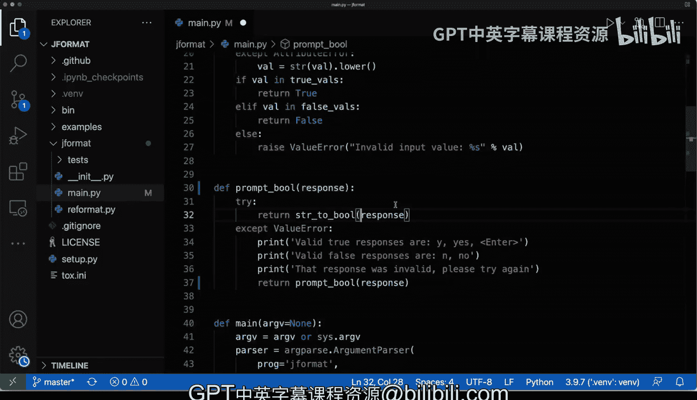

#  173：Python代码检查工具入门 🛠️

在本节课中，我们将要学习代码检查工具（Linter）的基本概念及其在Python开发中的应用。代码检查工具能自动分析代码，发现潜在的错误、未使用的变量或不符合编码规范的问题，帮助开发者编写更清晰、更健壮的代码。

## 什么是代码检查工具？

代码检查工具（Linter）是一种静态代码分析工具。如果你不了解它，它将会彻底改变你的开发方式。Linter适用于多种编程语言和不同的编码场景，在专业的软件开发中尤其重要。本节我们专注于在Python项目中使用Linter。

## 在命令行中使用代码检查工具

上一节我们介绍了代码检查工具的概念，本节中我们来看看如何在实践中使用它。首先，我们将通过命令行工具来体验其功能。

我使用的是VS Code编辑器，但让我们暂时忘记具体的编辑器。我将打开终端。

在终端中，你首先会注意到我正在使用一个已激活的虚拟环境。我个人喜欢使用的Linter工具叫做Flake8。接下来我将安装它，并解释为什么它很重要。

我将执行 `pip install flake8` 命令来安装Flake8。

现在，在这个项目目录中，我有 `main.py`、`reformat.py` 和一些测试文件。如果我在没有任何参数的情况下运行 `flake8` 命令，你会看到一些警告信息。

该工具会检查每一个Python文件，并找出我编码时可能遗漏的问题。例如，在 `main.py` 中，它提示“F401: ‘os’ imported but unused”（导入了‘os’模块但未使用）。类似地，它还指出了其他一些导入但未使用的模块，这些都需要清理。

默认情况下，VS Code已经安装了一个Linter。稍后我会展示它在文本编辑器中的样子。但了解这是一个可以在终端运行的工具很有用。通常，文本编辑器中的这些Linter工具都依赖于你可以安装的命令行工具。

## 在编辑器中集成代码检查

现在你已经看到了命令行的输出，让我们关闭终端，看看它在编辑器中的表现。首先，我们检查“os imported but unused”这个警告。

如果我转到第3行，你会看到`os`的导入语句颜色有点暗淡，而`re`的导入看起来正常。这表示`os`的导入有问题。当我将鼠标悬停在上面时，会看到提示信息。

点击出现的“灯泡”图标，它会建议“Remove unused import”（移除未使用的导入）。我们可以开始清理这些未使用的导入，对`re`模块也进行同样的操作。

Linter的功能不仅限于检测未使用的导入，它还能捕获其他更严重、你可能遗漏的问题。

例如，在这个`prompt_bool`函数中，有一行代码下面有黄色的波浪线。如果你花点时间思考为什么这里会被高亮标记，原因是：函数参数中有一个`response_input`，它在第37行被使用了。然而，变量`question`并没有在任何地方定义。

如果我悬停查看，它会提示“`question` is not defined”（`question`未定义）。这是编辑器背后的Linter（在这里是VS Code使用的Pylance）发出的警告。我们可以尝试点击“快速修复”，但在这个案例中，它提供的可能不是最佳方案。

正确的解决方案是去修改代码，确保这里使用的是同一个变量`response_input`，而不是`question`。这样，函数内部就统一使用了相同的变量。

## 代码检查工具的配置与选择

如果你在文本编辑器（如本例的VS Code）中安装了Python扩展，Linter功能就会自动工作。当然，你也可以使用像`flake8`这样的工具，或者启用任何其他你喜欢的Linter。

不同的Linter工具会产生不同类型的警告、错误，其严格程度也可能不完全符合你的偏好。例如，对于某些代码风格问题，我当前的编辑器（Pylance）可能不会抱怨，但`flake8`或其他遵循PEP 8规范的Linter很可能会提出警告。

## 总结

本节课中我们一起学习了代码检查工具（Linter）。我们了解了它的基本用途，并实践了如何在命令行使用`flake8`工具，以及如何在VS Code编辑器中集成和使用Linter功能。Linter非常有用，它能帮助我们保持代码整洁，并让我们意识到那些可能被忽略的问题。掌握使用Linter是迈向编写高质量、可维护代码的重要一步。