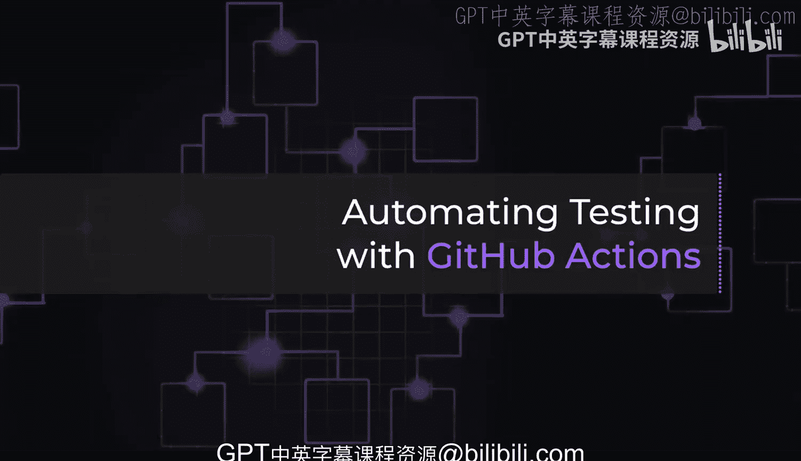
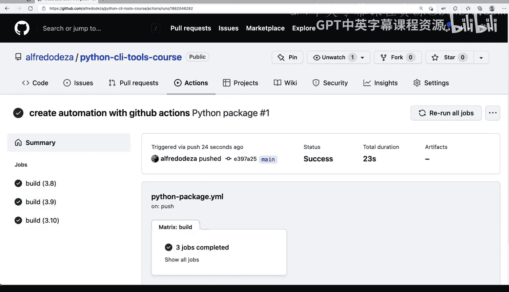
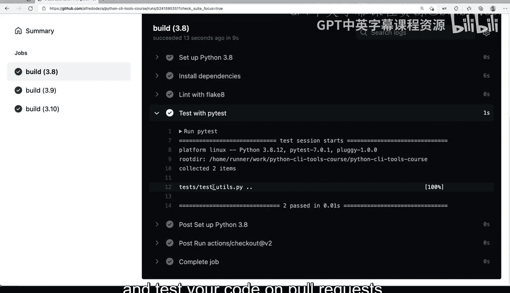
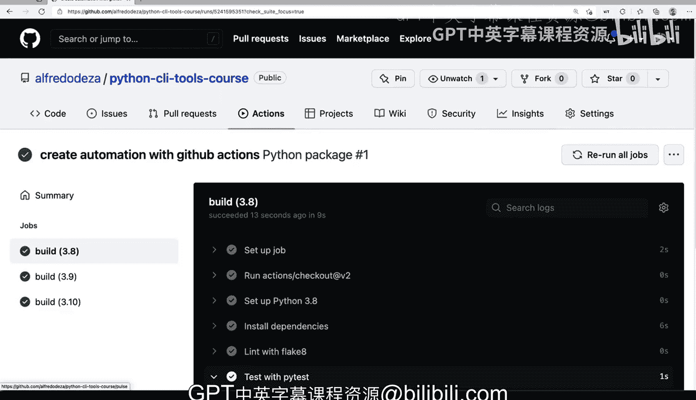

#  174：使用GitHub Actions自动化测试 🚀



在本节课中，我们将学习如何为托管在GitHub上的Python项目设置自动化测试流程。通过GitHub Actions，我们可以确保每次代码变更（如推送或合并请求）时，都能自动运行测试，从而保障代码质量。

---

上一节我们介绍了如何将项目推送到GitHub。本节中，我们来看看如何利用GitHub Actions为项目配置自动化测试。

我的代码仓库名为 `Python CI tools course`，其中包含了所有示例，包括我们已有的J格式命令行工具。该项目已配置 `setup.py` 文件并声明了依赖项，我们也知道如何手动运行测试。但为了提升协作效率，我们需要将测试自动化。例如，当合作者提交一个合并请求时，自动运行测试，而不是手动操作。

虽然可以手动添加自动化流程，但GitHub提供了更简便的方式。以下是具体步骤。

以下是配置GitHub Actions工作流的核心步骤：

1.  **进入Actions菜单**：在GitHub仓库页面上方，点击 **“Actions”** 选项卡。
2.  **选择工作流模板**：点击“新建工作流”后，搜索“Python”。选择名为“Python package”的模板，然后点击“Configure”。
3.  **理解预置配置**：模板会预生成一个配置文件，位于 `.github/workflows/` 目录下，通常命名为 `python-package.yml`。该配置定义了工作流将执行的操作。
4.  **自定义配置**：预置配置会安装依赖并运行 `pytest`，同时会在多个Python版本（如3.8, 3.9, 3.10）下进行测试。你需要根据项目实际情况调整。例如，如果项目没有 `requirements.txt` 文件，而是通过 `setup.py` 管理依赖，则需要修改安装步骤。
5.  **提交配置文件**：完成配置后，通过GitHub网页界面提交该文件到仓库。提交信息可以是“Create automation with GitHub actions”。
6.  **触发与监控**：提交后，工作流会自动触发。你可以在“Actions”选项卡中查看运行状态和详细日志。

现在，让我们快速解析一下这个预置配置文件的核心部分。它主要完成以下任务：

*   **设置环境**：配置运行器（容器）并指定要测试的Python版本。
*   **安装依赖**：默认会安装最新版的 `pip`，以及 `flake8`（代码风格检查工具）和 `pytest`（测试运行器）。
*   **运行测试**：执行 `pytest` 命令来运行项目中的测试。

对于我们的项目，由于依赖是通过 `setup.py` 管理的，我们需要将默认的 `pip install -r requirements.txt` 步骤，修改为通过开发模式安装当前包：
```yaml
- name: Install dependencies
  run: |
    python -m pip install --upgrade pip
    pip install flake8 pytest
    pip install -e .  # 这行替代了安装requirements.txt
```

此工作流配置了触发条件：当有代码推送到 `main` 分支，或有指向 `main` 分支的合并请求时，就会自动运行。提交配置文件后，你可以在“Actions”页面看到一个新的任务开始执行。点击进入可以查看每个Python版本下的测试详情，例如检查 `pytest` 的运行日志，确认它是否正确地找到了你的测试文件（如 `tests/test_*.py`）。



---





本节课中，我们一起学习了如何为GitHub上的Python项目配置自动化测试。通过创建GitHub Actions工作流，我们实现了在代码推送或合并请求时，自动在多个Python版本环境下运行测试，这极大地提高了代码的可靠性和协作开发的效率。